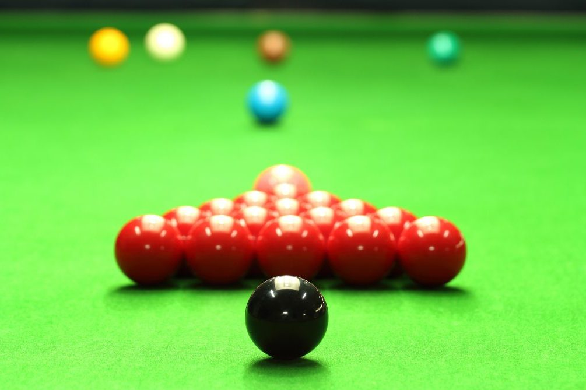
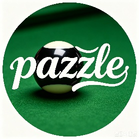
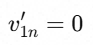
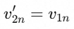
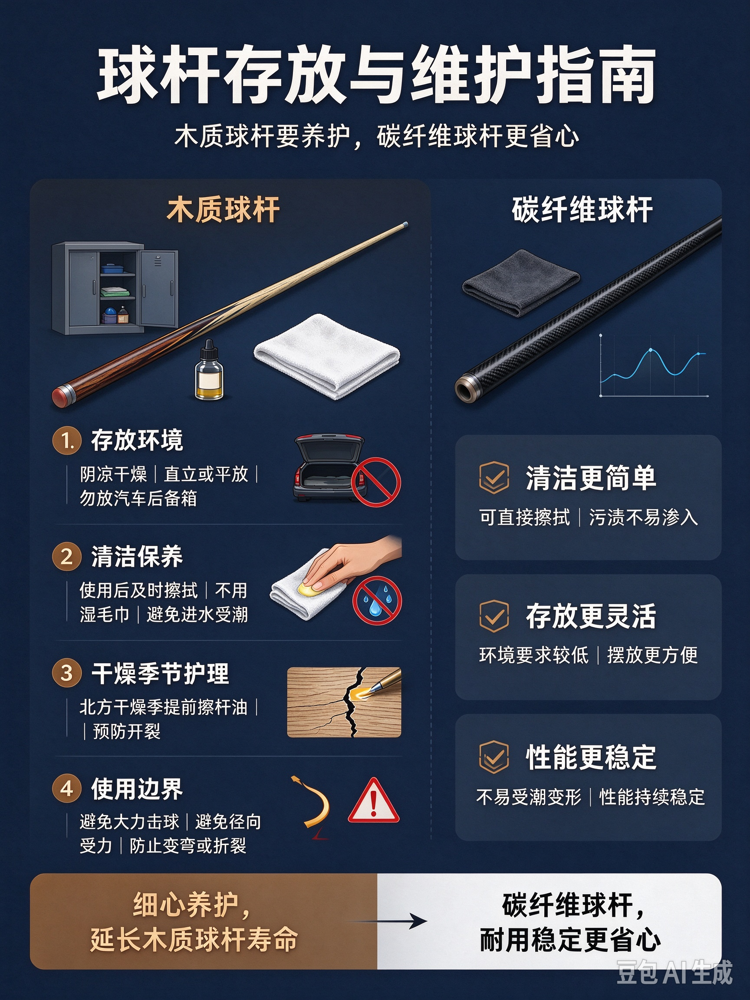
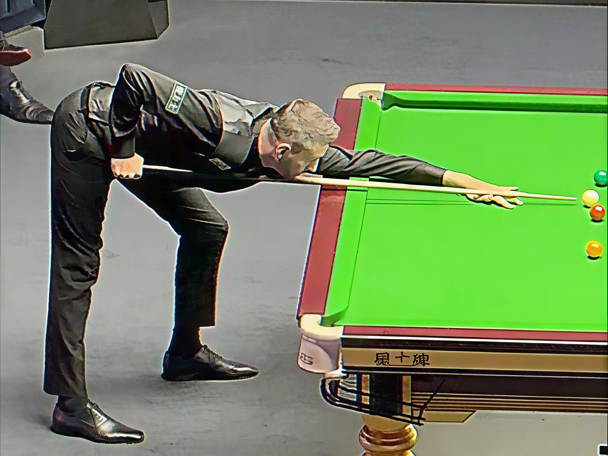
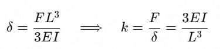
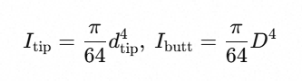
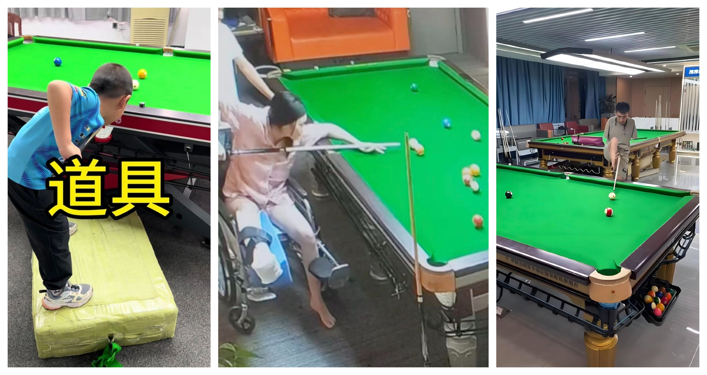
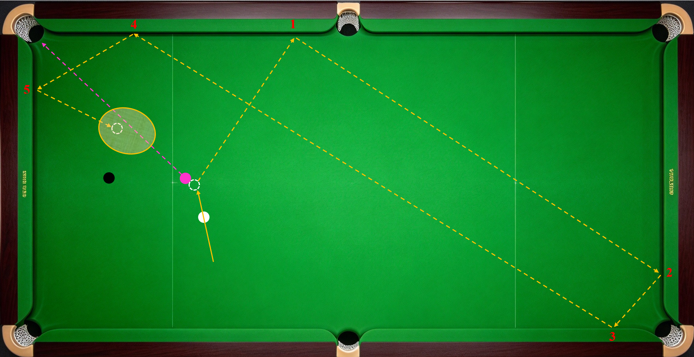

#  

<figure>

<figcaption>
董燚（著） ©2026
</figcaption>
</figure>

**爱上斯诺克**

<figure>

<figcaption>
<strong>——斯诺克教学纲要</strong>
</figcaption>
</figure>

#  

<figure>

<figcaption>
作者简介：董燚（1992.09-），男，斯诺克爱好者。
</figcaption>
</figure>

- 谨以此书感谢爱我的妻子和家人。

爱上斯诺克——斯诺克教学纲要

作者：董燚

Copyright © 2026

本书内容是我在斯诺克练习、学习过程中的思考与心得，旨在提供一种认识斯诺克、提升球技的思路。本人在斯诺克的学习之路上深受庞卫国老师《台球进阶技巧图解》一书的启发，行文时也参考借鉴了书中部分思路与表述，特此郑重说明，并向庞卫国老师致以诚挚谢意。同时也热忱推荐各位读者购买阅读这本佳作。

本书内容以原创为主，部分图片来自网络公开信息，如有侵权请联系我删改。

受限作者水平，文中内容不一定正确，以您的见解为准。

版本：第一版

成书时间：2026年9月23日-2026年10月30日

版权协议：CC-BY-NC-ND license

本书采用 署名-非商业性使用-禁止演绎 4.0 知识共享许可协议

您可以自由复制、分发本书全文，但必须满足：

1\. 标注原作者与书名；

2\. 不得用于任何商业目的；

3\. 不得修改、改编、重组、衍生后对外发布。

许可协议详情：https://creativecommons.org/licenses/by-nc-nd/4.0/deed.zh-hans

# 目录

[第一章 认识斯诺克 [1](#第一章-认识斯诺克)](#第一章-认识斯诺克)

> [第一节 把斯诺克当什么？——从兴趣到特长，再到职业
> [1](#第一节-把斯诺克当什么从兴趣到特长再到职业)](#第一节-把斯诺克当什么从兴趣到特长再到职业)
>
> [第二节 斯诺克哲学 [3](#第二节-斯诺克哲学)](#第二节-斯诺克哲学)
>
> [第三节 赢球的逻辑 [4](#第三节-赢球的逻辑)](#第三节-赢球的逻辑)

[第二章 斯诺克基础技能
[6](#第二章-斯诺克基础技能)](#第二章-斯诺克基础技能)

> [第一节 斯诺克运动物理原理
> [6](#第一节-斯诺克运动物理原理)](#第一节-斯诺克运动物理原理)
>
> [第二节 球杆选择 [13](#第二节-球杆选择)](#第二节-球杆选择)
>
> [第三节 球杆弹性分析 [17](#第三节-球杆弹性分析)](#第三节-球杆弹性分析)
>
> [第四节 打出高速旋转 [22](#第四节-打出高速旋转)](#第四节-打出高速旋转)
>
> [第五节 常用指标和术语
> [24](#第五节-常用指标和术语)](#第五节-常用指标和术语)

[第三章 斯诺克基础技能
[27](#第三章-斯诺克基础技能)](#第三章-斯诺克基础技能)

> [第一节 专注力 [27](#第一节-专注力)](#第一节-专注力)
>
> [第二节 击球姿势 [29](#第二节-击球姿势)](#第二节-击球姿势)
>
> [第三节 入位 [31](#第三节-入位)](#第三节-入位)
>
> [第四节 握杆 [32](#第四节-握杆)](#第四节-握杆)
>
> [第五节 手架 [35](#第五节-手架)](#第五节-手架)
>
> [第六节 出杆和瞄准 [37](#第六节-出杆和瞄准)](#第六节-出杆和瞄准)
>
> [第七节 线路 [40](#第七节-线路)](#第七节-线路)
>
> [第八节 打点 [47](#第八节-打点)](#第八节-打点)
>
> [第九节 发力方式 [49](#第九节-发力方式)](#第九节-发力方式)
>
> [第十节 杆法 [51](#第十节-杆法)](#第十节-杆法)
>
> [第十一节 让点 [53](#第十一节-让点)](#第十一节-让点)
>
> [第十二节 后障碍球 [55](#第十二节-后障碍球)](#第十二节-后障碍球)
>
> [第十三节 贴库球和袋口球
> [56](#第十三节-贴库球和袋口球)](#第十三节-贴库球和袋口球)
>
> [第十四节 架杆和延长杆
> [57](#第十四节-架杆和延长杆)](#第十四节-架杆和延长杆)
>
> [第十五节 扎杆和跳杆 [59](#第十五节-扎杆和跳杆)](#第十五节-扎杆和跳杆)
>
> [第十六节 弱侧手击球 [63](#第十六节-弱侧手击球)](#第十六节-弱侧手击球)
>
> [第十七节 基础技能练习球形
> [65](#第十七节-基础技能练习球形)](#第十七节-基础技能练习球形)

[第四章 斯诺克应用技能
[70](#第四章-斯诺克应用技能)](#第四章-斯诺克应用技能)

> [第一节 清台思路和进攻练习阶段
> [70](#第一节-清台思路和进攻练习阶段)](#第一节-清台思路和进攻练习阶段)
>
> [第二节 开球 [73](#第二节-开球)](#第二节-开球)
>
> [第三节 长台、贴库球和大角度球
> [76](#第三节-长台贴库球和大角度球)](#第三节-长台贴库球和大角度球)
>
> [第四节 围球 [85](#第四节-围球)](#第四节-围球)
>
> [第五节 炸球 [91](#第五节-炸球)](#第五节-炸球)
>
> [第六节 K球 [94](#第六节-k球)](#第六节-k球)
>
> [第七节 清彩球 [97](#第七节-清彩球)](#第七节-清彩球)
>
> [第八节 特殊进球方式
> [100](#第八节-特殊进球方式)](#第八节-特殊进球方式)
>
> [第九节 防守 [105](#第九节-防守)](#第九节-防守)
>
> [第十节 赛台和赛场适应
> [114](#第十节-赛台和赛场适应)](#第十节-赛台和赛场适应)
>
> [第十一节 比赛心理 [115](#第十一节-比赛心理)](#第十一节-比赛心理)

[第五章 职业斯诺克 [118](#第五章-职业斯诺克)](#第五章-职业斯诺克)

> [第一节 世界职业比利和斯诺克协会、职业球员及职业赛事
> [118](#第一节-世界职业比利和斯诺克协会职业球员及职业赛事)](#第一节-世界职业比利和斯诺克协会职业球员及职业赛事)
>
> [第二节 赛事规则 [121](#第二节-赛事规则)](#第二节-赛事规则)
>
> [第三节 赛场规则和球员礼仪
> [123](#第三节-赛场规则和球员礼仪)](#第三节-赛场规则和球员礼仪)
>
> [第四节 斯诺克的历史和文化
> [125](#第四节-斯诺克的历史和文化)](#第四节-斯诺克的历史和文化)

# 第一章 认识斯诺克

## 第一节 把斯诺克当什么？——从兴趣到特长，再到职业

拿起球杆，站到球桌前亲身试一试。感受手握球杆击打母球，借由母球撞击目标球入袋这项运动，看自己是否感兴趣。如果产生了这份兴趣，恭喜你，你可以一直玩下去，持续享受这项运动带来的乐趣。

摸清基础玩法，多打一段时间，再来看看自己有没有天赋。愿意沉下心刻苦训练，日积月累之后，就可以练出不错实力，把斯诺克打磨成一项特长，成为广大爱好者里那十分之一的高手。

如果你向往更高强度的对抗与心理较量，希望以斯诺克博取名利，成为千万分之一，那么走上职业道路是最佳选择。

身份有别，水平各异。享受斯诺克乐趣，体会击打与控制的独特魅力，在以上4个阶段都能实现。

本文版权协议为 CC-BY-NC-ND license

## 第二节 斯诺克哲学

斯诺克是台球的一种双人对抗玩法，取胜方式包括局分高于对手、对手连续三次击打无遮挡红球不中和对手认输，其中局分高是常规取胜方式。斯诺克的得分方式有两种，一是进球得分，其上限为147分；一种是防守（障碍球）得分，通过控制母球和目标球的相对位置增加击打难度，迫使对手犯规，己方直接得分，这种得分方式没有上限。斯诺克进球得分的规则是先击打一颗红球，再击打一颗彩球，直到红球全部入袋，再依次击打彩球。

斯诺克是现有球类运动和现有台球玩法中唯一能够通过防守迫使对方犯规进而直接得分的运动。如前文所述，局分高是获胜的常规方式。既然都是得分，防守得分与进攻得分同样重要。斯诺克比赛的开局往往从防守开始，而非大力炸球。所以，不论当前打法潮流多么激进，进攻多么受推崇，防守仍然是这个游戏的核心玩法，好的防守同样能够获得掌声，帮助球员赢取胜利。

本文版权协议为 CC-BY-NC-ND license

## 第三节 赢球的逻辑

赢球靠两大综合实力。

一是**获取机会能力**，包括：

1.长台更强。2025年世锦赛决赛中，马克·威廉姆斯开球和防守时白球与红球落位安全，并非好的进攻机会，但赵心童凭借超常规的长台射程和进球率，多次获得上手机会，赢下对局。现场解说嘉宾麦克·马努斯说道：

You cannot keep playing safe against Zhao Xintong

（面对赵心童，你很难一味做防守）

2.发现和使用特殊进球方式的能力。包括组合球、翻袋、克拉克、借下、开伦和二次碰撞等。

组合球，即口语中的“传球”，目标球被母球撞击后与其他球碰撞，不论经过几次碰撞，中间发生碰撞的是红球还是彩球，最终使红球合法进袋的情形。

翻袋，即目标球经母球撞击后碰库进袋，一库或多库翻袋均合法。

克拉克是Kick
Shot的音译，指母球先撞击库边反弹，再撞击目标球，完成进攻或者解球，与翻袋类似。

借下，即目标球无法直线入袋，经与其他球撞击改变行进路线后进袋的情形。

开伦。类似于借下，指母球先撞击红球改变线路，再将目标红球打进的进球方式。

二次碰撞与借下类似，指的是母球与红球撞击改变行进路线，进而撞击其他红球并进球的情形。

面对没有直接进攻路线的局面，通过观察和计算，找到特殊进球路线，也是获取上手机会的重要手段。职业球员敢于在赛场上使用这类进球路线，往往是因为看到了很好的机会，有较大的把握。

3.防守能力。包括做安全球和障碍球的能力。

安全球通常指绝大多数职业球员在正常发挥的情况下不会选择进攻的长台和大角度球。在具体对局里，安全与否取决于对手的进攻能力，包括前面提到的长台能力和特殊进球能力。低水平选手因紧张和压力无法打进中台直线球时，安全的下限会降低。

好的安全球让自己保持局面的主动性。能够连续打出好的安全球，等待对手犯错，是防守拉锯时获取上手机会的常规表现。

障碍球，即斯诺克（snooker），是这项运动名称的由来，也是运动的精髓所在。一杆成功的障碍球可以使己方获得防守先手。打出障碍球，就有机会迫使对手犯规进而直接得分，还有更大的可能性获得上手机会。在对局中，如果能连续做出高质量的障碍球，会给对手造成极大的防守压力和心理压制。当对手超分时，逆转翻盘也要靠做斯诺克。

4.解球能力。即对方做出斯诺克时，成功打到目标球不犯规的能力。更高的要求是解到不漏球，解进或者反做往往靠运气。解球能力与防守能力是相符相成的，防守创造机会，解球化解危机。

二是**单杆得分能力**。理想的单杆表现是一杆超分，再进一步是单杆破百，单杆147分则是可遇而不可求单杆最佳表现。单杆得分能力由以下基础能力构成：

1.  熟练掌握和运用斯诺克赛事规则；

2.  较好地适应赛场和赛台；

3.  比赛过程良好的心理状态；

4.  上手后的球局规划能力；

5.  持续的专注力；

6.  稳定的非受迫进球成功率，涉及球杆选择、站姿、入位、握杆、手架、出杆节奏、瞄准节奏、让点等基础知识和技术；

7.  和稳定的母球到位率，涉及打点、发力方式、撞击分离角、反射角、常用路线等基础知识和技术。

在后面的章节会逐一介绍。

本文版权协议为 CC-BY-NC-ND license

# 第二章 斯诺克基础技能

## 第一节 斯诺克运动物理原理

斯诺克运动的本质，是人操控球杆击打静止的母球，令球体在台面上运动、互相碰撞、撞击库边，直至所有球回归静止。自母球脱离皮头的瞬间起，后续发生的一切，都是纯粹的物理现象。倘若将人换成机器，理论上这台机器选手可以从开球起稳定每一杆打出
147
满分。若一名球员被冠以“机器”的绰号，在我看来可谓是斯诺克界的最高赞誉。当然，球员“墨尔本机器”尼尔·罗伯逊是有血有肉的大活人，他会得意、会生气、也会懊恼。人类所有喜怒哀乐、爱恨情仇，无时无刻不在影响着他的赛场状态。

斯诺克运动的核心器材包括球杆、球、台尼和边库。

球员的击打意图经由球杆传递至母球。正常发力时，小臂带动手腕、手指，力量从握杆处传导至球杆，杆头撞击母球，从而改变母球的运动方向、行进速度以及自转方向与转速；当需要发出大力击打时，大臂乃至全身都会协同参与发力，球杆就是这套发力体系当中的传力媒介。

现代职业赛事用球为高密度铸造型酚醛树脂，耐撞耐磨不掉色。理想状态下，球的密度均匀，重心与几何中心重合。斯诺克的母球和目标球为完全相同材质，球径、重量等物理参数一致。

台尼为羊毛织物，有些产品添加少量尼龙增加耐磨性能。新台尼的表面有短绒毛，比赛时通常梳理为统一朝向底库方向。台尼厚度约1.1-1.3mm，球压上去有轻微弹性凹陷，形变≤0.4mm，通常忽略不计。球在台尼上的有滑动和滚动两种运动状态，台尼的新旧程度、绒毛方向、湿度和静电等都会影响球的运动轨迹。

边库主要由天然橡胶制成。球与边库的撞击面为一小段平面，其高度区间为26-26.5mm，球体半径为26.25mm，球吃库撞击点对准球心高度，确保不改变球的平面运动状态。边库的法向恢复系数为0.60-0.65，即球垂直撞库，反弹速度约等于入射速度的60‑65%。球撞库时与胶边的接触时间极短（0.8‑1.5
毫秒），胶边发生短时凹陷：

- 小力吃库（普通走位力度）：0.8‑1.2 mm

- 中等力度（比赛最常见翻库力度）：1.5‑2.2 mm

- 全力大力撞击（职业选手最大力度）：2.5‑3.2 mm

正常安装状态的球台，石板表面平整光滑，接缝齐整，整体水平调平。台尼平整紧绷。器材的安装和制造状态都按照理想状态，不再讨论。（以上数据部分由AI提供，未经验证）

改变球运动状态的情形可大致分为击球、球在台尼上运动、两球撞击、球撞击边库四种：

1.  击球

使用标准手架击球时，身体与球杆形成的结构可近似抽象为摆锤结构。后臂肘关节充当固定转轴，在手部约束控制之下，小臂带动球杆做近似水平的前后摆动，完成击打。

库边手架与标准手架结构类似。母球后斯诺、扎杆等情形需抬高后手和前手架，其他不变。使用架杆时，手臂与球杆的相对位置由标准手架的上下垂直关系变为水平垂直关系，结构原理类似。

发力结构影响发力效果。最理想的击打状态，是后小臂与球杆夹角恰好呈90°时，皮头碰触母球；皮头接触母球后，球杆运动方向保持一致，避免杆头上挑或下坠。

2.  球在台尼上运动

球在台尼上的运动分为转动、滑动和滚动三种类型。滑动指球与台尼的接触点不变，无垂直台面方向自转，在台面上滑行。滑动过程中，球表面在垂直台面方向上相对球心的转动距离为零。转动指的是球心在台面上滑动的同时，球表面围绕球心在特定方向旋转。偏离中心点击打母球会使母球进入转动状态。滚动是转动的一种特殊态，指球恒定在垂直台面向前的方向上转动，球心在台面上的移动距离等于球表面与台尼接触点相对球心的转动距离。

球在台尼上的运动规律与自身旋转和台尼绒毛方向有关。

自身旋转可在三维空间内分解成三个分量，即在平行台面方向的旋转（左右旋）、垂直台面方向的旋转（前旋和回旋）和垂直于行进方向的旋转（扎杆）。

垂直台面方向自转：

向后转动的球，向后转动的速度衰减到零的瞬间进入滑动状态，随即转入滚动状态；

向前转动的球，向前转动的速度衰减到等于球心的平移速度时，转入滚动状态。

引入以下变量：

V自转，指球表面与台尼的接触点相对球心在垂直台面方向上的旋转速度；

V自转 （向前），指旋转方向与滑行方向相同；

V自转 （向后），指旋转方向与滑行方向相反；

V滑行，指球心在台面上平移的速度；

S自转，指球表面与台尼的接触点相对球心在垂直台面方向上转动的距离，等于周长乘以转动圈数。

S滑行，指球心在台面上平移的距离。

则

滑动过程：V自转 = 0；S自转 = 0

转动过程：V自转 ＞ 0；S自转 ≥ S滑行

滚动过程：V自转 = V滑行；S自转 =
S滑行

向后转动转滚动：V自转 （向后）＞ 0 — V自转 = 0 —
V自转 （向前）＞ 0

向前转动转滚动：V自转 （向前）＞ V滑行 —
V自转（向前） = V滑行

平行台面方向自转：

只带有平行台面方向自转的球，在台尼上先滑动，后滚动。

水平方向上偏离中心点击打时，球的行进方向会向打点偏移方向的反方向偏移。即左塞向右偏，右塞向左偏。打点越靠外，偏移量越大。

垂直于行进方向的旋转：

对球施加垂直于行进方向的旋转时（扎杆），球会走出弧线。若同时球施加左侧旋转，球的行进路线会向出杆方向的右侧偏移，向右侧画弧，并向左侧收拢；反之，向左侧偏移，向左侧画弧，并向右侧收拢。扎杆效果受打点偏移量、球杆与台面的夹角（杆尾高度）、速度和力量影响：

- 打点越靠外，旋转越强；

- 夹角越大，旋转越强；

- 速度越快，旋转越强；

- 力量越大，收拢越晚，弧线越长。

台尼的绒毛方向与球心在台面上的移动方向的相对关系会影响球受到台尼的摩擦阻力。

当球的移动方向与绒毛方向相同（夹角为0）时，受到的台尼阻力最小，球速正常，且无侧向干扰。随着球的移动方向与绒毛方向的夹角增加（0-180°），球受到的台尼阻力增加，减速效应增强。

顺毛（球的移动方向与绒毛方向夹角在0-90°之间）时，球的轨迹向绒毛方向偏移，随着夹角增大，受到的侧向干扰越强，偏移量越大。逆毛（球的移动方向与绒毛方向夹角在90°-180°之间）时，球的轨迹也向绒毛方向偏移，随着夹角增大，受到的侧向干扰越弱，偏移量越小。这种现象被称为绒毛效应（Nap
效应），即斯诺克球台定向绒毛台尼造成的轨迹偏移现象。

上述球加塞偏移、扎杆画弧和绒毛走向造成的轨迹偏移现象都受到击球力量的影响。可以大致归纳为如下关系：

<table style="width:99%;">
<colgroup>
<col style="width: 10%" />
<col style="width: 44%" />
<col style="width: 44%" />
</colgroup>
<thead>
<tr>
<th style="text-align: center;">条件</th>
<th style="text-align: center;">小力</th>
<th style="text-align: center;">大力</th>
</tr>
</thead>
<tbody>
<tr>
<td style="text-align: center;">左旋</td>
<td>向右偏移，偏移量小</td>
<td>向右偏移，偏移量大</td>
</tr>
<tr>
<td style="text-align: center;">右旋</td>
<td>向左偏移，偏移量大</td>
<td>向左偏移，偏移量大</td>
</tr>
<tr>
<td style="text-align: center;">左扎杆</td>
<td rowspan="2">收拢早，弧线短</td>
<td rowspan="2">收拢晚，弧线长</td>
</tr>
<tr>
<td style="text-align: center;">右扎杆</td>
</tr>
<tr>
<td style="text-align: center;">顺毛</td>
<td rowspan="2">向绒毛方向偏移，弧线明显</td>
<td
rowspan="2">向绒毛方向偏移，弧线变直，力量达到一定程度时可忽略绒毛效应。</td>
</tr>
<tr>
<td style="text-align: center;">逆毛</td>
</tr>
</tbody>
</table>

3.  两球撞击

如前文所述，斯诺克用球不论颜色，每颗球的重量和大小都是一样的。且碰撞过程时间极短，两球之间的相互作用力远大于台面摩擦、空气阻力等外力，所以可以把两球组成的系统近似看作孤立系统，两球撞击的过程严格遵守动量守恒定律

和牛顿第三定律：两球碰撞时，彼此施加的作用力大小相等、方向相反、作用在两球中心连线上。

已知球重量相同，即m1 = m2；

目标球为静止状态，即；

若将两球碰撞近似为完全弹性碰撞，将速度延撞击瞬间两球球心连线方向（法向n）和垂直球心连线方向（切向t）进行分解，可得：

；；；

也就是说，在质量相等、完全弹性、目标球静止、忽略球间摩擦的理想状态下两球相撞，目标球只获得母球沿球心连线方向的速度分量；母球保留自己垂直球心连线方向的速度分量。这就是台球里常说的中杆分离角约90°
的来源。

真实斯诺克碰撞中，两球之间存在摩擦力，球间切向摩擦会产生切向冲量，目标球会被轻微“拖拽”，使分离角略小于
90°。当母球带同向侧向旋转时（反塞），会强化“拖拽”效果；当母球带反向侧向旋转时（顺塞），会弱化“拖拽”效果。

此外，母球垂直于台面方向的旋转（即前旋和后旋）会改变两球撞击后母球的运动状态，其运动轨迹会向旋转方向偏移。当母球在V自转
（向后）＞ 0时撞击目标球，呈现低杆效果；当母球在V自转
（向前）＞
V滑行时撞击目标球，则呈现高杆效果。母球延90°分离角方向滑动的能量越小，母球前旋或后旋的速度越快，高杆和低杆效果出现得越早。

球撞击球堆的情形可等效近似为多次两球相撞，不再展开。

4.  球撞击边库

理想状态下，忽略球与边库碰撞瞬间边库凹陷，将撞击过程近似为点撞击；忽略边库台尼与球之间的侧向摩擦，那么，球撞库边的轨迹可以近似看作二维刚体对刚性直边的镜面反射，有如下规律：

- 球心轨迹相对库边法线对称，即入射角等于反射角；

- 沿库边方向的速度分量不受影响，即切向速度不变；

- 垂直库边方向的速度被反向，即法向速度反向。

实际撞击时，受到边库凹陷影响，大力击球会带来如下效果：

- 库边凹陷后，球与库边的接触区域变大，法向冲量方向会略微向球前进方向偏；

- 凹陷会把球“包”一下，相当于给球一个沿库边方向的分量，使反射角收窄；

所以大力翻袋或吃库时，反射角比理论值小，即大力击球的反射角小于入射角。

受到边库台尼与球之间的侧向摩擦影响，球的旋转会改变反射角和切向速度：

- 前旋和顺塞会使球在离开边库时向旋转方向偏移，即增大反射角；后旋和反塞也会使球在离开边库时向旋转方向偏移，即缩小反射角。

- 顺塞会使球在离开边库时获得摩擦加速，即增大切向速度；反塞会使球在离开边库时受到摩擦减速，即减小切向速度。

球与边库之间的碰撞非完全弹性碰撞，边库的法向恢复系数为0.60-0.65，即法向反弹速度约等于法向入射速度的60‑65%。即撞库会降低法向速度。

不难发现，斯诺克背后运用的物理与数学均属于基础层级。参与运算的物理变量十分有限，数量级只有2位数。斯诺克进攻规则一句话就能说清。有效击球台面面积不到6.5m²，长不足3.6米，宽不足1.8米。开局台面一共
15 颗红球、6 颗彩球，理论 36
杆便可完成整套满分流程。结合当下AI的智力水平和机械制造能力，足以制造出一台机器选手，杆杆打出满分杆。

本文版权协议为 CC-BY-NC-ND license

## 第二节 球杆选择

无论参加比赛还是去球房，都有公杆可用。所以，单纯想要玩一下的话，不需要任何器材投入。不像足球、篮球要买球，羽毛球、网球、乒乓球要买球拍......

考虑到木质球杆每一根都存在差异，如果要获得稳定的击球体验，最好的办法是自备球杆。球杆由前肢、后把、皮头等组成。通常以球杆前肢材质区分，包括白蜡木、枫木和碳纤维球杆。斯诺克球员几乎全部使用白蜡木球杆。“台球皇帝”亨得利和“神奇小子”傅家俊曾使用枫木球杆。苏格兰球员安东尼・麦克吉尔曾在2023年天津国锦赛中使用1/2分体碳纤维球杆，打进八强。

**1.评价球杆性能的指标主要包括弹性、阻尼和杆头直径**

弹性影响杆法效果。球杆弹性与球杆材质的杨氏模量（E，单位GPa，衡量弹性最敏感的物理参数）成线性正比。详细论证过程见相关章节。白蜡木杨氏模量为10-12GPa，枫木为11-13GPa，二者区别不大。而碳纤维（T700级别）约为230GPa，远高于木材。

阻尼影响击球反馈。阻尼是指摇荡系统或振动系统受到阻滞使能量随时间而耗散的物理现象。阻尼比是结构动力学中衡量自由振动衰减速率的无量纲参数，数值介于0-1之间，值越小，衰减速率越快。木材是多孔材料，靠内部微孔和细胞壁间的摩擦来耗能，阻尼比一般在0.05—0.15之间，属于天然阻尼，手感温润，对讲究击打手感的人来说，木材的阻尼特性和综合表现更对路。碳纤维复合材料（CFRP）的阻尼性能主要来自树脂基体的黏弹性，以及纤维与树脂界面间的摩擦耗能，振动时能把机械能转化成热能，它的阻尼比钢和铝合金大，阻尼比大约在0.01—0.05之间，减震效果很突出。碳纤维材料阻尼比低，减震快，所以在击打过程中手感不明显。两种材质的主要区别是，木质球杆力量传导明显且细腻，击打过程中震动反馈明显，容易获得抓球感。

木材的新材，含水量8-12%，阻尼比为0.02-0.035。木材含水量的提升能提升击球反馈，但同时会降低杨氏模量，降低弹性效果。行业内部通常以材料风干年数为卖点，木质球杆养护时也讲究擦油防潮，可见较干的木材更受推崇。

杆头直径影响击打点位细腻度。通常杆头直径与球的直径成比例。中式八球的球径约57毫米，打杆杆头直径范围通常为10.5-12.5毫米，球径杆径比为4.6-5.4。斯诺克的球径为52.5毫米，球杆杆头直径范围通常为9.3-10.0毫米，球径杆径比为5.3-5.6。通常的体验是，粗杆打小球缺乏细腻度，手感闷；细杆打大球费劲，容易飘。所以，选择合适的杆头直径即可。

**2.影响击打体验的指标主要是材质、重量、后把直径和皮头软硬度**

材质包括白蜡木通杆、枫木通杆、碳纤维通杆，白蜡木前肢+后肢插花、枫木前肢+后肢插花、碳纤维前肢+碳纤维后把、碳纤维前肢+木质后把等。材质不同影响反馈细腻度、握感和美观度。

重量包括整枝重量和前后重力分配。斯诺克球杆重量通常在17至19盎司之间，换算后约480至530克。多重的球杆适合自己，需要亲身体会。前后重力分配对击打手感影响较大，木材密度均匀的通杆一致性最佳。分体插花杆前轻后重。碳纤维通杆需嵌入配重并精调。碳纤维前肢+木质后把的组合对配重的调整要求最高，易出现前轻后重，影响出杆稳定性。

后把直径通常在28-32毫米之间，常见数值为29毫米。需根据自身手长选择合适的后把直径。

皮头由硬到软通常分为H、M、S三档。皮头软硬度影响击打准确性和触球时长。通常硬的皮头打点准，传力清晰；软的皮头形变大，触球传动效果好。皮头软硬度需要根据自身体感选择，大多数职业球员选择M档，“金左手”马克·威廉姆斯偏爱硬皮头。

**3.球杆的存放与维护**

木质球杆通常要存放在阴凉干燥的环境，直立或平放，不能放在汽车后备箱。使用后要及时擦拭，避免污渍浸入木纹，且不得用湿毛巾，避免进水受潮。北方干燥季节还需提前擦拭杆油防裂。使用一段时间后，木质球杆的性能可能会有所减弱。受木材区服强度影响，木质球杆不能大力击球，不能径向受力，避免永久性变弯或折裂。相比之下，碳纤维球杆优势明显，不严谨的说，随便擦、随便放、随便造，性能持续稳定。

总结来说，按照材质、结构、长度、重量、粗细、插花和涂装等可以将各式各样的球杆区分开来，而总的组合数量是有限的。比如按材质分只有白蜡木、枫木和碳纤维三种；按结构分也只有通杆、3/4和1/2三种，携带和存放需求会限制挑选范围；长度、重量和粗细需结合自身身高、臂展、握感和力量大小挑选或定制；而插花和涂装并不会影响球杆性能。对于新手和普通爱好者，在尚不能区分球优劣的阶段，不必因各类名贵的插花木料和花哨绚丽的外观涂装而挑花了眼，更不必因买不起名贵球杆而苦恼。在这个阶段，高档球杆之间的性能差异对你而言其实微乎其微，找到一根适合自己的球杆，才是核心要义。

肯·达赫迪在11岁时花2英镑买下一支被人遗弃的球杆，一直用到55岁。期间他获得世界青年斯诺克冠军、世界业余冠军、1997世锦赛冠军（击败亨得利）以及6个排名赛冠军。“台球皇帝”斯蒂芬·亨得利的球杆是13岁花40英镑购入的，他7次登顶克鲁斯堡全部使用这支球杆，直到2003年在托运时意外折断。我想把亨得利的原话放在这里：

打了这么多年球，我从未想过换一根球杆。这是我 13
岁买下的第一根球杆。当时在邓弗姆林一家斯诺克球房的柜子里挑出来的，仅仅是因为我喜欢杆上雷克斯・威廉姆斯的签名。

我攒了 40
英镑买下它。这就是一块廉价木料，长久以来一直是其他球手的笑料。亚历克斯・希金斯曾说这杆子“只配用来撑番茄！”

但我执意一直用它。靠着这根球杆，我拿下无数奖杯，其中包括 7
座世锦赛冠军。这是一根通杆，我把它收纳在木质包皮球盒里，球盒反倒比里面这根球杆贵得多。

In all the years I've been playing I've never considered changing my
cue. It was the first cue I ever bought, aged 13, picked from a cabinet
in a Dunfermline snooker centre just because I liked the Rex Williams
signature on it.

I saved £40 to buy it. It's a cheap bit of wood and it's been the butt
of other players’ jokes for ages. Alex Higgins said it was ‘only good
for holdin’ up f\*g tomatoes!

But I insist on sticking with it. And I've won a lot of silverware,
including seven World Championship trophies, with it. It's a one-piece
which I carry in a wooden, leather-bound case that's much more expensive
than the cue it houses.

放下器材包袱，享受击球乐趣。

本文版权协议为 CC-BY-NC-ND license

## 第三节 球杆弹性分析

弹性影响杆法强度。在台球语境里，球杆弹性指击球瞬间杆身发生弯曲形变，随后回弹释放能量的能力。把“击球”翻译成力学模型，在击球瞬间，球杆可视为一根具有两个近似支座的变截面细长弹性梁：

- 固定端：后手握持处（虎口＋手指的夹持），后支座。

- 手架：前支座。

- 自由端：杆头（皮头）与母球接触点。

- 杆身：变截面（锥形）圆梁，材料为白蜡木、枫木或碳纤维。

图示如下：

← L →

\[后手握持处\]─────\[接牙\]─────────────●皮头(自由端)

👉发生向下弯曲变形δ（也称端点挠度）

为进一步简化模型，忽略皮头、铜箍、接口及插花的影响，将球杆等效为单一材质。将球杆材质（杨氏模量E）、杆头直径dtip、后把直径D、有效长度（固定端与自由端的距离）L、整杆长度Ltotal和锥度段长度Lj作为衡量“弹性系数k”的主要参数，同时引入中间变量：

冲击力F；

弯曲变形δ；

锥度α = D/dtip；

截面惯性矩I，前肢截面惯性矩Itip，后把截面惯性矩Ibutt；

则k可以用如下公式表示：

1/ktotal = 1/k前肢 + 1/k后把，公式1

公式2

将公式2代入公式1，得到公式3，其中Lh = L。

公式3

，公式4

将公式4代入公式3，且当前肢与后把材质相同，即E = Ej =
Et时，得到

1/k = 64/3πED3 \*
(Lj3/dtip +
(Lh3-Lj3)/D)

可以看到，k与杨氏模量E线性正相关；与后把直径D三次正相关；有效长度Lh与锥度段长度Lj的差越小，即手往前握杆，k值越大；当有效长度Lh
=
Lj时，与杆头直径成线性负相关，与锥度段长度Lj三次方负相关。用表格列举如下：

| 因素 | 数学关系 | 评价 |
|----|----|----|
| 材质（杨氏模量E） | 一次方正比 | 影响线性，枫木（11-13GPa）与白蜡木（10-12GPa）E差约10–20%，含水率每+1%含水率E约降 3–5%，影响幅度有限。碳纤维T700系列E为230GPa，与木质球杆区别较大。 |
| 后把直径D | 三次方正比 | 最强的几何杠杆，但被握感、接箍和配重锁死，实际可调空间很小。数学上它贡献大，工程上不自由。 |
| 杆头直径dtip | 近似一次方正比 | 最弱的杠杆。12mm→11.5 mm 仅降约 4%“弹性”，其主要作用是改变皮头接触面积，对“杆身弹性”的贡献很小；且磨细后局部应力（σ∝1/d3tip）上升更快，易断。工程上不自由。 |
| 有效长度L | 负相关 | 是场上唯一可实时调节的量，变短有利于提升“弹性”。实践中受个体身材、入位后手架距离和后手距离影响，存在理论最小值。在场上根据球形实时调整。使用较强旋转时后手适度前握有增益效果。后手前移 2 cm（70→68 cm）“弹性”增约 9%。 |
| 锥度段长度Lj | 负三次方 | 理论上变短有利于提高“弹性”，实践中要考虑前后运杆时的平顺度，最短长度为整杆长度Ltotal的二分之一，即1/2分体球杆。 |

接下来对比同几何参数，同握杆距离下白蜡木、枫木和碳纤维球杆的弹性系数：

- 球杆1：总长145厘米，在108.75厘米处分体，前肢材质为碳纤维，杆头直径9.5毫米，前肢末端直径30毫米，后把为等粗碳纤维，直径30毫米。

- 球杆2：总长145厘米，杆头直径9.5毫米，在108.75厘米处直径变为30毫米，此后直径不变，材质为白蜡木。

- 球杆3：总长145厘米，杆头直径9.5毫米，在108.75厘米处直径变为30毫米，此后直径不变，材质为枫木。

- 击打时手握在135厘米处。

三根杆的几何参数完全一致：前肢锥度段 x∈\[0,1.0875\]， d从 9.5 mm
线性增至 30 mm；后把段 x∈\[1.0875,1.35\] 为等径 30 mm。手握处
Lh=1.35m处视为固定端。

几何部分（与材料无关）：

|                         | 杨氏模量E | 弹性系数k | 比率 |
|-------------------------|-----------|-----------|------|
| 球杆1（全碳纤维，T700） | 230 GPa   | 5239 N/m  | 基准 |
| 球杆2（全白蜡木）       | 10 GPa    | 228 N/m   | 23   |
| 球杆3（全枫木）         | 12 GPa    | 273 N/m   | 19   |

可以看到，碳纤维球杆显著优于木质球杆。不过碳纤维前肢多为空心卷制管。若壁厚
t=1.5 mm，前肢截面惯性矩I约降至实心的
78%，弹性系数同比例缩小。壁越薄，掉得越多。

下表是常见插花、接口材料的杨氏模量。

|    材料    | 杨氏模量 E (GPa) |                   备注                   |
|:----------:|:----------------:|:----------------------------------------:|
|  古夷苏木  |       18.4       |         非洲古夷苏木，后把插花料         |
| 粉红象牙木 |       15.1       |             南非，插花装饰料             |
|    黄檀    |       17.5       |       黄檀属，不同种浮动 16‑19GPa        |
|   白蜡木   |       12.3       |              小头杆前肢主材              |
|   硬枫木   |       12.6       |            美式杆常用前肢木料            |
| 纯铜（Cu） |       122        | 金属，铜箍材料，范围 110‑130GPa 取中间值 |

本文版权协议为 CC-BY-NC-ND license

## 第四节 打出高速旋转

旋转来源于打点与母球中心点的偏移量和击球速度（皮头接触母球到离开母球期间赋予母球的转速）。

**一、人为因素**

人为因素占第一位，比球杆更重要。

1.  打点与母球中心的偏移距离。距离越远，旋转越强烈。在不滑杆呲杆的前提下，尽量远离母球中心点（高、低、左、右），有助于打出较强的旋转。但并非越靠边越好，超过安全区域，摩擦力失效，就会呲杆打滑，反而没有旋转，这种情况在击打母球顶部和左、右侧时更易发生。

2.  击球速度。即皮头接触母球到离开母球期间赋予母球的转速。击打要领是球杆从接触母球开始发力加速，穿透母球。要将小臂摆动和手腕甩动的力量尽可能多得用于加速母球旋转，而非加速母球滑行。这是打出旋转最核心、最难把握的部分，公开的信息对此有一些经验总结，此处不列举。关键是自己多练多体会。

3.  出杆稳定性。从后停到击出，要尽量保持球杆水平，直线运动，减小上下左右晃动。

4.  上好克粉。皮头与母球间的静摩擦系数越大，击打传递的加速效果越强。

**二、球杆因素**

1.  皮头（最重要配件）表面粗糙度。皮头多为牛皮或猪皮多层压制而成。若长期使用不打磨擦粉，皮头表面会发生釉化，降低与母球（树脂，表面光滑）间的静摩擦系数。

| 工况 | 静摩擦系数 μₛ | 简要说明 |
|:--:|:--:|:--:|
| 无巧粉，皮头釉化（起釉抛光） | 0.15‑0.22 | 皮头表面封闭、光滑，极易滑杆 |
| 无巧粉，皮头正常织构（开毛孔微绒） | 0.25‑0.35 | 哪怕皮头粗糙度很好，没有巧粉依然摩擦偏低，大偏移打点依然呲杆 |
| 上好标准干巧粉（理想状态） | 0.60‑0.80 | 理想状态 |
| 巧粉过量堆积 / 油巧蜡质堵塞毛孔 | 0.40‑0.55 | 蜡脂填满孔隙，颗粒无法有效锚固，摩擦下降 |

2.  皮头硬度。软质皮头在击球瞬间会产生更大的凹陷形变，"包裹"母球的时间更长，有利于加速母球旋转。

3.杆身弹性（参考《球杆弹性分析》）。

简单总结优先级（从高到低）：

打点位置＞击球速度＞上好巧克＞皮头表面粗糙度＞皮头硬度＞球杆弹性

以上是母球旋转的理论分析。现实中，很多人喜欢比赛看谁的低杆拉得远。能够打出强烈的旋转，提高能力上限当然是好事。不过我们不必因低杆效果达不到最远距离而烦恼。低杆能力是众多斯诺克技能中一项，超远距离低杆能力作为这项能力的极限值，其实战应用场景很少，并非高频杆法。反而因为超远距离低杆较低的稳定性和较高的失控风险，职业球员实战中往往在没有更好的选择时才使用。

在实际击球时，要考虑进球稳定性、母球撞击后线路及落点，选择合适的打点和杆速，并非偏移量越大，杆速越快就越好。尤其是在使用侧向旋转时，横向偏移量越大，杆速越快，赋予母球的侧向旋转越强，与此同时，母球撞击目标球前的行进路线与出杆方向的偏移量越大。掌握不好打点偏移距离、杆速和出杆方向的关系，会降低进球率和走位到位率。一个朴素的经验——能用中杆，不加旋转。

本文版权协议为 CC-BY-NC-ND license

## 第五节 常用指标和术语

如图所示，球台上的常用术语大多来自英文直译，也有国内约定俗成的叫法，包括：

边库：顶库、底库和边库；

袋口：顶袋、底袋和中袋；

分区：上半区，低分彩球区，包含开球区；下半区，高分彩球区，包含摆球区。

母球：白球，主球。

目标球：红球或彩球。

盘分、局分：如0：0 ,4：3等；

本局比分、局内得分、小分：如71：67，103：0等。

为了解释某个现象用到的词语，如分离角、入射角、进球线、击球点等，在对应章节介绍。顺序阅读时如遇到表述不清的词语，可在后文中查找相应解释。

衡量斯诺克水平的常用指标包括：

**一、技术细节数据**

1.  进球成功率。特指中台、短台进球成功率。顶尖选手 90%+。

2.  长台成功率。世锦赛决赛选手累积成功率通常在50-60%。

3.  总进球成功率。所有可攻目标球打进比例，顶尖选手 90%+。

4.  安全球成功率。安全球到位率，衡量防守、做障碍、控制台面能力，以对手无法简单进球为评判标准；塞尔比、希金斯等防守大师的核心强项，通常在80%左右。

5.  解球成功率。解斯诺克的成功率与质量。官方转播无此项，通常数据包含在安全球成功率中。

6.  走位到位率。与进球成功率一体两面，二者共同作为衡量球员围球能力的核心指标。

7.  K球成功率。非官方指标，比赛中非常看重，决定能不能清理难点，连续拿分；

8.  击球成功率：衡量瞄准和出杆质量的核心指标，是进球成功率、长台成功率、安全球成功率、解球成功率、走位到位率、K球成功率的和。应当将提高并维持高百分比的击球成功率作为练球和比赛表现的核心追求。

9.  平均出杆时间。衡量比赛节奏。奥沙利文常 17 秒左右；塞尔比普遍 26
    秒上下，是区分快慢打法的标志性指标。此指标不作为考虑球员水平的指标，对评价球员个人风格、思考习惯和比赛观赏性有一点参考价值。

以下是职业球员的赛事数据：

**二、进攻火力数据**

1.  破百（Century）：单杆≥100
    分。生涯总破百代表底蕴；单赛季破百代表当前进攻手感。目前WST单赛季破百数已经提高到100+。

2.  50 +：单杆
    50–99，一杆拿到足够优势、大概率拿下本局，衡量连续得分能力。

3.  平均单杆得分（Average Break）：每次上台平均得分。顶尖选手一般 \>
    30；越高代表上手后得分效率强。数据具有一定的参考性，但不具备绝对性。

4.  147满分杆：满分杆数量。147本身可遇而不可求，比赛中没有足够的奖励，球员通常把赢球排第一，不会刻意追求147。练球和表演赛，147较常见，无压力状态+几杆纠错，职业球员轻松就能做到。

5.  单杆最高分：比较鸡肋。顶尖球员都有WST147记录。一项WST赛事的单杆最高分奖金通常几千英镑，吸引力不高。

**三、实战能力数据**

1.  胜率：总比赛获胜占比，反映整体稳定度。

2.  决胜局胜率：抢赛点、生死局表现，心理抗压能力（有些球员胜率数据好看，但关键局拉胯）。

3.  超分后防守 / 被超分翻盘能力：落后追分、超分控台，大赛硬实力。

4.  决赛胜率。

5.  大赛抗压能力：三大赛、高奖金赛事排名及胜率。

**四、荣誉数据**

1.  世界排名：WST 两年滚动积分，代表近两年综合成绩；TOP16
    是核心门槛，直接获得大师赛、世锦赛正赛资格。TOP64保留赛季积分，属于精英门槛。

2.  世界第一时长：WST 两年滚动积分排名第一的总时长和单次时长。

3.  三大赛冠军数（世锦赛、英锦赛、大师赛）：含金量远高于普通排名赛；集齐即大满贯，是历史球星标尺。亚历克斯・希金斯、亨德利、奥沙利文都以此封神。“75”三杰、“80”五虎、“90”新星、“00后”新生代这些民间称谓都以三大赛数据作为核心评价指标。

4.  排名赛冠军数：职业生涯正式排名赛夺冠总数，衡量长期统治力。

本文版权协议为 CC-BY-NC-ND license

# 第三章 斯诺克基础技能

## 第一节 专注力

给斯诺克的基础技能排序，我将专注力放在了第一位，排在站姿、入位、握杆、手架等等这些有形技能之前。长时间集中注意力是人的天赋的一部分。当球技提升到一定水平，比如达到职业水平时，球员已经具备简单局面下的清台能力，能否清台往往受专注力影响。比赛中专注力的影响会进一步放大，左右比赛结果。

与专注力接近的学术概念是持续性注意（Sustained
Attention），指较长时间内把认知资源持续投向既定任务，抵抗自发走神与外界干扰，维持任务绩效的认知能力。在斯诺克语境中，

- 较长时间对应——单杆时间；

- 既定任务对应——持续分析球局，制定清台计划，完成击打动作，直至单杆结束；

- 自发走神对应——击打瞬间注意不在进球点，而在母球走位、打进的喜悦、打不进的压力等等；

- 外界干扰包括——不舒服的手架、不适应的球台和场地、旁边球台的动向、晃动的摄像机、观众干扰等等；

- 维持任务绩效对应——保持单杆不断，直至将能力范围内的球打完。

人的专注力具有以下特点：

1.  专注力在个体间存在先天差异。

2.  人的生理状态会影响专注力。睡眠、疲劳、压力、昼夜节律、性别和年龄都会改变注意表现。

3.  动机与任务特性也会影响专注力。任务是否枯燥、是否有反馈、是否感兴趣，都会影响一个人能否持续投入。

- 单调低事件率任务：警觉衰减效应突出，很难长时间维持，如Mackworth
  雷达警戒实验，15-30分钟注意力明显下滑；

- 有反馈、适度挑战、内在兴趣任务：进入心流状态，可以维持更长时间，90-120分钟；

- 过高认知负荷：资源快速耗尽，持续注意时间变短。

职业赛事一场比赛或一个阶段的局数通常为8-9局，计划时间为3-4小时，期间中场休息一次。也就是说，职业比赛中球员需要在1-2小时内保持专注。对于高水平的职业选手而言，斯诺克属于“有反馈、适度挑战、内在兴趣”的任务，他们能够在一个比赛时段（1-2小时）内始终保持专注，在进攻和防守端打出高水平的博弈，向观众展现精彩的比赛表现。

在斯诺克900比赛中，单局限时15分钟，出杆限时20秒，犯规送手中球，对手超分后翻盘可能性低。这样的规则会持续消耗球员的注意力，看似比赛用时更短，但节奏快，出杆压力大，对专注力的要求可能比WTS赛事更高。

本文版权协议为 CC-BY-NC-ND license

## 第二节 击球姿势

击球姿势，指的是在击球过程中，保持球杆平行台面、正对击打方向、便于瞄准和发力的状态下，人的身体相对台面、球杆和地面的稳定位置和姿态。

你可能会看到标准姿势示意图和一些要点，包括：

支撑脚脚尖正对击打方向，支撑腿绷直，垂直于地面；另一只脚向外斜向约15°迈出半步，腿自然弯曲；两脚与肩同宽，身体重心位于两脚之间，偏向支撑腿；俯身使身体平行于台面，下巴轻贴球杆；前手臂微弯，向前伸出，前肘、小臂和手架贴于台面；前侧沉肩，后肘上提；后手虎口贴住球杆，五指轻握；后小臂与球杆呈90°夹角；后手腕、下巴和手架三点一线；大臂、小臂和球杆三线一面等等。

仔细观察职业球员的击球姿势，会发现有人脚尖外撇，有人支撑腿弯曲，有人前臂几乎伸直，有人后肘关节外拐，有人后手腕内扣......基本姿势大同小异，局部细节千差万别。毕竟并非每个人都是标准身材。即便同一名球员，使用标准手架、库边手架、扎杆、架杆以及上台击打时的姿势均不相同。

总结不同职业球员和他们在不同击打情境下的姿势，有以下共同点：

- 运杆平稳，保证球杆在三维空间中完成近似直线的往复运动

- 正对击打方向

- 便于瞄准和发力

击球姿态受制于身材和体位，服务于瞄准和发力。好的击球姿势，一是有效，二是优雅，归根到底要适合自己。“莱斯特小丑”马克・塞尔比的站姿舒展优雅，“中国龙”丁俊晖的站姿堪称亚洲球员的参照范本。在练球伊始学会标准站姿，固化良好的动作习惯，有利于提升击打稳定性，优化动作观赏性，更有助于各类杆法充分释放应有的威力。

本文版权协议为 CC-BY-NC-ND license

## 第三节 入位

入位，指身体正对击球方向，支撑脚踏上击球线，身体从直立转入击球姿势的过程。通常，球员会先离最终站位一到两步，站着完成观察和预瞄准；准备妥当后向前迈一步或者小步前移，支撑脚落位固定，身体顺势趴下进入击球姿势。

职业球员中，马克·塞尔比的入位动作优雅自然，干脆利落，属于一步入位型。“囧哥”凯伦・威尔逊喜欢迈小碎步。球员在认真击打时通常会完整做出从后向前的迈步动作，有时也会将入位过程与走动结合，在走上下一颗球的击球线后顺势俯身，省略迈步动作，这样出杆会更快一些。

倘若俯身之后感觉瞄得不准或发力不畅，应当起身退至支撑脚落点后方，重新完成站立观察、预瞄准，向前迈步、完成入位，转为击球姿势。如此反复调整，直至可以出杆。切勿趴下之后前后左右挪动，这样的原地调整往往顾此失彼，“遮了前胸，漏了屁股”。如果仅仅为了加快出杆速度而草草出杆，导致击球失误，更是得不偿失。

遇到入位不舒服、进球难度大、改变思路等情况时，职业球员通常会重新入位。在比赛决胜阶段，以及击打关键球时，球员的出杆速度明显变慢。他们仔细观察，反复比划，多次入位，将平时可能省略的技术动作完整地做完，就是为了稳妥出杆，保证击球成功。

入位是形成击球姿势的前置动作，好的入位能够保障好的击球姿势。在整套击打技术当中，入位属于一项基础技能，小技术。但不能轻视入位过程，仍要以认真的态度，按步骤一步一步完整做完技术动作。养成良好动作习惯，直至将入位的技术要点融入潜意识，形成肌肉记忆。

本文版权协议为 CC-BY-NC-ND license

## 第四节 握杆

一是握杆的位置。后手通常握在后把上，后手前后球杆的重量相适，便于运杆和发力。使用标准手架，使球杆与台面平行，皮头快要接触母球，小臂正好与球杆呈垂直状态时，便是后手的最佳位置。

以身高、臂展175cm，球杆长度145cm为例。使用标准手架时，手架前球杆长30cm，手架到后手距离95cm，后手宽10cm，后手后还有10cm的余量用于动态调整（数据仅供参考）。

需要打出精细控制时，球员通常会缩短手架距离并前握后手。若因台面和球形导致手架受限，要灵活调整手架距离和后手握杆位置，最大限度缩小出杆质量的波动。

身高臂长的球员需要定制稍长的球杆，否则使用标准手架时后手可能会握在后把末端，在向前送杆较长时出现球杆挤出现象。球杆太短也不利于特殊情形时动态调整握杆位置。

二是握杆的手法。握杆时手指之间、手指、手掌与球杆之间的位置关系因人而异，但有以下共同点：

1.  使用标准手架，使球杆与台面平行，皮头快要接触母球，小臂正好与球杆呈垂直状态时，便是后手握杆的最佳位置。

2.  无论是虎口限位（拇指、食指与虎口固定球杆）还是中指限位（拇指、中指与手掌固定球杆），运杆出杆全程，手相对球杆的位置不变。也就是球杆始终控制在手中，不会脱手。

3.  除固定球杆的手指需全程贴合球杆外，其他部位需随球杆摆动自然张开和收拢，以保持球杆水平运动。一旦手指握死，向后运杆时后手抬高，杆头低头，向前送杆时沉大臂，翘杆头。

接下来以虎口限位（拇指、食指与虎口固定球杆）为例详细介绍静态和动态的握杆手法。

1.静态：

虎口从上方贴住球杆，若后把称手（直径适配手掌大小），杆身下方正好落在食指、中指和无名指的第二指节（中节指骨），第一指节（远节指骨）顺势贴合球杆；拇指关节抵住食指或中指第一指节，合围包裹球杆，小指轻贴杆身。

虎口负责限位，保证运杆出杆全程手相对球杆的位置不变；食指、中指和无名指承担主要承重，自下方托住球杆；拇指与小指提供辅助夹持，进一步稳固杆身。

2.动态：

向后运杆阶段：无名指、小指随球杆后摆自然张开，其余三指保持放松，轻贴球杆；

向前运杆阶段：无名指、小指随球杆前摆同步收拢，其余三指跟随小臂摆动协同发力。

架杆握法。使用架杆时，小臂与球杆仍要保持垂直关系，区别在于此时小臂与球杆形成的平面不再与台面垂直相切，而是接近平行。手肘、小臂、握杆手与球杆仍要保持摆锤结构，从而保证发力和出杆方向一致性。因此，握杆手仍要满足以下要点：

1.  便于发力和控制方向；

2.  固定球杆；

3.  随球杆摆动自然张开和收拢。

常见的握法是食指、拇指和中指握稳球杆，虎口贴住杆身，无名指中节指背夹持球杆。运杆过程中，五指均保持放松，随球杆摆动调整发力指节，五指和掌心自然张开和收拢。

使用标准手架时，握杆手的手指可自然托住球杆。而使用架杆时，握杆手要在克服部分球杆重力的同时控制出杆方向上的发力，从结构上要更难一些。此外，使用架杆时失去了球杆运动过程中来自手架、下巴乃至胸部的辅助控制和反馈，要打出精细的控制也要更难一些。

上述内容结合视频和图片看更便于理解，感兴趣的读者可查阅网络公开内容。

本文版权协议为 CC-BY-NC-ND license

## 第五节 手架

手架的作用：

一是承担部分身体重量。标准手架的击球姿势下，身体重心在两腿之间，偏向支撑腿，腿保持身体左右方向的平衡。手架承担部分身体重量，控制身体前后方向的平衡。

二是承载球杆重量。

三是调节皮头高度。通过手架的高低，来调节皮头的高度。比如打高杆时，手架隆起，便于球杆水平时皮头高度高于母球中心。

四是辅助维持球杆稳定，提高运杆方向一致性。高水平球员不使用手架也能把杆出直，打出好球，不过使用手架能显著降低控制球杆运动方向的难度。

不论手架的形式如何变化，都是以发挥上述作用为目的。常见的手架形式包括：

1.  标准手架

是常见常用的基础手架。要领是掌根和四指指肚紧贴台面，四指张开，手方向朝前，指根关节隆起，拇指紧贴食指近节指骨（第三指节），与食指形成“V”字形状，用于杆头的支撑和限位。通常，球员通过调节手架“V”型交叉点的高度来控制打点的高低。

2.  库（袋）上手架

即杆头放在库上或袋角上，由库边胶条或袋角支撑，只发挥限位作用的手架。一种是手掌平贴库边，四指并拢，拇指外分，在拇指和食指间形成球杆通道。另一种是掌根和四指指肚紧贴库边，指根关节隆起，拇指轻贴中指，在食指和中指间形成球杆通道，拇指指根关节辅助限位。

3.  库（袋）边手架

使用标准手架手型，四指指肚抵住库（袋）边，手臂其他部分悬空。

4.  平行库边手架

使用标准手架手型，小指、无名指和中指（按需）在库上，指肚紧贴库面，中指（按需）和食指在台面上，指肚紧贴台面，掌根贴库边或抬起。

5.  高手架

使用标准手架手型，掌根抬起。

手架形式的文字描述结合示例图片更易理解，有一定观赛或实战经验的爱好者通过文字描述可想到对应场景，我的视频中也能看到不同手架。

手架距离。通常，手架“V”型交叉点距离母球表面中心点的距离易为20-40cm之间。具体根据后拉长度、身高臂展、个人习惯和球形的不同而调整。手架越近，控制的精确度越高，同时后拉长度越短，不利于发力。手架通常不宜过远，遇到手架较远的情况时，应善于使用加长把、架杆等器材，提高出杆稳定性。

本文版权协议为 CC-BY-NC-ND license

## 第六节 出杆和瞄准

运杆、出杆，前停、后停，拉杆（回杆）、送杆，这些是台球圈内的行话。

- 拉杆就是小臂从垂直球杆位置向后摆动，最大幅度直至皮头接近标准手架“V”型交叉点。

- 送杆是拉杆的反向动作，就是小臂从拉杆停止位置向前摆动，最大幅度直至皮头接近母球表面的位置。

- 运杆就是拉杆和送杆过程的总和。

- 前停，指运杆过程结束后，皮头在接近母球表面位置的停顿。

- 后停，指蓄力击打时拉杆到预期位置后的停顿。

- 出杆，就是从后停到击球后停住的过程。

这些词所对应的技术环节，说白了，就是适应击球姿势，调整呼吸节奏，平顺运杆环节，顺序完成瞄准，最后出杆击球的过程。这些技术环节具有动作上的连贯性和时间上的重叠性，因此放在一起讨论。

1.适应击球姿势

在出杆过程中，身体处于整体稳态，局部动作。这种整体稳态是身体肌肉紧绷发力状态下的稳态，而非全身放松躺平的稳态。使用标准击球姿势时，靠双脚、前臂和手架形成的三点支撑保持动态平稳；使用台上击球姿势时，前臂和手架、辅助腿、支撑腿共同发力，辅助腿还要做出勾脚、盘腿、屈腿等相对雅观的功能性动作。击球姿势要稳定，要雅观，从建立击球姿势到完成出杆，中间有一个适应的过程。

2.调整呼吸节奏

经常打枪的朋友可能知道，枪法准不准，呼吸节奏影响很大。呼吸节奏混乱时枪枪描边，稳住呼吸节奏在合适时机扣动扳机更容易命中。俯身后前后运杆，或者俯身后不运杆前停，都是调整呼吸的时机。

3.  平顺运杆环节

包括后拉和前送时，感受后肘的下沉与上提、后手腕的后摆和前甩、握杆手的张开与收拢、下巴（胸部）轻贴球杆的起伏、手架“V”型结构是否顺滑等，在大脑中形成感知，便于在出杆击球时动态微调发力的节奏和大小。

4.瞄准顺序

瞄准包含两部分，即站姿预瞄准和出杆瞄准。

预瞄准时，先观察袋口和目标球，找到进球点；再走上击球线，对准进球点俯身。站姿预瞄准属于入位环节，可简化。

附身后进入出杆瞄准。顺序是：

1.  先瞄杆头，调整手架和握杆位置，确认皮头与母球打点的距离；

2.  再瞄母球打点，确认杆法；

3.  再瞄袋口，找到进球线；

4.  再瞄目标球，找到进球点；

    如有需要，可再瞄母球，确认打点；也可多次重复以上流程，直至建立击球信心；

5.  最后出杆时瞄准目标球进球点，确保大脑给手传递的信号准确，保证击球成功率。

<!-- -->

5.  出杆击球

出杆击球就是从最后一次运杆的前停、到后停、再到击球后停住的过程。这一步决定了击球成败，也是上述内容执行质量的汇总展示。

网络上关于这一部分技能的细节论调很多。比如有人强调最后一次运杆的前停和后停时间，要求停顿要明显。实际上，前后停顿时间因人而异，高水平职业球员也各不相同。“飓风”亚历克斯・希金斯的击球节奏极快，几乎没有后停时间。还有人强调运杆时要先做一次长拉长送，再做两次短拉短送，最后再回拉击球。实际上运杆次数、幅度和快慢并不直接影响击球效果。观察统计高水平职业球员的运杆动作就会发现，他们运杆的总次数，每次运杆的幅度和快慢各不相同，比如“火箭”罗尼・奥沙利文通常运一次就出杆，“巫师”希金斯先长运一次，再短点两次后出杆，有些球员如“神奇小子”傅家俊，压根不运杆。所以运杆多少次、每次运多长、快运还是慢运，要不要前后停，停多久，这些问题都要自己摸索。在保证击球成功率的前提下形成稳定的个人习惯，实现无意识的运杆“自动化”。每次击球尽量不打乱这种“自动化”的固有习惯。

在《击球姿势》一节中，提到好姿势的共同点：

- 运杆平稳，保证球杆在三维空间中完成近似直线的往复运动

- 正对击打方向

- 便于瞄准和发力

出杆前运杆、瞄准，调整呼吸，前停后停，目的也是为了出杆时球杆平稳，正对击打方向直线击出。总之，高质量完成瞄准步骤，在呼吸节奏的合适时机回拉并直线击出，才是好的出杆的底层逻辑。

本文版权协议为 CC-BY-NC-ND license

## 第七节 线路

《斯诺克运动物理原理》一节中提到了以下现象：

1.  母球撞击目标球，目标球只获得母球沿球心连线方向的速度分量，母球保留自己垂直球心连线方向的速度分量。也就是所谓中杆分离角不变。

2.  母球垂直于台面方向的旋转（即前旋和后旋）会改变两球撞击后母球的运动状态。当母球延90°分离角方向滑动的力小于自身滚动的力时，其运动轨迹会向滚动方向偏移。这就是所谓的高杆和低杆效果。对应高杆减小分离角，低杆增大分离角。

3.  球撞库时，球心轨迹相对库边法线对称，即入射角等于反射角；不同的撞库力量、旋转会改变反射角，具体规律是：

- 高杆、顺赛、小力增大反射角；

- 低杆、反塞、大力缩小反射角；

- 中杆中力反射角不变。

4.受到边库台尼与球之间的侧向摩擦影响，球的旋转会改变撞库后的切向速度，即顺塞加速；反塞减速。

通常情况下，我们不满足于分离角等于90°和入射角等于反射角的情况。我们希望通过改变击打点位和发力赋予母球速度和旋转，使母球在碰球或吃库后走出更加丰富多变的路线，从而规避障碍、主动K球，走到精确的位置（行话叫走细位，手摆位）。为了灵活运用上述规律，实现走位目标，我们需要掌握以下两个底层逻辑：

1.  线路变化的效果只和撞击后的力量、速度和方向有关，击打点位、初始发力大小并不必然决定线路。即撞击效果看当前。

2.  球的运动规律随滑动和转动速度的相对关系变化分段讨论，我们更关心最终效果。即放松过程看结果。

以“两球相撞”为例，低杆击打母球，母球以上图角度撞击目标球后，目标球奔向袋口。此时母球有切向的滑行速度和低杆的自旋速度。

1.  若母球与目标球距离近、低杆赋予母球向后自旋的速度高，母球克服台尼和空气摩擦撞击目标球瞬间，向后自旋速度大于零，则母球遵循低杆增大分离角规律，运动方向向后。

2.  若母球与目标球距离远、低杆赋予母球向后自旋的速度不足，母球在撞击目标球前，因台尼和空气摩擦，向后自旋的能量耗尽（低杆效果消失），从滑行转为滚动（即低速向前自转，球表面转动距离等于球心平移距离），那么撞击目标球瞬间，向前自旋速度大于零，则母球遵循高杆缩小分离角规律，运动方向向前。

3.  若适度控制出杆速度，低杆赋予母球向后自旋的能量恰好在撞击目标球的瞬间耗尽，此时母球在垂直台面方向的旋转速度为零，遵循中杆分离角不变的规律，延切向滚动。

这就是撞击效果看当前。掌握上述原理，你就会明白为什么长台定杆打低点。

以“球撞击边库”为例，粉球中杆右塞5库叫黑球。如上图所示，母球5次吃库：

第一库：母球右旋。吃库瞬间，母球旋转方向与滑动速度相对边库的切向分量方向相反，受到台尼的摩擦力方向与撞库后的切向速度方向相同，为顺塞，吃库加速；

第二库：母球右旋。吃库瞬间，母球旋转方向与滑动速度相对边库的切向分量方向相反，受到台尼的摩擦力方向与撞库后的切向速度方向相同，为顺塞，吃库加速；

第三库：母球右旋。吃库瞬间，母球旋转方向与滑动速度相对边库的切向分量方向相反，受到台尼的摩擦力方向与撞库后的切向速度方向相同，为顺塞，吃库加速；

第四库：母球右旋。吃库瞬间，母球旋转方向与滑动速度相对边库的切向分量方向相同，受到台尼的摩擦力方向与撞库后的切向速度方向相反，为反塞，吃库减速；

第五库：母球右旋。吃库瞬间，母球旋转方向与滑动速度相对边库的切向分量方向相同，受到台尼的摩擦力方向与撞库后的切向速度方向相反，为反塞，吃库减速；

可以看到，赋予母球的初始旋转方向是固定的，球吃库的加减速效果则要具体讨论，也就是撞击效果看当前。

若**转速稍弱**，在第四、五次吃库时，球的右旋效果耗尽，在水平方向的转速可能归零，球将以滚动状态吃库。此时球速降低（小力），滚动为高杆，遵守：

- 小力、高杆增大分离角

母球的落点可能会更靠近黑球。

极端一些，若再**降低击打力量**，母球吃第四库时就失去能量，停在黑球靠近边库的区域。

不论最终落点是哪个，在实战中只评价是否在射程范围内，不必逐一分析细究具体过程，也就是放松过程看结果。

再看第二个球形，打红叫黑，停到椭圆区域，如上图所示，。

杆法一：低杆刹车。小力打母球中心点下方，使母球由向后转动转滚动，吃库弹起后停在预定区域内。母球在撞击目标球前经历三个阶段：

阶段一（图中数字1标注路径）：V自转 （向后）＞
0，母球处于向后转动状态；

阶段二（瞬间）：V自转 = 0，母球向后旋转的能量耗尽，自转消失。

阶段三（图中数字2标注路径）：V自转 （向前）＞
0，母球处于滚动状态。

杆法二（增加进球难度）：低杆反塞。小力打母球中心点左下方，母球撞击目标球前受后旋控制，中途卸力；母球撞击底库后反塞减速，再次卸力。这种杆法同时使用低杆刹车效果和反塞吃库减速效果。

杆法三（角度再大一点）：高杆吸库。大力打母球中心点上方，母球撞击底库后球心运动方向与球在垂直方向的旋转方向相反，出现刹车效果。

在实战中，我们可能会快速评估各种杆法效果，选择一个打出，我们只关注路线可行性和母球落点，放松过程看结果。

常见球形的线路，包括开球线路、十字回球线路、黑球两边分、黑球正角度吃一库K球（堆）、黑球反角度K球（堆）、蓝球正角度K球堆、清彩衔接（各个角度下黑叫黄、黄叫绿、绿叫咖啡、咖啡叫蓝、蓝叫粉、粉叫黑）等，这些常用的线路值得专题训练，提高成功率。球形较多，且已有公开教学内容，此处不再逐一讨论。

接下来说说线路的选择。打一颗叫一颗，有多种杆法和线路，怎么选最稳妥。

先确定下颗球的预期走位区域。预期走位区域通常为扇形。将进球线反向延长50cm，以目标球进球点为轴向左或向右右旋转15°，反向延长线10-50cm线段扫过的区域为预期走位区域。这里的10cm、50cm和15°根据需要调整。母球距离目标球太近限制出杆延伸，太远杆法难度高。

接下来对比各种杆法和线路对应的母球行进总距离、线路变化次数、最后一段线路穿过预期走位区域的方向和长度，有以下规律（排序分先后）：

1.  母球行进总距离越短，越好控；

2.  线路变化次数越少，越好控；

3.  穿过方向与反向延长线的夹角越小，走位容错越大，同向平行最佳；

4.  穿过线路的长度越长，走位容错越大。

一句话总结这四条规律，

前两条：越简单越可靠；

后两条：容错越大越好。

以上图蓝叫粉为例，

黑色线路1为低杆横台，母球撞击蓝球后短距离直线走到预期走位区域；

红色线路2为低杆一库，母球撞击蓝球后撞击1次边库，2次变化线路；

橙色线路3为高杆三库，母球撞击蓝球后撞击2次边库，3次变化线路。

对三条线路在总距离、变化次数、方向夹角、穿过长度四个方面排序，值越小越稳定。

<table style="width:86%;">
<colgroup>
<col style="width: 14%" />
<col style="width: 14%" />
<col style="width: 14%" />
<col style="width: 14%" />
<col style="width: 14%" />
<col style="width: 14%" />
</colgroup>
<thead>
<tr>
<th style="text-align: center;"></th>
<th style="text-align: center;">总距离</th>
<th style="text-align: center;">变化次数</th>
<th style="text-align: center;">方向夹角</th>
<th style="text-align: center;">穿过长度</th>
<th style="text-align: center;">杆法偏好</th>
</tr>
</thead>
<tbody>
<tr>
<td style="text-align: center;">线路1</td>
<td style="text-align: center;">1</td>
<td style="text-align: center;">1</td>
<td style="text-align: center;">3</td>
<td style="text-align: center;">3</td>
<td rowspan="3" style="text-align: center;">❓</td>
</tr>
<tr>
<td style="text-align: center;">线路2</td>
<td style="text-align: center;">2</td>
<td style="text-align: center;">2</td>
<td style="text-align: center;">2</td>
<td style="text-align: center;">2</td>
</tr>
<tr>
<td style="text-align: center;">线路3</td>
<td style="text-align: center;">3</td>
<td style="text-align: center;">3</td>
<td style="text-align: center;">1</td>
<td style="text-align: center;">1</td>
</tr>
</tbody>
</table>

可以看到，3条线路各有优劣。

我们作为有自主意识和情绪波动不定的人类，往往有自己的偏好，有擅长的杆法。我的建议是：

手感好相信自己；

关键球尊重规律。

本文版权协议为 CC-BY-NC-ND license

## 第八节 打点

击打母球时，包括扎杆，我们将击打区域近似看作圆形平面。如图所示：

图中白色区域为常规击打区域。延黄色线形成9个打点，按顺时针顺序分别对应中杆（中心交汇点）、高杆、高杆右旋转、中杆右旋转、低杆右旋转、低杆、低杆左旋转、中杆左旋转、高杆左旋转。两条黄色线间的白色扇形区域共8个，对应垂直台面方向和平行台面方向旋转不同的强弱关系。

红色区域属于母球边缘，击打要求高，稍有不慎会出现呲杆，使用次数低。可以看到，图中低杆方向的红色区域最窄、高杆方向次之，左、右旋转方向略宽，宽度相同。此图只表明数量对比关系，并非精确值。具体区域范围受到杆头直径、皮头表面摩擦力等因素影响。需要注意的是，击打母球底部极限区域时，出杆要平直，动作上后手要放松，避免上挑呲杆；击打母球顶部极限区域时，出杆要平直，动作上有意提肘下压杆头，避免降肘呲杆。

在《打出高速旋转》一节中提到，高速旋转的影响因素包括打点和杆速等。专门列出一节讨论打点，主要想表达一个观点：

为打出相同的旋转速度，实现同一种杆法效果，尽量选择靠近中心的打点，通过提高杆速实现，而不是使用靠近红色区域的打点，省力击打。也就是打点聚焦，多变杆速。

原因在《斯诺克运动物理原理》一节中提过，“打点越靠外，偏移量越大”。击打母球非中心点，母球会偏离击球方向运动，需要调整进球点和力量矫正，进球难度几何增加。我们的第一目标是用最稳妥的方式击球、围球进而赢球，将斯诺克打简单，给旁观者“我上我也行”的感觉。这就需要打点聚焦，多变杆速的杆法策略。

本文版权协议为 CC-BY-NC-ND license

## 第九节 发力方式

发力分两个方面，力量大小和速度快慢。

力量和速度的结合，形成了行内常说的推、打、点、搓、登（stun）、戳等打法。

“推”，是类似“匀速”击打的发力方式，也是最稳定的发力方式。发力区间在中小力范围，适用于各种打点。运杆时向前送杆的过程就是“推”。“推”需要的力量小，从皮头接触母球到球杆静止，球杆速度变化小，时间长，最容易执行。大力“推”会打出“戳”的效果。中式八球开球常用“戳”的发力方式。

“点”是快速收力的一种发力方式，发力区间在中小力范围，多用于低于中心点的打点，比如行内常说的“低杆轻点”，也适用于其他打点。皮头触球瞬间的速度高于“推”，皮头离开母球后快速收力减速，球杆向前延伸短。

“登”（stun）也是快速收力的一种发力方式，往往用在略低或略高于中心点的打点。皮头触球瞬间的速度远高于“推”，力量大于“点”，皮头离开母球后快速收力减速，球杆向前延伸短。

“搓”，是“推”的加速版，皮头触球瞬间的速度高于“推”，打点多低于中心点，如“低搓”。有时“搓”打出的效果也可用“点”打出。

“打”，指球杆从后停，到皮头接触母球，再到皮头离开母球的整个过程中均处于加速状态的发力方式，皮头离开母球后正常向前延伸，并减速停止。“推”和“打”是斯诺克中最常用的发力方式，常见的斯诺克开球防守线路都是“打”出来的。高杆、低杆和左、右旋转效果均可用“打”的发力方式打出，而高速旋转只能通过“打”的发力方式打出。需要特别说明的是，小力也能打出加速，同样打点和旋转效果，“打”出加速效果所需的力量越小，击球姿势和发力方式的配合越成熟。用最轻的力打出最大的加速效果，以及突破转速上限，是我们改进击球姿势和发力方式的最终追求。

在上述“推”、“点”、“登”、“搓”、“打”、“戳”的发力方式中，“点”和“登”皮头触动母球的感受最短，似乎在一瞬间，像皮头在母球表面“叮”了一下；“推”、“搓”、“戳”的感受稍长；“打”则有明显地皮头推动母球加速的过程感受。

本文版权协议为 CC-BY-NC-ND license

## 第十节 杆法

杆法也是行内用词。给它下个定义：

杆法，是使母球和目标球延既定路线和旋转状态行进并停在指定区域或点位的一种击打选择。

球杆击打母球，母球以转动或滑动状态向进球点方向移动。母球撞击目标球后，目标球进袋或延既定线路行进至某一位置，母球受力量和旋转的影响改变撞击后和吃库后的行进方向和速度，按照特定路线运动直至能量耗尽停在某一点位。所谓杆法，就是母球和目标球从上述运动到停止过程中的所有可能变化收敛到一种的结果。选择杆法，就是选择特定结果。

杆法 = 打点 + 发力方式，也就是打点+速度+力量的组合。

打低、推杆，就是低推；

打低、搓杆，就是低搓；

打低、加速，就是低杆；

打高、加速，就是高杆；

打中心、正左、正右，高速，定杆；打低、中速，定杆；

打高一点点、中速大力，前斯登；

打低一点点、中速大力，后斯登。

不论使用哪种组合，哪个杆法，核心目标是使母球延预定路线行进至预定位置，使目标球进袋或延既定线路行进至预定位置。

杆法关注的核心对象是母球。常见杆法的名称也来自母球的打点和运动状态。如“低搓”、“高杆吸库”、“低杆吸库”、“定杆”、“前斯登”和“后斯登”中的“低”、“高”指的是母球的打点；“吸库”、“前”、“后”、“定”指的是母球的运动状态。

通过阅读《打点》、《发力方式》两节及本节内容，读者可能具备了通过杆法名称判断打点和发力方式的能力。众多杆法具体如何打出，此处不再展开，需要读者去球台上亲身体会。我相信，结合《线路》一节有关原理和常用线路，多多练习，假以时日，便能在实战中运用各种杆法和线路，控球能力突飞猛进。

本文版权协议为 CC-BY-NC-ND license

## 第十一节 让点

让点也是行内用词。在击打母球中心点左、右侧时，母球的行进路线会偏离球杆击打方向，无法打到按照击打母球中心点瞄准时所对应进球点，需要同步修正瞄准注视的进球点，也就是让点。

实际上，击打母球中心点左、右侧，使母球带水平方向旋转，在不考虑两球间摩擦的情况下，在母球撞击目标球瞬间，母球与目标球的接触点仍然是按照击打母球中心点瞄准时所对应的进球点。也就是说，进球点不让点。

我们之所以要击打母球的左、右侧，是为了给母球赋予对应方向的旋转，进而获得与台尼摩擦变线和吃库改变分离角、加减速的效果。那么为了纠正母球偏移造成的撞击点变化，也需要按照母球在台面上转动时的运动规律来调整击打方向相对进球点延伸线方向的偏移量（或者说瞄准偏移量）。

那么如何纠正母球偏移造成的瞄准点变化呢？根据《斯诺克运动物理原理》中的相关规律可知：

- 左塞向右偏，右塞向左偏；即修正方向与加塞方向相同。

- 打点越靠外，偏移量越大；即修正幅度与打点偏移量相适。

- 力量越大，偏移量越大；即修正幅度与力量大小相适。

接下来分两种情况具体讨论：

1.水平击打，也就是球杆平行台面击打母球，母球撞击目标球前在台面上滑行，其行进路线与击打母球中心点时的路线重合。以《线路》一节介绍过的打袋口红球叫黑球为例，杆法1：低杆刹车和杆法2：中杆左塞撞击目标球前线路重合，区别是吃库后线路（红色虚线线路2为中杆右塞路线，橙色虚线线路1为低杆刹车路线）不同。这种情况可根据两球距离、打点偏移量、速度和力量，调整瞄准平移量。

2.斜向击打，球杆与台面产生夹角，即抬高杆尾打击，也就是扎杆时，母球获得了水平面内垂直于行进方向的旋转，母球会先向水平旋转的反方向偏移，再向回收拢（如上图红色线路2）。偏移后收拢的效果随杆尾高度、力量和速度变化。此时的瞄准平移量需要根据两球距离、旋转强弱（速度）和力量灵活调整。且因收拢现象的存在，瞄准平移量较纯水平旋转时小。使用较强的扎杆时，甚至可以不偏移，对准原进球点方向击打。

总之一句话：为了杆法效果，按照杆法瞄准，靠杆法纠正。道理就是这么个道理，具体让多少点，还得在实践中摸索、微调，形成可靠能力。

本文版权协议为 CC-BY-NC-ND license

## 第十二节 后障碍球

后障碍球，指手架与母球之间有障碍球的情形。根据障碍球的多少，通常有以下解决击打限制的方法：

1.  使用高手架；

2.  使用高架杆（Spider）；

3.  使用天鹅架杆（Swan）；

4.  使用钉耙架（Rake rest）；

5.  使用抬起的十字架杆（Standard Rest）；

6.  放弃没把握的进攻方式，选择更可靠的防守路线。

后障碍球分全贴合障碍和半障碍。全贴合后障碍球只能打到球顶部极小范围，需克服以下难点：

- 容易滑杆，打点偏离中心点时滑杆风险更高；

- 出杆即高杆，需要按高杆计算路线和落点；

- 大力击球困难，容易滑杆；

- 出杆后控制球杆低头，避免触球犯规。

半障碍球稍好一点。

不论使用高手架还是特殊架杆，出杆质量都要高。走位不当，或者因对手防守落位，后障碍球难免会遇到。可分配少量训练时间适应一下，提高出杆稳定性和击打成功率。

本文版权协议为 CC-BY-NC-ND license

## 第十三节 贴库球和袋口球

贴库球有全贴库和半贴库两种。

全贴库球，球紧贴边库，只能打到球顶部半圆区域，需使用库上或库边手架。全贴库球的难点是：

容易滑杆，打点偏离中心点时滑杆风险更高；

出杆即高杆，需要按高杆计算路线和落点；

大力击球困难，容易滑杆。

半贴库球，球靠近边库，使用库上手架不抬高杆尾的情况下打不到整颗球的全部打点。相较全贴库球，击打的限制和难点少：

打低杆需要立杆尾。

袋口球指的是母球停在袋口附近，需使用袋上或袋边手架的情形。袋角很窄，手放在上面支撑面不足，球杆放在上面上下支撑不足，所以袋上手架不如库上手架稳定。弧形袋角与手指长度分布正好相反，袋边手架也不如库边手架稳定。好在袋角与台面袋口边缘有一定距离，击打时相当于半贴库球，打点的限制少一点。

走位不当，或者因对手防守落位，贴库球和袋口球难免会遇到。需要专项训练，提高出杆稳定性和击打成功率。

本文版权协议为 CC-BY-NC-ND license

## 第十四节 架杆和延长杆

架杆的类型有：

1.  十字架杆（Standard Rest）；

2.  高架杆（Spider，直译为蜘蛛架杆）；

3.  天鹅架杆（Swan，也叫蛇形架杆）；

4.  钉耙架（Rake rest）；

5.  长架杆；杆身延长的十字架杆，有些球桌不配套提供长架杆，而是用伸缩套筒代替。

架杆的使用，涉及握杆、击球姿势和发力方式三个方面。

架杆的握法，参见《握杆》一节。

架杆的击球姿势，其目标与标准手架的击球姿势相同，如《击球姿势》一节中所说：

- 保持球杆平行台面、正对击打方向、便于瞄准和发力

提供一种击球姿势要点供参考：

持杆手与同一侧的腿在进球线上，两腿与肩同宽。手肘水平或放低一点，使杆尾在下巴附近，并留有一定的空间，以使运杆更加顺畅。球杆放在主视眼下方，或与主视眼平齐。架杆尽量摆在球杆的正下方，以降低对视线的影响（有障碍球的情况除外）。

其发力原理与标准手架的击球姿势相近。使用架杆时，小臂与球杆仍要保持垂直关系，区别在于此时小臂与球杆形成的平面不再与台面垂直相切，而是接近平行。手肘、小臂、握杆手与球杆仍要保持摆锤结构，从而保证发力和出杆方向一致性。架杆的弱势有三：

1.  架杆回杆时大臂肱二头肌收缩发力，送杆时肱三头肌收缩发力，与标准手架的击球姿势相反。通常人的肱二头肌比肱三头肌更强壮，因此架杆出杆的发力范围略小。

2.  使用架杆时，回杆的最大行程为小臂垂直球杆位置与握杆手贴近下巴或胸口时的距离，而标准手架的击球姿势，回杆的最大行程为小臂垂直球杆位置到手臂接近伸直的距离；使用架杆时，送杆的最大行程为小臂垂直球杆位置到手指保持球杆平直的极限位置，而标准手架的击球姿势，送杆的最大行程为小臂垂直球杆位置到握杆手接触胸口时的距离，因此架杆的出杆行程更小。

3.  架杆的击球姿势，手肘、小臂、握杆手与球杆形成的摆锤结构，维持其稳定性更依赖三角肌，而标准手架的击球姿势中，克服摆锤结构重力的是肱三头肌，所以架杆的稳定性也弱于标准手架。

鉴于此，使用架杆击打时，应更多选择中小力、短距离出杆的杆法。

延长杆包括：

1.  加长把。长度固定，材质多为木质，通常配合台上击球姿势使用。职业球员的加长把长度按自己的习惯定制，无标准长度，有的球员会准备多根长度不同的加长把；材质也各不相同，通常选择球杆后把同材质加长把，或插花同材质加长把。加长把的直径通常与杆尾直径相同，因此使用过程中手感不变。同材质的加长把还能降低整体重心的偏移量，使用体验最好。

2.  伸缩加长把。有伸缩机构，可长可短，便携性好，一根当多根使，通常配合架杆使用，也有球员在台上击球姿势时用。缺点是密度通常低与实心加长把，直径、密度和触感与球杆差别大，加装后整体重心前移。

3.  伸缩套筒。配合标准长度架杆和长架杆使用。可延伸的距离最长，手感最差。组接时要检查套筒是否卡紧，避免虚接。

本文版权协议为 CC-BY-NC-ND license

## 第十五节 扎杆和跳杆

斯诺克规则中，母球与目标球之间有障碍球时，不能直接跳过去，只能绕着走。在比赛中经常能看到选手使用扎杆，还诞生了不少扎杆解进的名场面。下面介绍扎杆的打点范围、发力要求和动作要领，影响扎杆线路和旋转强弱的因素参见《斯诺克运杆物理原理》。

与常规打法不同的是，扎杆时球员主动抬高杆尾，若将所有打点投影到一个平面并称作击打面，则扎杆母球的击打面不再与台面垂直，二者的夹角小于90°。此时，球的运动可以分解为：

1.  延出杆水平方向（前进方向）的运动；

2.  垂直台面方向的运动，即球收到皮头和台面挤压，弹起腾空；

3.  垂直于台面和平行于台面的旋转；

4.  垂直于前进方向的旋转。

在《斯诺克运杆物理原理》一节中讨论了球在台尼上的运动，球的自身旋转在垂直行进方向上的分量（4），是扎杆效果的来源。因此，扎杆的打点在击打面垂直中心线的两侧。为了不让球跳起脱离台面，避免犯规，需控制传递给球的动能在垂直台面方向上的分量（2），合理选择力量和打点。因此扎杆的打点通常在击打面水平中心线以下。下图白色区域为扎杆打点范围（仅供参考）：

扎杆时杆尾抬起，击球后的送杆距离受限，发力通常短促有力，出杆加速快，停止也快。因此握杆手需前握。

扎杆击球时，通常使用高手架，特殊球形还会用到空中手架。扎杆击球时，随着杆尾抬升，重心偏向辅助腿，身体也随之外旋。球杆抬高到一定幅度，辅助腿转为支撑腿，握杆手、小臂、后肘的摆锤结构从标准手架击球姿势转为架杆姿势。

需要特别注意的是，不论如何调整打点、力量和速度，扎杆的画弧效果强还是弱，快还是慢，扎杆的弧线只出现在母球撞击前行进路线的前半段。若障碍球停在后半段，就不能使用扎杆绕过了。

跳杆虽不被允许，但仍可在特定球形中利用母球起跳实现走位和K球的目标，有时能发挥出常规杆法打不出的奇效。如下图所示：

打黑K球堆。目标：K散球堆，K出可衔接的红球。

杆法一：强高杆。可能的效果：

1.  靠母球冲击力撞开外围第一圈红球，再凭借母球高速前旋进一步冲散球堆，最终冲出球堆。最理想的效果，实现难度大。

2.  靠母球冲击力撞开外围第一圈红球，再凭借母球高速前旋进一步冲击球堆第二圈，最终力竭停在球堆中。母球困死，K球失败。

3.  靠母球冲击力撞击外围第一圈红球，冲击力被球堆卸除，未撞开，再凭借母球旋转冲击，再次被球堆卸力，母球停止球堆外围。未撞出可衔接红球，K球失败。

杆法二：高杆下压。击打母球顶部高杆点位，出杆时皮头向斜下方延伸，利用皮头下压使母球微微弹起，撞击黑球后跳起落在球堆中间，冲击力配合高杆前旋效果冲散球堆。

可以看到，斯诺克中跳杆虽不能直接用于越过障碍击打目标球，或跳起落在目标球的另一侧，但灵活运用除此之外的用法，能创造出常规杆法打不出的效果。

本文版权协议为 CC-BY-NC-ND license

## 第十六节 弱侧手击球

从使用场景看，需用弱侧手击打的球形均可使用架杆完成。弱侧手击球属于可选技能。

弱侧手击球也有其便利性和优势。人体大致左右对称，弱侧手的击球姿势、入位、握杆、手架、出杆和瞄准与惯用手基本相同。通过惯用手掌握的动作要领、积累的实践经验可以快速平移至弱侧手。而线路、打点、发力方式、杆法等等技能均是通用的。因此，练出稳定可靠的弱侧手，在击打短距离台上球时替代架杆，是完全没有问题。

观察职业球员的动作，绝大多数球员弱侧手的击球姿势不如惯用手美观和标准，控制力、能力极限和稳定性也不如惯用手。但这并不影响他们在比赛的“秀杆法”环节使用弱侧手击球。

中国球员、2026年世锦赛冠军吴宜泽，在球局胜负尚未分晓的情况下，面对弱侧手和架杆二选一的球形，也常常十分自然地选择弱侧手击球，展现出强大的自信。

“火箭”罗尼 ·
奥沙利文的惯用手是右手，他的左手实力同样高超，能全程使用左手赢下比赛。对手输球后反而抱怨奥沙利文不尊重自己。

本文版权协议为 CC-BY-NC-ND license

## 第十七节 基础技能练习球形

进球练习：不限杆法，进球即可，进球成功率达到50%可进阶下一难度。

1.  推白球；

2.  小台直线球，

3.  半台直线球；

4.  角度球；

5.  彩球点位球；粉、蓝、咖的练习点位在对应圆圈上。黄和绿对称，类似角度球练习。

6.  中长台直线球（5分点）；

杆法练习：严格按要求的杆法，实现对应杆法效果，击球成功率达到50%以上。

1.  小台直线球，分别使用推、搓、点、登、打、戳等发力方式，使用中、高、低点位打出定杆、前进、后退效果。

2.  半台直线球，分别使用推、搓、点、登、打、戳等发力方式，使用中、高、低点位打出定杆、前进、后退效果。

3.  中长台直线球，分别使用推、搓、点、登、打、戳等发力方式，使用中、高、低点位打出定杆、前进、后退效果。

上面列举的球形涉及的基础技能包括瞄准、入位、击球姿势、握杆、手架、出杆，母球中轴线上的高、中、低打点，发力方式，以及杆法中的纯高杆、低杆和定杆。

适量练习球形（实战少用）：

1.  各种角度的黑球、蓝球贴库球及袋口球；

2.  架杆的进球练习；

3.  一颗障碍球的半台直线后障碍球；

选练球形（实战可不用）：

1.多颗障碍球的半台直线、角度后障碍球；

2.弱侧手练习；

有偏离中轴线的打点，才需要让点，不能脱离打点说让点。选择偏离中轴线的打点，是为了走出特定线路。要走出特定线路，离不开相应的杆法，脱离线路谈杆法没有意义。我们讨论分离角、讨论入射角和反射角，讨论球在台上的各种运动规律，介绍打点、让点、线路、杆法，最终都是为了进球和走位。所谓走位，就是K停，属于K球的一种特殊结果。可以想象预期停球位置旁一颗球的位置有红球，母球停止后刚好轻贴这颗红球（K球）。因此，偏离中轴线打点的直线球和所有角度球球形练习，以及涉及的打点、让点、杆法、线路的练习，都放在应用技能相关章节介绍。

本文版权协议为 CC-BY-NC-ND license

# 第四章 斯诺克应用技能

## 第一节 清台思路和进攻练习阶段

清台的顺序，就是斯诺克进攻技能进阶顺序的倒序。把斯诺克进攻技能练习的进阶过程划分成如下阶段：

阶段一：掌握斯诺克基础技能，包括击球姿势、入位、握杆、手架、出杆、瞄准、线路、打点、发力、杆法和让点等；

阶段二：击球练习，包括推白球、小台直线球、半台直线球、中长台直线球（5分点）、角度球以及各个角度打入不同袋口的彩球点位球；

阶段三：分离角和反射角的练习，包括不同角度、速度和力量大小的分离角和反射角；

阶段四：杆法练习，包括不同距离、角度和打点的推、点、登、搓、打等；

这四个阶段的练习球形在《基础技能练习球形》一节具体介绍。以下阶段的练习球形分别在对应章节中列举。

阶段五：围球练习（半台连续进攻），包括3-5颗球蛇彩（练习红、黑、粉相互衔接）、蛇彩（练习黑球、粉球和蓝球围球）、T字球形（练习粉球围球）、X球形（粉球锁死，练习黑球围球，蓝球过渡）、双龙（粉球锁死，一颗红球是活球，其他互锁，练黑叫红的走位精细度）等；

阶段六：清彩练习（全台连续进攻）：从黑球叫位黄球开始，按黑-黄-绿-咖-蓝-粉-黑的顺序完成7杆连续进攻；

阶段七：围球清台练习（全台连续进攻）：将阶段五的球形按一定规则（乱序、从下往上、从外往内、尽量高分、147）清台；

阶段八：实盘清台练习：模拟开球后或经过数杆防守后的球形，此时红球散落，彩球全部在点可用、部分高分彩球不在点位或锁死，尽量高分清台。

清台的基本思路是:

1.  将乱局转化或切割成一个或多个围球球形；

2.  局部围球得分；

3.  切换球形继续围球和清理难点（局面好时这一步可以省略）；

4.  清彩。

清台的具体过程是：

1.  “上手”。打进红球，将母球走位至彩球点位附近。一局当中可能有多次“上手”机会，提高得分能力的目标是一次上手赢下球局。

2.  清理高分彩球（黑、粉、蓝）占点的红球和进球线路上的球，并将彩球归位。这一步打开了高分彩球进攻通道，将高分值彩球打回点位，进入熟悉的围黑、围粉、围蓝阶段，称为“入局”。这一阶段球形复杂，难度高，走位精细度要求高，容易失误。

3.  围高分彩球快速得分，称为“上分”。在“上分”阶段初期失误，将大好局面拱手让人，是最伤士气的。提高专注力，保持良好的入位习惯和出杆节奏，目标是把简单球全打完。

4.  清理难点。K球也罢，炸球堆也罢，讲求杆法、线路和精度，太复杂的球形就要看运气。理性看待K球结果。

5.  清彩。

综上所述，清台的过程即上手、入局、上分、排除难点、清空台面的过程。微观上，要坚持思考，做到“打一颗看三颗”，也就是打这一颗要看好下颗球的角度，便于走位第三颗球。

理想的清台过程是围绕点位上的彩球清理点位附近的红球，从黑球或上手位置附近的彩球开始，依次过渡到粉球、蓝球，直至打完红球，完成清彩，也就是蛇彩的清台过程。

最佳的清台过程是围着黑球将所有红球打完，最后完成清彩，也就是147的清台过程。

本文版权协议为 CC-BY-NC-ND license

## 第二节 开球

斯诺克球局，从“开球”开始。开球通常为防守。

目标：常规目标是将母球打回开球区，轻微打散球堆，打出2颗可单下红球且不露出容易进攻的中袋或长台机会；进阶目标是将母球停在靠近顶库的位置，轻微打散球堆，打出2颗可单下红球且不露出容易进攻的中袋或长台机会；最高目标是将母球停止低分彩球后方形成斯诺克，球堆散开，可单下的红球多。

杆法和线路：以右侧开球为例，常用杆法和线路是中杆右塞或中低杆右塞3-4库、中杆或中高杆2-3库。左侧开球正好相反。

目标球选择：以右侧开球为例，目标球为球堆第1-3颗。目标球越靠近粉球，开球后球堆越散，黑、粉脱离点位锁死的可能性越高。

打法：常规打法，打第一颗，实现常规目标；

激进打法，打第2或第3颗，打出多颗可单下红球，保持黑、粉可下球（下图为示意图）；

控局打法，打第3颗，打乱球堆，将更多红球打到库边，并使黑、粉脱离点位锁死（下图为示意图）。

比赛中，通常根据双方长台成功率和竞技状态，比赛节奏和球局重要性，选择合适开球打法。对局伊始，通常选择常规打法试水。局中，我方长台成功率和竞技状态优势，可选择激进打法，快速建立局分优势。局末，我方局分大幅领先，可选择控局打法限制对手绝地反扑。局分焦灼的关键局，双方心理预期拉满，应避免使用激进打法，防止对手轻易建立局分和心理上的优势。决胜局，若对手手感正热，可采用控局打法拖住比赛节奏，诱使对手冒进；否则宜使用常规打法，不宜使用激进打法，避免被对手一杆打死。

上述策略均建立在双方防守能力相对的基础上。能在防守拉锯中胜出才是开球后赢球的关键。

本文版权协议为 CC-BY-NC-ND license

## 第三节 长台、贴库球和大角度球

长台、贴库球和大角度球属于全部球形的一种，它的底层逻辑并未超出前文介绍过的内容范畴。之所以单独行文介绍，主要在于其特殊性和重要性。

1.  量变带来质变

先说结论：

- 距离（长台）影响容错。击球点与目标球球心连线在袋口方向的延长线在碰撞处偏离最佳进球线的量随目标球与袋口距离增加而放大。击球线在击打处偏离最佳击球线的量随母球与目标球的距离增加而放大。

- 距离（长台）影响瞄准。进球点的视野范围随母球与目标球的距离增加而变小，难看清，进球线随目标球与袋口距离增加而难看清。

- 夹角（贴库球）影响有效袋口宽度。目标球的进球线与临近边库的夹角越小，有效袋口宽度越小。

- 角度（大角度球）影响袋口视野和进球点可视范围，袋口与主视眼的连线与击球线的夹角越大，袋口偏离视野中心越远，进球点的可视范围越小，瞄准越困难。

接下来逐一分析：

击球时，目标球球心与进袋前假想球球心间的连线为进球线，与袋口外角连线的中心点之间的连线为最佳进球线；目标球与母球碰撞瞬间的接触点为击球点，能使目标球进袋的击球点为进球点，延最佳进球线进袋的进球点为最佳进球点；母球球心与击球点的连线为击球线。最佳进球点与母球球心的连线，即为最佳击球线。

从母球的视角看。出杆瞬间，击打方向与最佳击球线重合，目标球空心居中进袋；若击打方向偏移，击球线也随之偏移。击球线相对最佳击球线的偏移量随母球与目标球间的距离增加而增大，即母球离目标球越远进球越难。

同理，从目标球的视角看。击球点与目标球球心连线在袋口方向的延长线（后文简称延长线）与最佳进球线重合，目标球空心居中进袋；若击球点偏移，延长线也随之偏移。延长线相对最佳进球线的偏移量随目标球与袋口的距离增加而增大。即目标球离袋口越远进球越难。从放大图可以看到，目标球离袋口越近，进球点越多，组成的圆弧越长。

用L表示母球与目标球的直线距离，N表示目标球距离袋口的距离，H表示进球难度，则

H ∝ L，L越大，H越大；

H ∝ N，N越大，H越大；

受到球台限制，L增大时N减小，N增大时L减小。对于某个击球人而言，在斯诺克球台上，最难的不一定是母球距离目标球最远的球形，也不一定是目标球距袋口最远的球形，而是这两个距离都稍远的球形：

- 瞄得准，出杆质量低时，L越大越难，Hmax ∈ \[ L＞N,
  Lmax\]

- 出杆直，瞄准能力弱时，N越大越难，Hmax ∈ \[ N＞L,
  Nmax\]

贴库球（半贴库球）是相对进球线正对袋口开口方向的球来说的。斯诺克球桌的长宽比约等于2，因此目标球的进球线与临近边库的夹角（θ）的最大值为45°，最小值为零。斯诺克球径52.5mm，角袋宽85mm，球空心居中入袋时，左右两侧各有16.25mm的间隙，考虑到球吃袋角反弹滑进的情形，进球的容错空间更是超过16.25mm。

用w表示有效袋口宽度，如图中红色线段w所示，随着 θ
变化，红色线段w在等腰直角三角形（由黄、白、红三段实线组成）中摆动，其长度范围为

w ∈ \[60.1 ,85\]

粉球点位空心居中进球，其进球线与临近边库的夹角 θ =
45°，此时袋口的有效袋口宽度（w）就是袋口设计宽度（W），即

当 θ = 45°，wmax = W = 85 mm；

有效袋口宽度（w）与目标球的进球线与临近边库的夹角（θ）的关系是：θ
越小，w越小，进球难度越大，即

H ∝ 1/w ∝ 1/θ

贴库球的进球线与临近边库的夹角最小（θmin =
0），有效袋口宽度最窄（wmin ≈
60.1mm，略大于球径52.5mm），只能吃袋角滑进。

如上图所示，无论从哪个方向、多大角度击打目标球，目标球的球心与袋口外角连线中心点重合时的进球线为最佳进球线，而随着进球线与临近边库的夹角（θ）变小，瞄准时视野中袋口外角连线中心点与外角的重叠度变高。这是很多人在实践中提出“贴库球（半贴库球）瞄外角”的原因。

大角度球（45°-
90°）是球形在袋口视野上的极限。直线球的进球线与击球线重合，二者夹角度数为零，进球点的视野范围最大。从直线球开始，随着袋口与主视眼的连线与击球线夹角持续增大，进球点在视野中被压缩，视野范围减小，瞄准视野中袋口偏离视线的中心点变远。

当袋口与主视眼的连线与击球线的夹角增大到一定程度（一般为35°，可根据自身视力情况确认自己的可视角度），附身击球时，袋口从视野中消失，进球线也随之消失，瞄准难度陡然跃升。这时常用的瞄准方法是先看最佳进球线，找到最佳进球点并盯住；再走到最佳击球线上，附身入位，转入击球姿势，再次之前视线焦点始终在最佳进球点上；随后按照《出杆和瞄准》一节中所述的顺序瞄准。有时为了避免丢失最佳进球点会简化瞄准步骤，或者重复上述瞄准过程强化确认。

量变带来质变。长台是球形在距离上的极限；贴库球是球形在有效袋口宽度上的极限；大角度球是球形在角度上的极限。长台和贴库球（半贴库球）是检验瞄准、入位、击球姿势、握杆、出杆、手架、打点、发力方式、让点、杆法等基础技能的黄金标尺。我们练习走位和K球是为了走出合适的角度，避免大角度球。极限大角度球难度高、使用频次低，通常不作为训练内容，实战中无把握也尽量不选择击打。

长台能力可通过提高出杆质量、强化练习来提高，投入产出比相对较高。贴库球（半贴库球）和大角度球的进球成功率通过努力练习会带来提升，但无法突破球台的物理限制以及人体的生理极限，投入产出比略低。这些限制对带有“上帝视角”的机器来说都不存在，这也是我在《斯诺克运动物理原理》一节中说的“机器比人强”的原因之一。

2.  战略价值

“在绝对的准度面前，开球都是错误”。长台准度的价值就在于此。长台是主动出击获得上手机会的常见方式，10进3的长台叫“莽”，10进5的长台叫“拼”，10进8的长台那就是“机会”。提升长台能力，把别人眼中的“莽”变成自身能力范围内的“机会”，让长台成为自己独有的战略武器，想想都觉得幸福。

3.  长台练习球形

长台直线球在《基础技能练习球形》中有示例图。下面介绍“台球皇帝”斯蒂芬·亨得利在“一小时训练计划”中推荐的长台练习球形。

图片方向从上到下四颗红球，第一颗红球对应白色线路，高杆或高杆顺塞走3库，练习“打带防”；第二颗为黑色线路，登杆两库叫黑；第三颗为黄色线路，推杆一库走黑；第四颗为白色线路，定杆走黑。

下面是四种长台“打带跑”球形。三条同侧线路：白色线低杆拉回；黄色线高杆一库；粉色线中杆两库；一条对侧线路：黑色线中低杆顺塞，母球转角回到开球区对侧。

本文版权协议为 CC-BY-NC-ND license

## 第四节 围球

在《清台思路和进攻练习阶段》一节介绍了围球阶段的训练球形。这里所说的“围球”，就是围绕点位上的彩球清理点位附近的红球，从黑球或上手位置附近的彩球开始，依次过渡到粉球、蓝球，直至打完红球，进入清彩阶段。

围球考验球局规划和“打一颗看三颗”的短期动态规划，属于动脑的范畴；还考验不同角度球和杆法切换，动手又动脑。围球练习属于综合练习，可以多花时间训练，赛前可用于热身。

“打一颗看三颗”。击打第一颗球时要确定第二颗球的预期停球位置，这个位置要便于叫位第三颗球。在围球初期，可供选择的红球较多，走位容错大，感觉不用提前规划都能顺利进行。到围球后期，球的选项减少，开始考验提前谋划和精准走位。初级便开始“打一颗看三颗”的好处是确保围球简单高效顺利，减少意外情况发生。“打一颗看三颗”是一个动态过程，切记每打一杆都要重新“打一颗看三颗”。

常见的围球球形有：

1.  小蛇彩练习。

纵向小蛇彩。清台要领是控力控角度，所有球留小角度或直线球，避免大角度球。

横向小蛇彩。清台要领是留红球正角度或直线球，避免反角度。

2.  蛇彩练习。按标注区域颜色击打对应彩球。初期可从任一红球开始。清台要领是每颗红球走位对应彩球，走出小角度或直线球，避免大角度球。

3.  T字球形练习。从离粉球最近的一颗红球开始，尽量全部围粉。围粉要领是粉球留小反角，直线球可接受，大反角可纠错，避免形成正角度。

4.  X球形练习。红球在中袋和对角底袋的连线均匀排列，互不干扰进球路线，可从任一红球开始，尽量全部围黑。这个球形的走位容错较高，有中袋和顶袋接应，尽量练习全部红球进底袋。清台要领是避免黑球和红球的大角度球。

5.  “双龙”球形练习。红球在黑球和粉球连接线左右两侧交叉排列，两两互咬并将粉球锁死。从唯一可击打的红球开始，尽量围黑，可借蓝过渡，不能K散红球。此球形主要考验吃底库走位清台的精细度，用到的杆法和线路相对单一，以小横台、一库或两库走同侧和高杆顺塞一库走对侧为主。清台要领是留红球和黑球小反角。

6.  实盘模拟球形。这类球形的特点是长台起手，保留球堆，根据需要灵活调整可接应的袋口红球数量和高分值点位彩球数量。实战模拟球形的进阶之处在于加入了“长台上手”、“炸球”和“K球”。考虑球局规划和“打一颗看三颗”的能力，清台要领参考《清台思路和进攻练习阶段》一节。

上述球形都可根据训练需要调整红球数量、位置和击打规则。其他球形不再一一列举，按需选择即可。

围球训练计划。最好的计划是维持长期热情、榨干当日精力。练球要把握好度，避免长时间死磕一个球形，追求完美的成功率，或者一杆失误全盘重来，错失了体验其他球形的乐趣，过度消耗自身对斯诺克的热情；也要避免当日的全部训练时间都沉浸在舒适区里，看似练球时间很长，却因击球压力不足，练后精力满满，毫无长进。爱好者大可不必把练球当上学、当上班，享受斯诺克的魅力，开心最重要。

本文版权协议为 CC-BY-NC-ND license

## 第五节 炸球

炸球通常指的是用点位彩球K开或K散摆球区球堆的击球行为，角度合适时，不在点位的彩球和球堆附近的红球也可用于炸球。炸球是K球的一种特殊形式，6颗彩球都可用于炸球，随着角度变化有固定的线路和杆法（参考庞卫国《台球进阶技巧图解》）。点位黑球和蓝球炸球是常见的优先炸球选项。

炸球的能量来源。炸开球堆需要较大的能量，其主要来源是母球撞击目标球时切向的能量分量，母球的旋转不足以冲散球堆，只能起辅助作用。因此用来炸球的目标球应为中大角度球，且母球撞击后的运动方向正对球堆方向。即炸球靠分量，旋转做辅助。

炸球的时机选择。下一杆有接应，目标球角度合适，果断炸球；下一杆无接应，不炸也得炸。

炸球的撞击点。中小力撞边缘，避免母球贴死；有空隙钻进去，加强旋转捣散球堆。

炸球的注意事项。炸球前观察球堆，避开犯规组合球；合理选择撞击方向，避免衔接球被挡；合理控制撞击力度，避免将过多红球K到边库或低分区。

1.  点位黑球炸球示例

上图中橙色球区域和线路最佳，中低杆，母球撞击分离方向正对球堆；白色区域和线路也可选，高杆或高杆左旋转，母球吃底库弹起再撞击球堆。

2.  点位蓝球炸球示例

上图中白色球区域和线路最佳，中杆或中高杆，母球撞击分离方向正对球堆；橙色区域和线路也可选，高杆或高杆右旋转，母球吃两库弹起再撞击球堆；红色区域和线路及其镜像线路（母球从咖啡球和黄球中间穿过），中高杆右旋转，母球吃两库后撞击球堆，路线远，能量损耗大。

本文版权协议为 CC-BY-NC-ND license

## 第六节 K球

斯诺克的每一杆击球，都可以看成K球。炸球是大力K球堆，走位是K停。在《炸球》一节中说过，炸球是K球的一种特殊形式。走位，就是K停，属于K球的一种特殊结果。可以想象预期停球位置旁有一颗红球，母球停止后刚好轻贴这颗红球（K球）。

在斯诺克涉及的所有基础技能和应用技能中，问哪个技能值得单项训练？K球必定首选。练K球就是练走位，还能同时练角度球、练杆法、练线路，性价比较高。斯诺克常用的点位黑球来K球，点位蓝球次之。下面介绍黑球K球的2种球形。

1.黑球K台中球。如下图所示，白色区域和线路是黑球正角度一库或两库K红球；黄色区域和线路是黑球反角度直接K或一库K红球。

2.黑球K库边球。如下图所示，白色区域和线路是黑球正角度一库K红球，左侧库边红球使用高杆或中高杆左旋转，右侧库边红球使用中杆右旋转、中低杆、中低杆右旋转等；黄色区域和线路是黑球反角度直接K红球，杆法主要区分打点高低、力量和速度。

上述训练球形红球与黑球的距离可按需调整，图中模拟的是红球在摆球区附近；红球的数量也可按需调整，数量从少到多，控球从粗到细。不建议按顺序击打，可借助随机数生成器确定K球目标，确保每次出杆都重新思考。

本文版权协议为 CC-BY-NC-ND license

## 第七节 清彩球

在彩球点位球练习中，已经练过了各种角度的点位彩球。清彩球就是在彩球点位球练习的基础上加上走位。

精彩球的常规练习顺序是黄叫绿，绿叫咖，咖角蓝。蓝叫粉，粉叫黑。进阶练习采用循环练习法，从黑叫黄开始，随后黄叫绿，绿叫咖，咖角蓝。蓝叫粉，粉叫黑，黑再叫黄，循环往复。比赛中不一定从黑叫黄开始，其他不变。清彩球的各种角度的线路和杆法在庞卫国老师的《台球进阶技巧图解》（北京：化学工业出版社，2010.1
ISBN
978-7-122-07269-6）中了详细介绍，推荐阅读。本节主要介绍清彩球的最佳走位区域。

黑叫黄母球的最佳位置是黑球右侧反角，使用中杆、中杆左旋转等杆法一库走黄，母球吃库后线路正对黄球与袋口连线，走位容错高。平时训练时要主动留出这样的角度。其他角度和位置有对应的杆法和线路，难度各有不同，可适当练习。

黄叫绿的最佳位置是黄球与袋口连线的延长线，左侧5°-右侧20°（数值供参考，下同）之间的区域。

绿叫咖的最佳位置正好与黄叫绿对称。

咖啡球叫蓝球的最佳位置是左右两侧直线球和反角度35度以内。

蓝叫粉的最佳位置是反角度15~20度，轻推就能走到粉球与袋口的延长线。

粉叫黑最佳位置是粉球直线球到粉球正角度15度之间的区域。

黑球只要不是极限角度就行，相当于点位黑球练习，左右两侧直线球和正反20度以内都可以。

最佳走位区域，如图所示。训练的目标是每一杆叫位都走到最佳区域，每一次清彩训练的过程都一模一样。即杆杆走到，次次一样。

黄叫绿，母球走到黄球右侧时的补充线路：

图中白色线，角度为直线球或微偏右的正向小角度，低杆或低杆左旋转一库走位绿球；红色线，角度为正角度，比白色线球形稍大，高杆推两库；黑色线，角度为小反角，低杆或中低杆、登杆横台走位绿球。

本文版权协议为 CC-BY-NC-ND license

## 第八节 特殊进球方式

掌握特殊进球方式，能够拓宽“找机会、抓机会”的认知和能力，让自己技高一筹。在比赛中发现并把握对手看不到的机会，不仅能打出精彩进球，还能获得上手机会，延续进攻。下面介绍几种常见的特殊进球方式。

组合球。也叫传球，如二传、三传，指的是母球先撞击的红球直接或经过多次力量传导将另一颗红球撞进的进球方式。斯诺克中，红球堆常常会形成正对袋口的天然组合球（也叫自然角），在防守时及时发现并利用这种天然组合球可以“打带防”，获得上手机会；炸球时则要小心球堆组合球。“中国龙”丁俊晖曾在比赛中打出一杆底库“四传”组合球，非常精彩。下图分别为自然角组合球“打带防”和二传。

翻袋。即母球撞击目标球后，目标球先吃库，再进袋的进球方式。常见的翻袋球形是一库翻中袋。因为中袋袋口开口方向与翻袋时球的运动方向平行，袋口有效进球宽度大。不论顶库、底库翻角袋还是边库翻角袋，袋口的有效进球宽度往往都不及中袋翻袋。下图是常见的翻袋球形，红色线路为红球一库翻对侧中袋；争黑时对手黑白两边分，可以按黑色线路三库翻中袋，黄色线路一库翻对侧底袋属于比较激进的选择。斯诺克球台上翻长库和翻多库并非常规进攻手段，仅在表演环节出现，此处不再列举。

克拉克。Kick
shot的直译。指母球先碰库边反弹，再撞击目标球将其打进的进球方式。目标球停在袋口，容易进球，但母球直接击打的线路上有障碍，这时可用克拉克轻松化解。勾进属于克拉克的一种形式。如下图所示。

借下。指母球先撞击的红球撞击其他球后改变线路进袋的进球方式。借下有三种应用场景，一是目标球的进球线上有障碍，目标球不能直线入袋；二是直线入袋的有效进球宽度小于借下时的宽度；三是为了实现K球的目的。如下图所示。

红色线为目标球的进球线上有障碍的球形；黄色线为直线入袋的有效进球宽度小于借下宽度的球形；黑色线为K球借下，红球借库边互咬的两颗红球的上方一颗薄边借下，同时将两球K开。

开伦。类似于借下，指母球先撞击红球改变线路，再将目标红球打进的进球方式。常用于母球的击球线上有障碍，母球不能直接打到进球点的球形。如上图白色线所示球形。

二次撞击。指目标球与母球发生两次撞击后入袋的进球方式。二次撞击可能会用到翻袋和借下的进攻技巧。如下图所示。

红球直接击打左侧底袋的线路被黑球堵死。母球击打红球后，红球延白色线撞击底库，延红色线反弹，与停在左侧中袋附近的母球再次撞击，落入中袋。

下图底袋红球无直接切球角度，一库勾球线路被黑球挡住，观察母球、目标球与袋角关系，球形支持的情况下可以实现母球击打红球后，红球吃袋角弹起与母球二次撞击进袋。左侧中袋红球有切球角度，线路被粉球遮挡，球形支持的情况下也可使用二次撞击的方式进球。右侧中袋红球的进球线路被黑球和粉球挡住，可以母球高杆击打红球，红球撞开粉球和黑球后被高杆前进的母球二次撞击进袋。二次撞击的球形多种多样，您可自行探索。

看完各种特殊进球方式，我们不难发现，理论上桌面在绝大多数球形下均存在进球线路。只是有些线路太复杂，人一时想不到或算不清；有些线路难度太大，人来打成功率不足。对于能够快速计算和精细击打的机器来说，这些困难都不是困难。在它的眼里，桌上处处是机会。

本文版权协议为 CC-BY-NC-ND license

## 第九节 防守

防守的表现形式。最直观、最常见的“防守”，就是控制母球和目标球的相对位置，使对手无法轻易进攻的击球行为。进阶的防守形式，是能够形成斯诺克、建立防守先手的击球行为。应对对手做出的斯诺克时的击球行为，则为解球（解斯诺克）。做斯诺克和解斯诺克同为防守的表现形式，一体两面。

防守的常用线路。已知：

- 母球撞击目标球后先延切向运动（分离角），再根据旋转改变线路；

- 母球吃库时的入射角等于反射角，反射角的变化受旋转、力量等因素影响；

- 母球向前滚动，自带前旋。

根据以上原理，面对任一球形时，均可现场计算防守线路，并运用对应杆法打出来。这是“万能钥匙”，我们应对着重提升实时规划线路的能力。斯诺克运动发展多年，球台参数固定，前人已总结出了很多简单、安全、可靠的线路，相当于“常备钥匙”。如《开球》一节中列举的常用开球线路。接下来介绍防守环节的常用线路：

1.  打红球堆薄边防守。包括母球不加顺塞两到三库回到同侧和加顺塞转角三到四库回到对侧两种线路，可参考开球线路。

2.  贴球堆。对方开球后形成斯诺克，或没有回球线路，且红球集中不易漏球时采用。

3.  十字回球。打单颗红球薄边回到开球区的防守方式，因白球和红球的运动线路互相交叉形似“十”字而得名。

4.  白球沉底防守。母球没有返回开球区的线路，且沉底不漏机会，将母球从开球区打到底库附近的防守方式。

5.  贴单颗球。包括小力直接贴球和吃库勾贴，思路和线路类似贴红球堆。

6.  低杆卸力。球形分散，难以找到回球线路时，可以低杆将母球拉回开球区，同时目标球与袋角或其他球撞击卸力。这种方法母球可控，红球不可控，有一定风险。

7.  两边分。非常实用的防守思路，常用于剩一颗红球和争黑环节的防守，将母球和目标球同时打到库边。

两边分的思路还能应用在做斯诺克上。斯诺克球台上低分彩球和高分彩球形成了两条天然障碍线，按照两边分的思路将母球和目标球停止这两条线上，是比赛中常见的做斯诺克的线路。

8.  一库勾踢。目标球靠近库边，母球加旋转吃一库后踢走目标球，同时占位目标球位置，形成反做。

9.  两库勾薄边。

10. 扎杆绕过。利用扎杆变线的特性，绕过障碍球，实现防守目标。

11. 巧用袋角。借助袋角反弹可以实现旋转和边库不支持的线路反转，巧用这一特点，可以打出精彩的走位或解球。

12. 大力出奇迹。在看不到明确进球线路或防守线路时，大力击打红球堆，可以增加进球的概率。

本文版权协议为 CC-BY-NC-ND license

## 第十节 赛台和赛场适应

WST比赛用台、台尼和用球短期内指定品牌和型号不变，开赛时新桌组装使用，半决赛前更换一次台尼。赛场、台面的温度和湿度也有明确要求。这种制度性的安排保证了赛台打感的稳定性。使比赛用品练球是最直接省心的选择。目前，WST赛台使用星牌S101，台尼为Strachan
No.10 Championship，比赛用球为雅乐美Aramith
SuperPro1G，比赛场馆空气温度：20℃–22℃，相对湿度
RH：45%–55%；石板加热温度设定：42℃–45℃。

穿过品牌看材料和工艺，赛台的青石板平整度，边库橡胶型号，台尼材质和克重，球的材质和大小等等，这些信息都是公开的，材料不稀缺，工艺不复杂，其他品牌从技术上具备造出赛台同参数、同打感的产品。如果平时练球使用标准化的产品，赛台的适应起来也会比较快。

在新环境、新球台上可以通过以下球形快速识别赛台性能、适应赛场环境、调整击打状态：

1.  直线球极限低杆、高杆。测试走球速度。

2.  反角度粉球中杆右塞或中低杆右塞4-5库叫黑球。测试走球速度和边库弹性。

3.  面对转播摄像机、对手席和观众席，在距离最近的位置击球。预测击球时的视野内容和余光感受。

4.  安排击球声、裁判报分声、观众拍照声和闪光灯、观众咳嗽声、观众起立走动、转播摄像机镜头移动等模拟测试，适应赛场环境。

5.  预设高压。将此次击球设定为关键球，此球不进球局判负或者比赛判负。

本文版权协议为 CC-BY-NC-ND license

## 第十一节 比赛心理

写这篇时，正好是“小钢炮”马克·艾伦自2026年5月份世锦赛错失关键黑球，在决胜局输给吴宜泽后，26/27赛季的首次参赛，也就是北爱尔兰公开赛，在他的老家。此前，他连续缺席6站排名赛，包括作为卫冕冠军的英格兰公开赛。他首轮对手是乔丹·布朗，世界排名第65位。比赛中，马克·艾伦在第二局和第六局两次出现简单黑球失误，与世锦赛的失误如出一辙，最终首轮出局。他在赛后接受了采访，并在社交媒体发布公开声明，首次亲自回应休赛长达167天的原因：

过去十周我一直在心理健康诊所接受治疗，刚刚办理出院，才得以出战贝尔法斯特的赛事。我状态并不好，但我接受当下的这份状态……
我会继续接受治疗，之后再看前路如何。

他在赛后采访中说，

I felt like if I was going to play one last time, play here at The
Waterfront, where it all started, 2005, against one of my best mates. I
thought that was a better way to sign out.

I've been flooded by support, but the problem is within. I don't, I just
don't see a future with snooker in it if I was honest. It's sad to say,
because it's all I've loved to do since I was 12. But... The last few
months have been really difficult and it's sort of put snooker into
perspective for me. At the moment, I'm just trying to survive.

我当时心想，如果这是我最后一次上场，那就选在水岸球场 ——
一切开始的地方，2005
年我就在这里起步，对手又是我最好的朋友之一。我觉得这会是一个更好的告别方式。

铺天盖地的支持向我涌来，但问题根源在我自己内心。说实话，我已经看不到自己和斯诺克相伴的未来了。说起来很难过，毕竟从
12 岁起，斯诺克就是我唯一热爱的事。可是……
过去这几个月实在太难熬，也让我重新看清了斯诺克对我的意义。眼下，我只想撑下去。

说完这些，马克·艾伦和主持人都落泪了，主持人上前拥抱并鼓励艾伦，说大家永远支持你。

马克·艾伦1986年出生，“80”五虎之一，在2024年5月至8月临时世界排名登顶，成为北爱尔兰首位世界第一。目前获得12个排名赛冠军，其中包括1个大师赛和1个英锦赛冠军。2026年，马克·艾伦入选
WST 斯诺克名人堂。

马克·艾伦球风稳健，技术全面，竞技水平常年保持高水平。自2008年5月世界排名进入TOP16，至今约18年稳居其中。国内斯诺克比赛解说早有共识，马克·艾伦属于中国球员难战胜的外国球员，与肖恩·墨菲、、贾德·特鲁姆普、凯伦·威尔逊和尼尔·罗伯逊等顶级高手并列。

这就是竞技体育的特点，在外界看来强大坚韧的顶尖高手，也会受困于关键失误，陷入心理问题的泥潭之中。

我写这本书的目的，是记录自己练习和学习的心得，提供一种“放下器材包袱”、“正视名师光环”、“跳出科班范式”，享受斯诺克魅力和乐趣的进阶思路。希望这本书的读者不论是在职业赛场对战博弈，还是独自练球打磨技术，都能以一种朴素、求真的眼光看待斯诺克运动，认识并接纳自己的内心，通过斯诺克让自己的内心更加丰盈、沉静和坚韧。

心理博弈是斯诺克比赛的重要组成部分，临场发挥受心理因素的影响巨大。赢球一方面靠硬实力，另一方面也可以采用心理战术干扰对手的发挥。如

- 采用“控局开球打法”锁死高分彩球，干扰对手进攻节奏，给对手造成心理压力；

- 取得高比分优势或超分后，将红球或高分彩球打到边库，增加对手翻盘难度，给对手造成心理压力；

- 抓住对手的每一杆失误，让对手付出代价，增加对手出杆的心理压力；

- 凭借精湛的长台能力快速上手，用稳定的围球能力一杆致胜，给对手局分压力；

- 用高超的安全球水平，不断制造障碍，击溃对手心理防线；

- 用坚韧的球风与对手缠斗，让对手不敢稍有松懈；等等。

我不认同“故意拉长思考时间”、“刻意反复比划、瞄准、起身”、“揪住小节不放折磨对手和裁判”等恶意行为，这么做只会长对手志气。

在比赛中，始终保持平和的心态，客观看待运气和失误，胜不骄、败不馁，善于制造压力，更扛得住压力，保证技术动作稳定不变形，是提升比赛心理能力的核心要义。

本文版权协议为 CC-BY-NC-ND license

# 第五章 职业斯诺克

## 第一节 世界职业比利和斯诺克协会、职业球员及职业赛事

世界职业比利和斯诺克协会（WPBSA）是国际台球运动管理机构，作为斯诺克运动的管理机构，经多次重组和改名，存续至今。‌

世界斯诺克巡回赛（WST，由世界斯诺克公司于2020年更名而来），世界职业比利和斯诺克协会（WPBSA）下属的分支办赛机构。目前它是Matchroom体育集团旗下的子公司，负责组织世界斯诺克巡回赛等核心赛事。世界职业比利和斯诺克协会（WPBSA）是WST的第二大股东。

目前，世界斯诺克巡回赛（WST）提供的职业球员席位只有128个，实行2年滚动奖金积分排名。职业大名单构成如下：

- 上赛季保级球员：世界排名前64位的球员自动保留职业资格，共64人，积分滚动累积。

- 两年期巡回赛卡持有者：排名65-97位的球员，仍处于两年职业资格保护期内，共32人，积分滚动累积。

- 新晋/重返职业球员：通过Q
  School、WSF锦标赛、EBSA锦标赛、女子赛事等渠道获得两年期职业资格，共32人（含单赛季排名前4的保级球员4人），积分从零开始。

此外，WST还会发放1-2张特邀外卡（ITC）给有特殊贡献或影响力的老将，2025/26赛季给了傅家俊和吉米·怀特，因此最终职业球员总数可能达到
129人。

职业资格获取渠道。斯诺克职业资格每年通过约9个渠道，产生总计约33个两年期名额：

| 渠道                                            | 名额数 |
|-------------------------------------------------|--------|
| 欧洲Q School（两站，每站前4）                   | 8个    |
| 亚太Q School（两站，每站前2）                   | 4个    |
| Q Tour系列赛（欧洲第1+全球季后赛3个+中巡赛前2） | 6个    |
| WSF锦标赛（成人+青少年冠军）                    | 2个    |
| EBSA欧洲锦标赛（成人+U21冠军）                  | 2个    |
| 洲际业余锦标赛（亚太/泛美/非洲冠军）            | 3个    |
| 女子赛事（世锦赛冠军+世界前2）                  | 2个    |
| 单赛季排名前4（保级名单）                       | 4个    |
| 特邀外卡                                        | 1-2个  |

目前，斯诺克职业斯诺克赛事主要有以下赛制：

1.  分层资格赛。

第一种：TOP16 直接进正赛，完全不用打资格赛。排名81位以后球员 +
外卡选手（共64人）打资格赛第一轮，第一轮胜出的32人 +
排名49-80位球员（共64人）打资格赛第二轮，第二轮胜出的32人 +
排名17-48位球员（共64人）打资格赛第三轮，第三轮胜出的32人打资格赛第四轮（审判轮）。

正赛阵容 = 世界前16种子 + 资格赛晋级的16人 = 32人。

“三大赛”中的世锦赛、英锦赛采用此赛制。已停办的沙特大师赛也采用此赛制。

第二种，TOP32 直接进入正赛 64 强，无需打资格赛；33‑128
名打两轮资格赛决出另外 32 个正赛名额。

本土四站：英格兰公开赛、北爱尔兰公开赛、苏格兰公开赛、威尔士公开赛采用此赛制。

第三种：TOP16打第三轮资格赛，其资格赛延期至正赛场馆举行。资格赛第 1
轮：65‑128 位对决；资格赛第 2 轮：第 1 轮胜者对阵 33‑64 位；资格赛第 3
轮：第 2 轮胜者对阵TOP 32；32个胜者进入正赛。

绝大多数非本土赛事采用这种分层资格赛。包括德国大师赛、中国公开赛、武汉公开赛、世界公开赛（玉山）、深圳公开赛、国际锦标赛。

2.高奖金邀请赛。如斯诺克大师赛（Johnstone's Paint
Masters），仅限TOP16参赛；上海大师赛，TOP16 + 外卡，24
人邀请赛；利雅得狂欢季大师赛，TOP10 + 2外卡。

3.红包三站。世界大奖赛、球员锦标赛和巡回锦标赛，参赛球员分别为单赛季奖金榜前
32、单赛季奖金榜前 16和单赛季奖金榜前 12。

4.冠中冠赛制。本赛季冠军按资格顺位取前16位。

5.冠军联赛赛制。第一阶段：128 位职业球员分成 32
个四人小组，组内单循环；第二阶段：第一阶段32个小组的小组第一共32人分为8个四人小组，组内单循环；第三阶段：第二阶段8个小组的小组第一分为2个四人小组，组内单循环；决赛：第三阶段2个小组的第一名。

6.单局限时赛。128名球员每轮随机抽签。

（以上内容及数据来自网络，更新于2026年，以2026/27赛季的WST职业排名赛为统计对象，注意甄别）

总结当前世界斯诺克职业球员数量、职业体系球员容量、职业赛事数量和奖金规模、职业排名积分规则及比赛赛制，有如下特点：

1.  全球化不足，以英国本土为主，中国为新兴市场，赛事不稳定；

2.  职业球员总数少，更新率低；

3.  高排名球员更容易获得奖金，保持排名；

4.  低排名球员获取相同奖金需要赢的更多。

列举这些信息，是为了表达以下观点：

1.  职业天梯难攀登，是为少数人准备的。

2.  职业圈子规模小，是少数人的生意。

本文版权协议为 CC-BY-NC-ND license

## 第二节 赛事规则

**WST赛事规则：**

<https://www.wpbsa.com/rules/>

**斯诺克900赛事规则：**

<https://seniorsnooker.com/2023/10/25/the-seniors-900-is-coming/>

**基于斯诺克900的赛事畅想：斯诺克300**

传统斯诺克赛事无单局和出杆限时，部分比赛场次存在防守环节多、出杆时间长的现象，导致整个赛事的比赛节奏拖沓，观赏性下降。

为了改善这种情况，出现了单局限时赛和斯诺克900等赛事。斯诺克900在英国和中国均有比赛，赛事规模和影响稍大。这里重点讨论斯诺克900的特点：

1.  单局限时900秒，实现了单场比赛总用时可控，提高了整个赛事的时间可靠性和赛程安排的灵活性。

2.  出杆限时20秒，有效控制了防守和出杆的思考时长，单局比赛节奏加快。

斯诺克900的规则在限制防守多、出杆慢的同时也限制了其他环节：

1.  单局极限出杆总数固定在900/20 =
    45杆。而完成147需击打36杆，总出杆量不足会导致对抗强度下降，出现获取比方优势后压时间的情况，降低比赛观赏性。

2.  出杆限时20秒，在使用架杆和加长把时会出现时间不足的情况，限制球员正常的叫位选择。

3.  出杆限时20秒且犯规即获手中自由球，限制了规划高质量防守和解球的时间，造犯规的收益结构从多次被动得分转为一次被动得分+一次上手机会，传统赛制下的精彩防守对抗不复存在。

对斯诺克900规则取长补短，形成斯诺克300规则：

1.  无单局限时，无出杆限时。

2.  每名球员开局获得防守时间300秒。若规划高质量斯诺克需要1分钟，则每局有机会看到5次高质量防守对抗。300秒由此而来。

3.  出杆时间从裁判开赛或报分开始计时，若有合法进球，则返还此杆用时，否则视为防守，扣除此杆时间。

4.  一方犯规时，若其防守时间大于零，则按照WST赛事规则处置；若其防守时间为零，则在罚分的同时对手获得手中自由球。

5.  300秒防守时间耗尽的一方，之后击球无合法进球，对手均获得手中自由球。

6.  裁判自主按需擦球，每5分钟擦一次白球。

7.  裁判自主擦球，按规则摆球、复位斯诺克、清理彩球的时间不算进杆时。

8.  上述未提及的情况均遵守WST赛事规则。

获胜规则与WST赛事规则相同，包括清台后局分高于对手、对手连续三次击打无遮挡红球不中和对手认输。

这种规则的优势是保障了比赛前期或有进球机会时球员出杆前的思考时间，避免了出杆时间对叫位选择的限制，同时加快了比赛节奏，保留高质量防守对抗空间。因规则变化，裁判计时负担加重，需要引入计时系统保障比赛流畅性。

本文版权协议为 CC-BY-NC-ND license

## 第三节 赛场规则和球员礼仪

方寸绿台，礼序为先。斯诺克被称作
“绅士运动”，这份特质，一半来自严谨清晰的竞技规则，另一半根植于代代传承、被
WPBSA 与 WST
巡回赛共同恪守的赛场礼仪。规则划定胜负边界，礼仪守护这项运动的专注、尊重与公平，二者共同构成斯诺克的优雅内核。规则是底线，礼仪是斯诺克独有的赛场默契，哪怕在没有裁判监督的私人对局，球员也应对自觉遵守，举止文明。

1.  胜负之间的尊重

- 比赛开场、整场结束，主动和对手、裁判握手致意；

- 确认无力追赶、选择认输时，礼貌示意裁判与对手，不甩杆离场；不反复拖延、不故意消耗时间。

- 取得比赛胜利时，稳妥表达情绪，不刺激嘲讽对手。

2.  击球期间的克制

对手站在台面上思考、瞄准、运杆时，是礼仪的核心节点：

- 不要站在对手瞄准线、袋口后方，避开对手视野范围，安静坐在座椅或者侧后方；

- 保持静止，不随意走动、不弯腰、不做大幅度动作；

- 保持安静，不交谈、不叹气、不点评球局、不反复擦巧粉制造声响；

- 不主动给对手提战术建议，无论对手打出好球还是失误，都不在击球过程中做出反应。

3.  关键节点的大度

- 职业赛场默认
  “自我举证”：如果自己无意碰球、连击、犯规，哪怕裁判和对手没有看见，也应当主动示意犯规。诚实认犯，是斯诺克最核心的绅士准则。

- 对手打出精彩进球、单杆破百、清台，等对手回到座位后，点头或轻敲桌沿致意；

- 自己失误、打丢关键球，克制过激情绪，不摔杆、不辱骂、不做出挑衅动作；

- 自己运气球，应主动摆手示意，不视为理所当然，不得傲娇得意；

- 对手运气球（福球），不流露不满、不嘲讽，坦然接受。

4.  尊重规则的本分

- 尊重裁判判罚，有异议时礼貌提出，不争执、不顶撞；

- 无裁判的业余对局，对手进球后，主动帮忙摆回彩球、配合报分；

- 不随意触碰台呢、台面上的球，不拿球杆随意敲打台面；

- 防守缠斗，控制情绪，不恶意宣泄；

- 局分落后、大势已去，不消极怠工，认真完成每一次击球。

本文版权协议为 CC-BY-NC-ND license

## 第四节 斯诺克的历史和文化

斯诺克，这项在绿色台呢之上推演攻防的杆类运动，常常被贴上 “绅士运动”
的标签。它不只是一套击球、得分、做障碍的竞技规则，更是一套历经一百五十年沉淀、融合博弈、控制、自省的文化载体。规则划定胜负，历史塑造气质，而文化，藏在每一次安静的瞄准与出击、每一次坦然的认输和胜利之中。

1.  **起源：印度军营里的偶然创造**

斯诺克诞生于 1875
年，地点是印度贾巴尔普尔（Jubbulpore）的英军军官食堂，创造者是内维尔・鲍斯・张伯伦上尉（Neville
Bowes
Chamberlain，与英国二战首相并非同一人）。彼时驻印军官流行多种台球变体，其中
“黑球台球（Black Pool）” 由 15
颗红球加一颗黑球构成，玩法相对简单。张伯伦为了增加难度，陆续加入黄、绿、棕、蓝、粉六颗彩球，形成了我们今天熟悉的球型配置。

“Snooker”
本身是当时英军俚语，原意是军校菜鸟、新手。一次有军官接连失误，张伯伦笑称他是
“snooker”，这个词就此被拿来命名这项新游戏，本意就是
“容易犯错、处处充满障碍”，恰好对应这项运动核心 —— 制造障碍、化解障碍。

这项玩法随后传回英国本土，慢慢在俱乐部之间传播。1919年，斯诺克的基础规则正式定型，此后改动极少；1927年，首届世界斯诺克锦标赛举办，乔・戴维斯夺冠，被后世称为
“现代斯诺克之父”，斯诺克从此踏上职业化道路。

2.  **发展：从俱乐部消遣到全球职业巡回**

早期斯诺克长期扎根英国私人俱乐部，门槛偏高，受众有限。1969年 BBC
推出彩色电视节目《Pot
Black》，斯诺克色彩分明的彩球、缓慢安静的节奏，完美适配电视转播，这项运动迎来第一次爆发。70、80年代是斯诺克黄金时代，史蒂夫・戴维斯统治赛场，收视率、商业赞助同步走高，成为英国国民运动之一。

1975年大师赛创办，1977年英锦赛诞生，连同世锦赛一起，构成斯诺克至高荣誉
“三大赛（Triple
Crown）”：世锦赛考验耐力与长期心理，英锦赛偏向稳健攻防，大师赛是 TOP16
精英邀请赛，集齐三项冠军，就是球员梦寐以求的生涯大满贯。

九十年代后期热度回落，赛事数量缩减。巴里・赫恩接手之后，重整巡回赛体系，扩充赛事、提高奖金，斯诺克重新走向全球化。随着丁俊晖、赵心童、吴宜泽等中国球员崛起，斯诺克在国内快速普及，从英伦本土运动，变成覆盖欧洲、亚洲的国际项目。如今
WPBSA（世界职业比利和斯诺克协会）负责制定规则，WST（世界斯诺克巡回赛）运营职业排名赛，同时衍生出元老
900 限时赛、单局限时赛等变体玩法，丰富赛道。

3.  **斯诺克的文化内核**

<!-- -->

1.  绅士文化：不是礼服，是自律

马甲、衬衫、领结，是职业赛场延续至今的着装传统，但斯诺克的绅士精神，从来不止是着装形式。它的底层逻辑是尊重专注力：对手击球时，保持安静、避开视线；无意犯规主动向裁判示意，即便裁判没有看见；对手打出精彩进球，点头致意；运气球不抱怨，失误不迁怒台面、摔杆泄愤。斯诺克的对抗，是安静的对抗。没有激烈身体冲撞，所有博弈都在台面之上，考验身体控制、技战术纪律和情绪自控。这也是为什么它被视作绅士运动：胜利固然重要，但体面、诚实、尊重对手，是优先于胜负的共识。

2.  博弈哲学：进攻与防守的平衡

斯诺克名字本身就是
“障碍”，它天然包含两种路径：一是进攻清台、一杆制胜；二是精准防守，给对手制造难以化解的斯诺克，等待对方失误。它不像很多竞速、对抗运动追求极致爆发力，而是持续权衡：算分、评估剩余分数、判断解球难度、取舍进攻风险。一张球台，是小型的决策沙盘。顶尖球员既要拥有精准的进攻能力，也要懂得隐忍、等待时机。这也是斯诺克迷人的地方：它不只考验手感，更考验判断力与长远思维。

3.  两种面向：职业竞技与业余乐趣

职业斯诺克采用两年滚动世界排名积分体系，每一站比赛结束，排名随之动态变化。这种机制让职业赛场始终充满竞争：球员既要保持稳定的击球水准，也要学会规划赛程、管理状态、承受压力。顶尖球员常年处在高强度赛季中，马克·艾伦等选手公开谈及心理调整与自我修复，也让这项运动展现出更真实、更有温度的一面：竞技并不只有奖杯和掌声，也有低谷、坚持与重新出发。

而在业余圈层里，斯诺克又呈现出另一种轻松而充实的面貌。很多爱好者并不以排名和奖金为目标，而是享受琢磨杆法、走位和防守的乐趣。从控制不住母球，到逐渐打出理想的走位；从频繁失误，到完成一次连续得分，进步本身就带来成就感。一张球台，既能让人安静下来，也能在一次次瞄准、出杆和复盘中学会专注、耐心与自我调节。

职业斯诺克展示着这项运动的竞技高度，业余斯诺克则让更多人从中获得陪伴与乐趣。两者并不割裂：职业赛场的严谨与美感，会启发爱好者不断精进；而爱好者的热爱与参与，也让斯诺克文化更加鲜活。归根结底，斯诺克不只是胜负的较量，也是一种长期而温和的自我修炼——在绿台之上，学会控制、思考、沉淀，也学会享受每一次进步带来的快乐。

4.  **当下的变化：传统与创新的拉扯**

近年斯诺克一直在传统和革新之间寻找平衡：一方面保留长局制世锦赛、三大赛的庄重，坚守礼仪、规则的根基；另一方面推出限时赛、Snooker
900等快节奏版本，降低观赛门槛，吸引年轻观众。

全球化也带来文化的融合：英伦的绅士传统，和东方爱好者内敛、钻研的特质相遇，斯诺克不再只是属于英国的运动。越来越多人理解：它的魅力，不在于一定要打出
147
满分，而在于每一次思考、每一次瞄准，在方寸绿台之上，获得属于自己的平静与乐趣。

参考文献：

WPBSA / WST 官方斯诺克历史文档；

中国网，斯诺克历史；

微信百科，斯诺克；

人民日报，赵心童登顶，中国斯诺克撞出新刻度等。

本文由AI生成，有删改。

**欢迎来我的频道沟通交流：**

**抖音：一拳的斯诺克147之路（97875863919）**

**GitHub：https://github.com/dongyi147/A-Passion-for-Snooker-Snooker-Teaching-Outline**

**感谢你能看到这里，**

**感觉你还蛮有耐心的。**

**爱上斯诺克**

**——斯诺克教学纲要**
