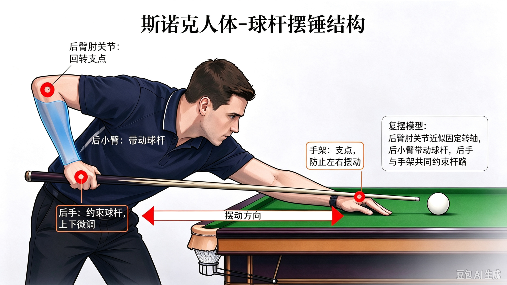
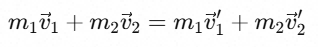
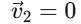
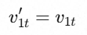
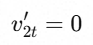

## 斯诺克运动物理原理

斯诺克运动的本质，是人操控球杆击打静止的母球，令球体在台面上运动、互相碰撞、撞击库边，直至所有球回归静止。自母球脱离皮头的瞬间起，后续发生的一切，都是纯粹的物理现象。倘若将人换成机器，理论上这台机器选手可以从开球起稳定每一杆打出
147
满分。若一名球员被冠以“机器”的绰号，在我看来可谓是斯诺克界的最高赞誉。当然，球员“墨尔本机器”尼尔·罗伯逊是有血有肉的大活人，他会得意、会生气、也会懊恼。人类所有喜怒哀乐、爱恨情仇，无时无刻不在影响着他的赛场状态。

斯诺克运动的核心器材包括球杆、球、台尼和边库。

球员的击打意图经由球杆传递至母球。正常发力时，小臂带动手腕、手指，力量从握杆处传导至球杆，杆头撞击母球，从而改变母球的运动方向、行进速度以及自转方向与转速；当需要发出大力击打时，大臂乃至全身都会协同参与发力，球杆就是这套发力体系当中的传力媒介。

现代职业赛事用球为高密度铸造型酚醛树脂，耐撞耐磨不掉色。理想状态下，球的密度均匀，重心与几何中心重合。斯诺克的母球和目标球为完全相同材质，球径、重量等物理参数一致。

台尼为羊毛织物，有些产品添加少量尼龙增加耐磨性能。新台尼的表面有短绒毛，比赛时通常梳理为统一朝向底库方向。台尼厚度约1.1-1.3mm，球压上去有轻微弹性凹陷，形变≤0.4mm，通常忽略不计。球在台尼上的有滑动和滚动两种运动状态，台尼的新旧程度、绒毛方向、湿度和静电等都会影响球的运动轨迹。

边库主要由天然橡胶制成。球与边库的撞击面为一小段平面，其高度区间为26-26.5mm，球体半径为26.25mm，球吃库撞击点对准球心高度，确保不改变球的平面运动状态。边库的法向恢复系数为0.60-0.65，即球垂直撞库，反弹速度约等于入射速度的60‑65%。球撞库时与胶边的接触时间极短（0.8‑1.5
毫秒），胶边发生短时凹陷：

- 小力吃库（普通走位力度）：0.8‑1.2 mm

- 中等力度（比赛最常见翻库力度）：1.5‑2.2 mm

- 全力大力撞击（职业选手最大力度）：2.5‑3.2 mm

正常安装状态的球台，石板表面平整光滑，接缝齐整，整体水平调平。台尼平整紧绷。器材的安装和制造状态都按照理想状态，不再讨论。（以上数据部分由AI提供，未经验证）

改变球运动状态的情形可大致分为击球、球在台尼上运动、两球撞击、球撞击边库四种：

1.  击球

使用标准手架击球时，身体与球杆形成的结构可近似抽象为摆锤结构。后臂肘关节充当固定转轴，在手部约束控制之下，小臂带动球杆做近似水平的前后摆动，完成击打。

库边手架与标准手架结构类似。母球后斯诺、扎杆等情形需抬高后手和前手架，其他不变。使用架杆时，手臂与球杆的相对位置由标准手架的上下垂直关系变为水平垂直关系，结构原理类似。

发力结构影响发力效果。最理想的击打状态，是后小臂与球杆夹角恰好呈90°时，皮头碰触母球；皮头接触母球后，球杆运动方向保持一致，避免杆头上挑或下坠。

2.  球在台尼上运动

球在台尼上的运动分为转动、滑动和滚动三种类型。滑动指球与台尼的接触点不变，无垂直台面方向自转，在台面上滑行。滑动过程中，球表面在垂直台面方向上相对球心的转动距离为零。转动指的是球心在台面上滑动的同时，球表面围绕球心在特定方向旋转。偏离中心点击打母球会使母球进入转动状态。滚动是转动的一种特殊态，指球恒定在垂直台面向前的方向上转动，球心在台面上的移动距离等于球表面与台尼接触点相对球心的转动距离。

球在台尼上的运动规律与自身旋转和台尼绒毛方向有关。

自身旋转可在三维空间内分解成三个分量，即在平行台面方向的旋转（左右旋）、垂直台面方向的旋转（前旋和回旋）和垂直于行进方向的旋转（扎杆）。

垂直台面方向自转：

向后转动的球，向后转动的速度衰减到零的瞬间进入滑动状态，随即转入滚动状态；

向前转动的球，向前转动的速度衰减到等于球心的平移速度时，转入滚动状态。

------------------------------------------------------------------------

引入以下变量：

V自转，指球表面与台尼的接触点相对球心在垂直台面方向上的旋转速度；

V自转 （向前），指旋转方向与滑行方向相同；

V自转 （向后），指旋转方向与滑行方向相反；

V滑行，指球心在台面上平移的速度；

S自转，指球表面与台尼的接触点相对球心在垂直台面方向上转动的距离，等于周长乘以转动圈数。

S滑行，指球心在台面上平移的距离。

则

滑动过程：V自转 = 0；S自转 = 0

转动过程：V自转 ＞ 0；S自转 ≥ S滑行

滚动过程：V自转 = V滑行；S自转 =
S滑行

向后转动转滚动：V自转 （向后）＞ 0 — V自转 = 0 —
V自转 （向前）＞ 0

向前转动转滚动：V自转 （向前）＞ V滑行 —
V自转（向前） = V滑行

平行台面方向自转：

只带有平行台面方向自转的球，在台尼上先滑动，后滚动。

水平方向上偏离中心点击打时，球的行进方向会向打点偏移方向的反方向偏移。即左塞向右偏，右塞向左偏。打点越靠外，偏移量越大。

垂直于行进方向的旋转：

对球施加垂直于行进方向的旋转时（扎杆），球会走出弧线。若同时球施加左侧旋转，球的行进路线会向出杆方向的右侧偏移，向右侧画弧，并向左侧收拢；反之，向左侧偏移，向左侧画弧，并向右侧收拢。扎杆效果受打点偏移量、球杆与台面的夹角（杆尾高度）、速度和力量影响：

- 打点越靠外，旋转越强；

- 夹角越大，旋转越强；

- 速度越快，旋转越强；

- 力量越大，收拢越晚，弧线越长。

台尼的绒毛方向与球心在台面上的移动方向的相对关系会影响球受到台尼的摩擦阻力。

当球的移动方向与绒毛方向相同（夹角为0）时，受到的台尼阻力最小，球速正常，且无侧向干扰。随着球的移动方向与绒毛方向的夹角增加（0-180°），球受到的台尼阻力增加，减速效应增强。

顺毛（球的移动方向与绒毛方向夹角在0-90°之间）时，球的轨迹向绒毛方向偏移，随着夹角增大，受到的侧向干扰越强，偏移量越大。逆毛（球的移动方向与绒毛方向夹角在90°-180°之间）时，球的轨迹也向绒毛方向偏移，随着夹角增大，受到的侧向干扰越弱，偏移量越小。这种现象被称为绒毛效应（Nap
效应），即斯诺克球台定向绒毛台尼造成的轨迹偏移现象。

上述球加塞偏移、扎杆画弧和绒毛走向造成的轨迹偏移现象都受到击球力量的影响。可以大致归纳为如下关系：

<table style="width:99%;">
<colgroup>
<col style="width: 10%" />
<col style="width: 44%" />
<col style="width: 44%" />
</colgroup>
<thead>
<tr>
<th style="text-align: center;">
条件
</th>
<th style="text-align: center;">
小力
</th>
<th style="text-align: center;">
大力
</th>
</tr>
</thead>
<tbody>
<tr>
<td style="text-align: center;">
左旋
</td>
<td>
向右偏移，偏移量小
</td>
<td>
向右偏移，偏移量大
</td>
</tr>
<tr>
<td style="text-align: center;">
右旋

</td>
<td>
向左偏移，偏移量大

</td>
<td>
向左偏移，偏移量大

</td>
</tr>
<tr>
<td style="text-align: center;">
左扎杆

</td>
<td rowspan="2">
收拢早，弧线短

</td>
<td rowspan="2">
收拢晚，弧线长

</td>
</tr>
<tr>
<td style="text-align: center;">
右扎杆
</td>
</tr>
<tr>
<td style="text-align: center;">
顺毛
</td>
<td rowspan="2">
向绒毛方向偏移，弧线明显
</td>
<td
rowspan="2">
向绒毛方向偏移，弧线变直，力量达到一定程度时可忽略绒毛效应。

</td>
</tr>
<tr>
<td style="text-align: center;">
逆毛
</td>
</tr>
</tbody>
</table>

3.  两球撞击

如前文所述，斯诺克用球不论颜色，每颗球的重量和大小都是一样的。且碰撞过程时间极短，两球之间的相互作用力远大于台面摩擦、空气阻力等外力，所以可以把两球组成的系统近似看作孤立系统，两球撞击的过程严格遵守动量守恒定律

和牛顿第三定律：两球碰撞时，彼此施加的作用力大小相等、方向相反、作用在两球中心连线上。

已知球重量相同，即m1 = m2；

目标球为静止状态，即；

若将两球碰撞近似为完全弹性碰撞，将速度延撞击瞬间两球球心连线方向（法向n）和垂直球心连线方向（切向t）进行分解，可得：

；；；

也就是说，在质量相等、完全弹性、目标球静止、忽略球间摩擦的理想状态下两球相撞，目标球只获得母球沿球心连线方向的速度分量；母球保留自己垂直球心连线方向的速度分量。这就是台球里常说的中杆分离角约90°
的来源。

------------------------------------------------------------------------

真实斯诺克碰撞中，两球之间存在摩擦力，球间切向摩擦会产生切向冲量，目标球会被轻微“拖拽”，使分离角略小于
90°。当母球带同向侧向旋转时（反塞），会强化“拖拽”效果；当母球带反向侧向旋转时（顺塞），会弱化“拖拽”效果。

此外，母球垂直于台面方向的旋转（即前旋和后旋）会改变两球撞击后母球的运动状态，其运动轨迹会向旋转方向偏移。当母球在V自转
（向后）＞ 0时撞击目标球，呈现低杆效果；当母球在V自转
（向前）＞
V滑行时撞击目标球，则呈现高杆效果。母球延90°分离角方向滑动的能量越小，母球前旋或后旋的速度越快，高杆和低杆效果出现得越早。

------------------------------------------------------------------------

球撞击球堆的情形可等效近似为多次两球相撞，不再展开。

4.  球撞击边库

理想状态下，忽略球与边库碰撞瞬间边库凹陷，将撞击过程近似为点撞击；忽略边库台尼与球之间的侧向摩擦，那么，球撞库边的轨迹可以近似看作二维刚体对刚性直边的镜面反射，有如下规律：

- 球心轨迹相对库边法线对称，即入射角等于反射角；

- 沿库边方向的速度分量不受影响，即切向速度不变；

- 垂直库边方向的速度被反向，即法向速度反向。

实际撞击时，受到边库凹陷影响，大力击球会带来如下效果：

------------------------------------------------------------------------

- 库边凹陷后，球与库边的接触区域变大，法向冲量方向会略微向球前进方向偏；

  ------------------------------------------------------------------------

- 凹陷会把球“包”一下，相当于给球一个沿库边方向的分量，使反射角收窄；

  ------------------------------------------------------------------------

所以大力翻袋或吃库时，反射角比理论值小，即大力击球的反射角小于入射角。

受到边库台尼与球之间的侧向摩擦影响，球的旋转会改变反射角和切向速度：

- 前旋和顺塞会使球在离开边库时向旋转方向偏移，即增大反射角；后旋和反塞也会使球在离开边库时向旋转方向偏移，即缩小反射角。

- 顺塞会使球在离开边库时获得摩擦加速，即增大切向速度；反塞会使球在离开边库时受到摩擦减速，即减小切向速度。

球与边库之间的碰撞非完全弹性碰撞，边库的法向恢复系数为0.60-0.65，即法向反弹速度约等于法向入射速度的60‑65%。即撞库会降低法向速度。

不难发现，斯诺克背后运用的物理与数学均属于基础层级。参与运算的物理变量十分有限，数量级只有2位数。斯诺克进攻规则一句话就能说清。有效击球台面面积不到6.5m²，长不足3.6米，宽不足1.8米。开局台面一共
15 颗红球、6 颗彩球，理论 36
杆便可完成整套满分流程。结合当下AI的智力水平和机械制造能力，足以制造出一台机器选手，杆杆打出满分杆。

------------------------------------------------------------------------
