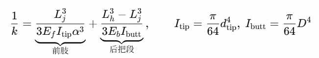
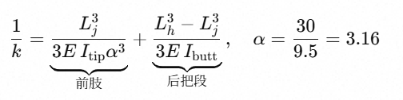
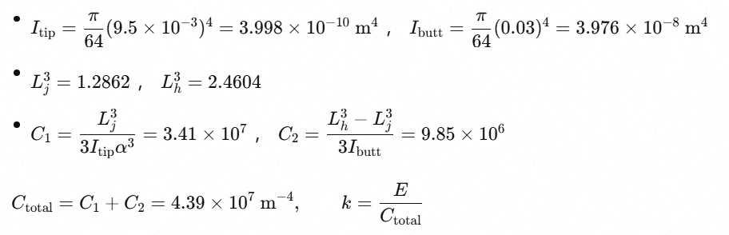

弹性影响杆法强度。在台球语境里，球杆弹性指击球瞬间杆身发生弯曲形变，随后回弹释放能量的能力。把“击球”翻译成力学模型，在击球瞬间，球杆可视为一根具有两个近似支座的变截面细长弹性梁~~最合理的简化是一端被约束、另一端自由的悬臂梁~~：

- 固定端：后手握持处（虎口＋手指的夹持），后支座。

- 手架：前支座。

- 自由端：杆头（皮头）与母球接触点。

- 杆身：变截面（锥形）圆梁，材料为白蜡木、枫木或碳纤维。

图示如下：

← L →

\[后手握持处\]─────\[接牙\]─────────────●皮头(自由端)

------------------------------------------------------------------------

👉发生向下弯曲变形δ（也称端点挠度）

为进一步简化模型，忽略皮头、铜箍、接口及插花的影响，将球杆等效为单一材质。将球杆材质（杨氏模量E）、杆头直径dtip、后把直径D、有效长度（固定端与自由端的距离）L、整杆长度Ltotal和锥度段长度Lj作为衡量“弹性系数k”的主要参数，同时引入中间变量：

冲击力F；

弯曲变形δ；

锥度α = D/dtip；

截面惯性矩I，前肢截面惯性矩Itip，后把截面惯性矩Ibutt；

则k可以用如下公式表示：

------------------------------------------------------------------------

1/ktotal = 1/k前肢 + 1/k后把，公式1

公式2

将公式2代入公式1，得到公式3，其中Lh = L。

公式3

，公式4

将公式4代入公式3，且当前肢与后把材质相同，即E = Ej =
Et时，得到

1/k = 64/3πED3 \*
(Lj3/dtip +
(Lh3-Lj3)/D)

可以看到，k与杨氏模量E线性正相关；与后把直径D三次正相关；有效长度Lh与锥度段长度Lj的差越小，即手往前握杆，k值越大；当有效长度Lh
=
Lj时，与杆头直径成线性负相关，与锥度段长度Lj三次方负相关。用表格列举如下：

------------------------------------------------------------------------

<table>
<colgroup>
<col style="width: 25%" />
<col style="width: 26%" />
<col style="width: 48%" />
</colgroup>
<tbody>
<tr>
<td>
因素
</td>
<td>
数学关系
</td>
<td>
评价
</td>
</tr>
<tr>
<td>
材质（杨氏模量E）
</td>
<td>
一次方正比
</td>
<td>
影响线性，枫木（11-13GPa）与白蜡木（10-12GPa）E差约10–20%，含水率每+1%含水率E约降
3–5%，影响幅度有限。碳纤维T700系列E为230GPa，与木质球杆区别较大。
</td>
</tr>
<tr>
<td>
后把直径D
</td>
<td>
三次方正比
</td>
<td>
最强的几何杠杆，但被握感、接箍和配重锁死，实际可调空间很小。数学上它贡献大，工程上不自由。
</td>
</tr>
<tr>
<td>
杆头直径dtip
</td>
<td>
近似一次方正比
</td>
<td>
最弱的杠杆。12mm→11.5 mm 仅降约
4%“弹性”，其主要作用是改变皮头接触面积，对“杆身弹性”的贡献很小；且磨细后局部应力（σ∝1/d3tip）上升更快，易断。工程上不自由。
</td>
</tr>
<tr>
<td>
有效长度L
</td>
<td>
负相关
</td>
<td>
是场上唯一可实时调节的量，变短有利于提升“弹性”。实践中受个体身材、入位后手架距离和后手距离影响，存在理论最小值。在场上根据球形实时调整。使用较强旋转时后手适度前握有增益效果。后手前移
2 cm（70→68 cm）“弹性”增约 9%。

</td>
</tr>
<tr>
<td>
锥度段长度Lj
</td>
<td>
负三次方

</td>
<td>
理论上变短有利于提高“弹性”，实践中要考虑前后运杆时的平顺度，最短长度为整杆长度Ltotal的二分之一，即1/2分体球杆。

</td>
</tr>
</tbody>
</table>

接下来对比同几何参数，同握杆距离下白蜡木、枫木和碳纤维球杆的弹性系数：

- 球杆1：总长145厘米，在108.75厘米处分体，前肢材质为碳纤维，杆头直径9.5毫米，前肢末端直径30毫米，后把为等粗碳纤维，直径30毫米。

- 球杆2：总长145厘米，杆头直径9.5毫米，在108.75厘米处直径变为30毫米，此后直径不变，材质为白蜡木。

- 球杆3：总长145厘米，杆头直径9.5毫米，在108.75厘米处直径变为30毫米，此后直径不变，材质为枫木。

  ------------------------------------------------------------------------

- 击打时手握在135厘米处。

三根杆的几何参数完全一致：前肢锥度段 x∈\[0,1.0875\]， d从 9.5 mm
线性增至 30 mm；后把段 x∈\[1.0875,1.35\] 为等径 30 mm。手握处
Lh=1.35m处视为固定端。

几何部分（与材料无关）：

<table style="width:99%;">
<colgroup>
<col style="width: 31%" />
<col style="width: 22%" />
<col style="width: 20%" />
<col style="width: 24%" />
</colgroup>
<thead>
<tr>
<th></th>
<th>
杨氏模量E
</th>
<th>
弹性系数k
</th>
<th>
比率
</th>
</tr>
</thead>
<tbody>
<tr>
<td>
球杆1（全碳纤维，T700）
</td>
<td>
230 GPa
</td>
<td>
5239 N/m
</td>
<td>
基准
</td>
</tr>
<tr>
<td>
球杆2（全白蜡木）
</td>
<td>
10 GPa

</td>
<td>
228 N/m

</td>
<td>
23
</td>
</tr>
<tr>
<td>
球杆3（全枫木）

</td>
<td>
12 GPa
</td>
<td>
273 N/m

</td>
<td>
19
</td>
</tr>
</tbody>
</table>

可以看到，碳纤维球杆显著优于木质球杆。不过碳纤维前肢多为空心卷制管。若壁厚
t=1.5 mm，前肢截面惯性矩I约降至实心的
78%，弹性系数同比例缩小。壁越薄，掉得越多。

下表是常见插花、接口材料的杨氏模量。

|    材料    | 杨氏模量 E (GPa) |                   备注                   |
|:----------:|:----------------:|:----------------------------------------:|
|  古夷苏木  |       18.4       |         非洲古夷苏木，后把插花料         |
| 粉红象牙木 |       15.1       |             南非，插花装饰料             |
|    黄檀    |       17.5       |       黄檀属，不同种浮动 16‑19GPa        |
|   白蜡木   |       12.3       |              小头杆前肢主材              |
|   硬枫木   |       12.6       |            美式杆常用前肢木料            |
| 纯铜（Cu） |       122        | 金属，铜箍材料，范围 110‑130GPa 取中间值 |
