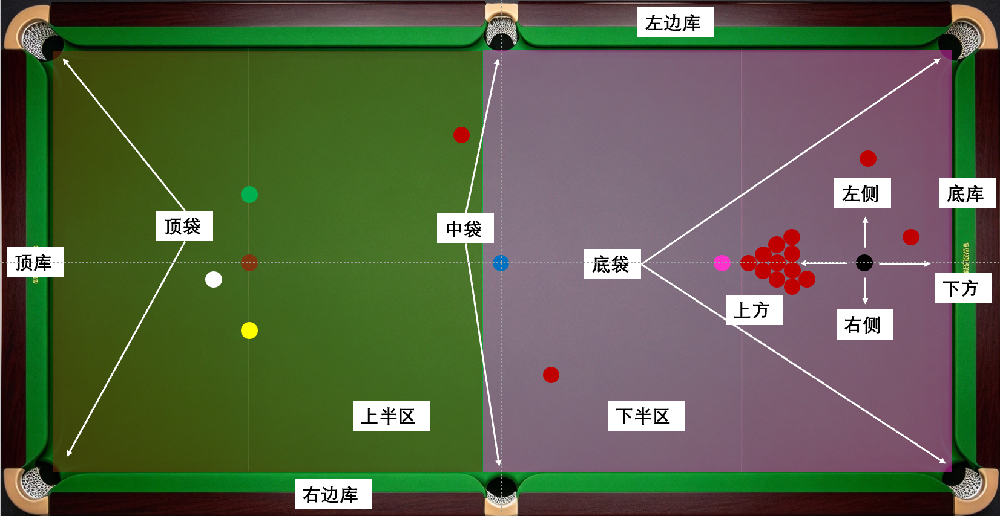

## 常用指标和术语

如图所示，球台上的常用术语大多来自英文直译，也有国内约定俗成的叫法，包括：

边库：顶库、底库和边库；

袋口：顶袋、底袋和中袋；

分区：上半区，低分彩球区，包含开球区；下半区，高分彩球区，包含摆球区。

母球：白球，主球。

目标球：红球或彩球。

盘分、局分：如0：0 ,4：3等；

本局比分、局内得分、小分：如71：67，103：0等。

为了解释某个现象用到的词语，如分离角、入射角、进球线、击球点等，在对应章节介绍。顺序阅读时如遇到表述不清的词语，可在后文中查找相应解释。

衡量斯诺克水平的常用指标包括：

------------------------------------------------------------------------

### 一、技术细节数据

1.  进球成功率。特指中台、短台进球成功率。顶尖选手 90%+。

    ------------------------------------------------------------------------

2.  长台成功率。世锦赛决赛选手累积成功率通常在50-60%。

3.  总进球成功率。所有可攻目标球打进比例，顶尖选手 90%+。

4.  安全球成功率。安全球到位率，衡量防守、做障碍、控制台面能力，以对手无法简单进球为评判标准；塞尔比、希金斯等防守大师的核心强项，通常在80%左右。

5.  解球成功率。解斯诺克的成功率与质量。官方转播无此项，通常数据包含在安全球成功率中。

6.  走位到位率。与进球成功率一体两面，二者共同作为衡量球员围球能力的核心指标。

7.  K球成功率。非官方指标，比赛中非常看重，决定能不能清理难点，连续拿分；

8.  击球成功率：衡量瞄准和出杆质量的核心指标，是进球成功率、长台成功率、安全球成功率、解球成功率、走位到位率、K球成功率的和。应当将提高并维持高百分比的击球成功率作为练球和比赛表现的核心追求。

    ------------------------------------------------------------------------

9.平均出杆时间。衡量比赛节奏。奥沙利文常 17 秒左右；塞尔比普遍 26
秒上下，是区分快慢打法的标志性指标。此指标不作为考虑球员水平的指标，对评价球员个人风格、思考习惯和比赛观赏性有一点参考价值。

以下是职业球员的赛事数据：

### 二、进攻火力数据

1.  破百（Century）：单杆≥100
    分。生涯总破百代表底蕴；单赛季破百代表当前进攻手感。目前WST单赛季破百数已经提高到100+。

2.50 +：单杆 50–99，一杆拿到足够优势、大概率拿下本局，衡量连续得分能力。

3.  平均单杆得分（Average Break）：每次上台平均得分。顶尖选手一般 \>
    30；越高代表上手后得分效率强。数据具有一定的参考性，但不具备绝对性。

4.147满分杆：满分杆数量。147本身可遇而不可求，比赛中没有足够的奖励，球员通常把赢球排第一，不会刻意追求147。练球和表演赛，147较常见，无压力状态+几杆纠错，职业球员轻松就能做到。

5.单杆最高分：比较鸡肋。顶尖球员都有WST147记录。一项WST赛事的单杆最高分奖金通常几千英镑，吸引力不高。

### 三、实战能力数据

1.  胜率：总比赛获胜占比，反映整体稳定度。

2.  决胜局胜率：抢赛点、生死局表现，心理抗压能力（有些球员胜率数据好看，但关键局拉胯）。

3.  超分后防守 / 被超分翻盘能力：落后追分、超分控台，大赛硬实力。

4.  决赛胜率。

5.大赛抗压能力：三大赛、高奖金赛事排名及胜率。

### 四、荣誉数据

1.  世界排名：WST 两年滚动积分，代表近两年综合成绩；TOP16
    是核心门槛，直接获得大师赛、世锦赛正赛资格。TOP64保留赛季积分，属于精英门槛。

2.  世界第一时长：WST 两年滚动积分排名第一的总时长和单次时长。

3.  三大赛冠军数（世锦赛、英锦赛、大师赛）：含金量远高于普通排名赛；集齐即大满贯，是历史球星标尺。亚历克斯・希金斯、亨德利、奥沙利文都以此封神。“75”三杰、“80”五虎、“90”新星、“00后”新生代这些民间称谓都以三大赛数据作为核心评价指标。

4.排名赛冠军数：职业生涯正式排名赛夺冠总数，衡量长期统治力。

------------------------------------------------------------------------
