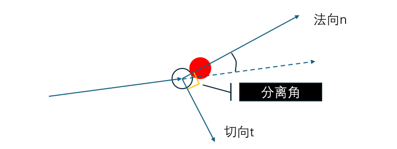
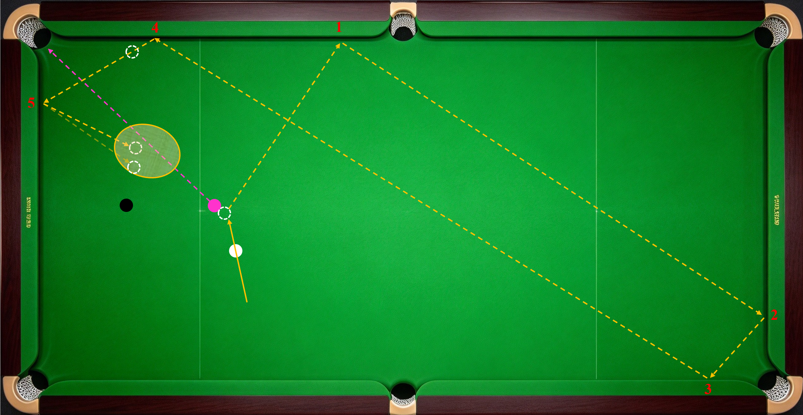
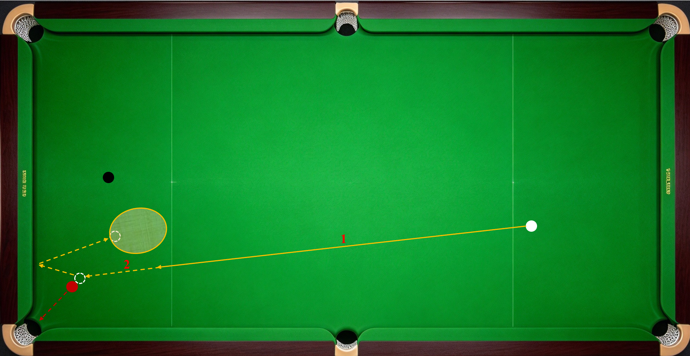
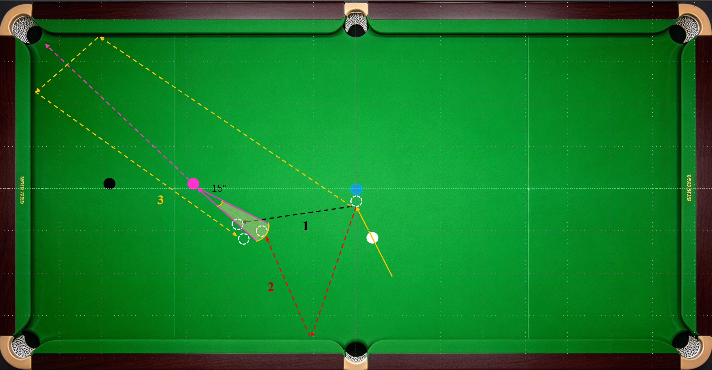

《斯诺克运动物理原理》一节中提到了以下现象：

1.  母球撞击目标球，目标球只获得母球沿球心连线方向的速度分量，母球保留自己垂直球心连线方向的速度分量。也就是所谓中杆分离角不变。

2.  母球垂直于台面方向的旋转（即前旋和后旋）会改变两球撞击后母球的运动状态。当母球延90°分离角方向滑动的力小于自身滚动的力时，其运动轨迹会向滚动方向偏移。这就是所谓的高杆和低杆效果。对应高杆减小分离角，低杆增大分离角。

3.  球撞库时，球心轨迹相对库边法线对称，即入射角等于反射角；不同的撞库力量、旋转会改变反射角，具体规律是：

- 高杆、顺赛、小力增大反射角；

- 低杆、反塞、大力缩小反射角；

- 中杆中力反射角不变。

4.受到边库台尼与球之间的侧向摩擦影响，球的旋转会改变撞库后的切向速度，即顺塞加速；反塞减速。

------------------------------------------------------------------------

通常情况下，我们不满足于分离角等于90°和入射角等于反射角的情况。我们希望通过改变击打点位和发力赋予母球速度和旋转，使母球在碰球或吃库后走出更加丰富多变的路线，从而规避障碍、主动K球，走到精确的位置（行话叫走细位，手摆位）。为了灵活运用上述规律，实现走位目标，我们需要掌握以下两个底层逻辑：

1.  线路变化的效果只和撞击后的力量、速度和方向有关，击打点位、初始发力大小并不必然决定线路。即撞击效果看当前。

2.  球的运动规律随滑动和转动速度的相对关系变化分段讨论，我们更关心最终效果。即放松过程看结果。

以“两球相撞”为例，低杆击打母球，母球以上图角度撞击目标球后，目标球奔向袋口。此时母球有切向的滑行速度和低杆的自旋速度。

1.  若母球与目标球距离近、低杆赋予母球向后自旋的速度高，母球克服台尼和空气摩擦撞击目标球瞬间，向后自旋速度大于零，则母球遵循低杆增大分离角规律，运动方向向后。

2.  若母球与目标球距离远、低杆赋予母球向后自旋的速度不足，母球在撞击目标球前，因台尼和空气摩擦，向后自旋的能量耗尽（低杆效果消失），从滑行转为滚动（即低速向前自转，球表面转动距离等于球心平移距离），那么撞击目标球瞬间，向前自旋速度大于零，则母球遵循高杆缩小分离角规律，运动方向向前。

3.  若适度控制出杆速度，低杆赋予母球向后自旋的能量恰好在撞击目标球的瞬间耗尽，此时母球在垂直台面方向的旋转速度为零，遵循中杆分离角不变的规律，延切向滚动。

    ------------------------------------------------------------------------

这就是撞击效果看当前。掌握上述原理，你就会明白为什么长台定杆打低点。

------------------------------------------------------------------------

以“球撞击边库”为例，粉球中杆右塞5库叫黑球。如上图所示，母球5次吃库：

第一库：母球右旋。吃库瞬间，母球旋转方向与滑动速度相对边库的切向分量方向相反，受到台尼的摩擦力方向与撞库后的切向速度方向相同，为顺塞，吃库加速；

第二库：母球右旋。吃库瞬间，母球旋转方向与滑动速度相对边库的切向分量方向相反，受到台尼的摩擦力方向与撞库后的切向速度方向相同，为顺塞，吃库加速；

第三库：母球右旋。吃库瞬间，母球旋转方向与滑动速度相对边库的切向分量方向相反，受到台尼的摩擦力方向与撞库后的切向速度方向相同，为顺塞，吃库加速；

第四库：母球右旋。吃库瞬间，母球旋转方向与滑动速度相对边库的切向分量方向相同，受到台尼的摩擦力方向与撞库后的切向速度方向相反，为反塞，吃库减速；

第五库：母球右旋。吃库瞬间，母球旋转方向与滑动速度相对边库的切向分量方向相同，受到台尼的摩擦力方向与撞库后的切向速度方向相反，为反塞，吃库减速；

可以看到，赋予母球的初始旋转方向是固定的，球吃库的加减速效果则要具体讨论，也就是撞击效果看当前。

若**转速稍弱**，在第四、五次吃库时，球的右旋效果耗尽，在水平方向的转速可能归零，球将以滚动状态吃库。此时球速降低（小力），滚动为高杆，遵守：

- 小力、高杆增大分离角

母球的落点可能会更靠近黑球。

极端一些，若再**降低击打力量**，母球吃第四库时就失去能量，停在黑球靠近边库的区域。

不论最终落点是哪个，在实战中只评价是否在射程范围内，不必逐一分析细究具体过程，也就是放松过程看结果。

再看第二个球形，打红叫黑，停到椭圆区域，如上图所示，。

杆法一：低杆刹车。小力打母球中心点下方，使母球由向后转动转滚动，吃库弹起后停在预定区域内。母球在撞击目标球前经历三个阶段：

阶段一（图中数字1标注路径）：V自转 （向后）＞
0，母球处于向后转动状态；

阶段二（瞬间）：V自转 = 0，母球向后旋转的能量耗尽，自转消失。

------------------------------------------------------------------------

阶段三（图中数字2标注路径）：V自转 （向前）＞
0，母球处于滚动状态。

------------------------------------------------------------------------

杆法二（增加进球难度）：低杆反塞。小力打母球中心点左下方，母球撞击目标球前受后旋控制，中途卸力；母球撞击底库后反塞减速，再次卸力。这种杆法同时使用低杆刹车效果和反塞吃库减速效果。

杆法三（角度再大一点）：高杆吸库。大力打母球中心点上方，母球撞击底库后球心运动方向与球在垂直方向的旋转方向相反，出现刹车效果。

在实战中，我们可能会快速评估各种杆法效果，选择一个打出，我们只关注路线可行性和母球落点，放松过程看结果。

常见球形的线路，包括开球线路、十字回球线路、黑球两边分、黑球正角度吃一库K球（堆）、黑球反角度K球（堆）、蓝球正角度K球堆、清彩衔接（各个角度下黑叫黄、黄叫绿、绿叫咖啡、咖啡叫蓝、蓝叫粉、粉叫黑）等，这些常用的线路值得专题训练，提高成功率。球形较多，且已有公开教学内容，此处不再逐一讨论。

接下来说说线路的选择。打一颗叫一颗，有多种杆法和线路，怎么选最稳妥。

先确定下颗球的预期走位区域。预期走位区域通常为扇形。将进球线反向延长50cm，以目标球进球点为轴向左或向右右旋转15°，反向延长线10-50cm线段扫过的区域为预期走位区域。这里的10cm、50cm和15°根据需要调整。母球距离目标球太近限制出杆延伸，太远杆法难度高。

------------------------------------------------------------------------

接下来对比各种杆法和线路对应的母球行进总距离、线路变化次数、最后一段线路穿过预期走位区域的方向和长度，有以下规律（排序分先后）：

------------------------------------------------------------------------

1.  母球行进总距离越短，越好控；

2.  线路变化次数越少，越好控；

3.  穿过方向与反向延长线的夹角越小，走位容错越大，同向平行最佳；

4.  穿过线路的长度越长，走位容错越大。

    ------------------------------------------------------------------------

一句话总结这四条规律，

前两条：越简单越可靠；

后两条：容错越大越好。

以上图蓝叫粉为例，

黑色线路1为低杆横台，母球撞击蓝球后短距离直线走到预期走位区域；

红色线路2为低杆一库，母球撞击蓝球后撞击1次边库，2次变化线路；

橙色线路3为高杆三库，母球撞击蓝球后撞击2次边库，3次变化线路。

对三条线路在总距离、变化次数、方向夹角、穿过长度四个方面排序，值越小越稳定。

------------------------------------------------------------------------

<table style="width:86%;">
<colgroup>
<col style="width: 14%" />
<col style="width: 14%" />
<col style="width: 14%" />
<col style="width: 14%" />
<col style="width: 14%" />
<col style="width: 14%" />
</colgroup>
<thead>
<tr>
<th style="text-align: center;"></th>
<th style="text-align: center;">
总距离
</th>
<th style="text-align: center;">
变化次数

</th>
<th style="text-align: center;">
方向夹角

</th>
<th style="text-align: center;">
穿过长度

</th>
<th style="text-align: center;">
杆法偏好

</th>
</tr>
</thead>
<tbody>
<tr>
<td style="text-align: center;">
线路1
</td>
<td style="text-align: center;">
1
</td>
<td style="text-align: center;">
1
</td>
<td style="text-align: center;">
3
</td>
<td style="text-align: center;">
3
</td>
<td rowspan="3" style="text-align: center;">
❓
</td>
</tr>
<tr>
<td style="text-align: center;">
线路2
</td>
<td style="text-align: center;">
2
</td>
<td style="text-align: center;">
2
</td>
<td style="text-align: center;">
2
</td>
<td style="text-align: center;">
2
</td>
</tr>
<tr>
<td style="text-align: center;">
线路3
</td>
<td style="text-align: center;">
3
</td>
<td style="text-align: center;">
3
</td>
<td style="text-align: center;">
1
</td>
<td style="text-align: center;">
1
</td>
</tr>
</tbody>
</table>

可以看到，3条线路各有优劣。

------------------------------------------------------------------------

我们作为有自主意识和情绪波动不定的人类，往往有自己的偏好，有擅长的杆法。我的建议是：

手感好相信自己；

关键球尊重规律。

------------------------------------------------------------------------

------------------------------------------------------------------------
