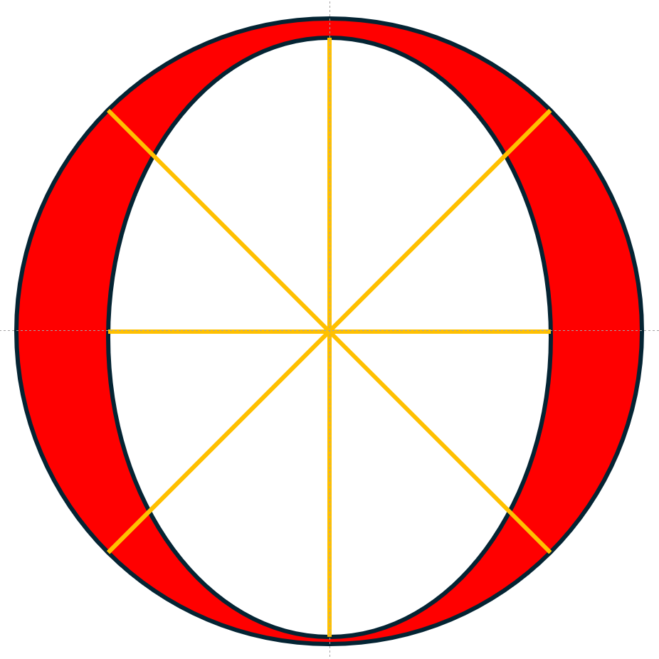

击打母球时，包括扎杆，我们将击打区域近似看作圆形平面。如图所示：

图中白色区域为常规击打区域。延黄色线形成9个打点，按顺时针顺序分别对应中杆（中心交汇点）、高杆、高杆右旋转、中杆右旋转、低杆右旋转、低杆、低杆左旋转、中杆左旋转、高杆左旋转。两条黄色线间的白色扇形区域共8个，对应垂直台面方向和平行台面方向旋转不同的强弱关系。

红色区域属于母球边缘，击打要求高，稍有不慎会出现呲杆，使用次数低。可以看到，图中低杆方向的红色区域最窄、高杆方向次之，左、右旋转方向略宽，宽度相同。此图只表明数量对比关系，并非精确值。具体区域范围受到杆头直径、皮头表面摩擦力等因素影响。需要注意的是，击打母球底部极限区域时，出杆要平直，动作上后手要放松，避免上挑呲杆；击打母球顶部极限区域时，出杆要平直，动作上有意提肘下压杆头，避免降肘呲杆。

在《打出高速旋转》一节中提到，高速旋转的影响因素包括打点和杆速等。专门列出一节讨论打点，主要想表达一个观点：

为打出相同的旋转速度，实现同一种杆法效果，尽量选择靠近中心的打点，通过提高杆速实现，而不是使用靠近红色区域的打点，省力击打。也就是打点聚焦，多变杆速。

原因在《斯诺克运动物理原理》一节中提过，“打点越靠外，偏移量越大”。击打母球非中心点，母球会偏离击球方向运动，需要调整进球点和力量矫正，进球难度几何增加。我们的第一目标是用最稳妥的方式击球、围球进而赢球，将斯诺克打简单，给旁观者“我上我也行”的感觉。这就需要打点聚焦，多变杆速的杆法策略。

------------------------------------------------------------------------
