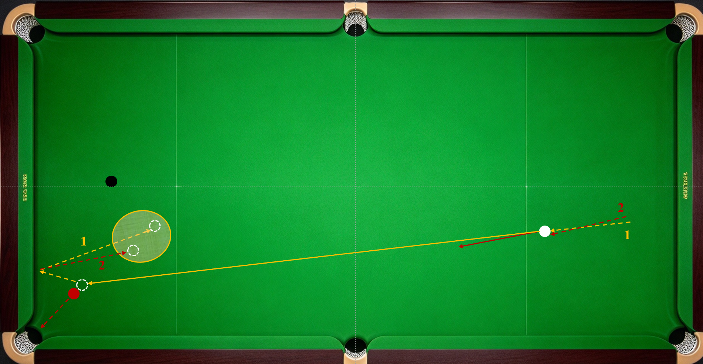
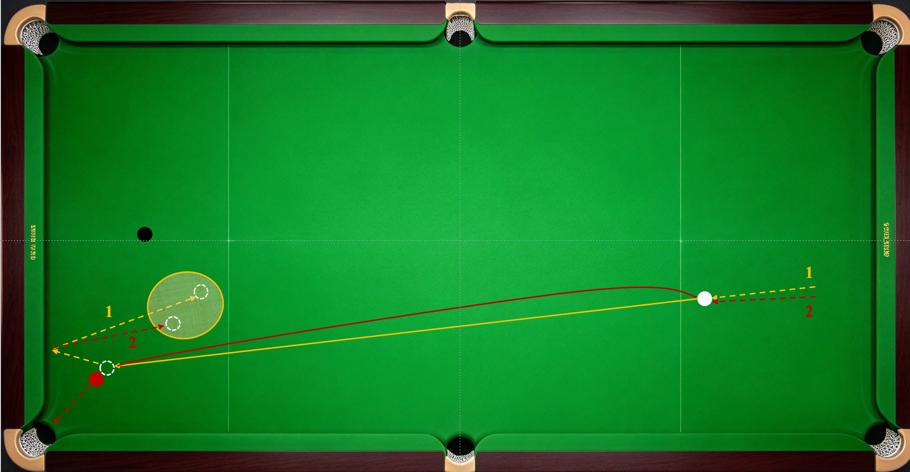

让点也是行内用词。在击打母球中心点左、右侧时，母球的行进路线会偏离球杆击打方向，无法打到按照击打母球中心点瞄准时所对应进球点，需要同步修正瞄准注视的进球点，也就是让点。

实际上，击打母球中心点左、右侧，使母球带水平方向旋转，在不考虑两球间摩擦的情况下，在母球撞击目标球瞬间，母球与目标球的接触点仍然是按照击打母球中心点瞄准时所对应的进球点。也就是说，进球点不让点。

我们之所以要击打母球的左、右侧，是为了给母球赋予对应方向的旋转，进而获得与台尼摩擦变线和吃库改变分离角、加减速的效果。那么为了纠正母球偏移造成的撞击点变化，也需要按照母球在台面上转动时的运动规律来调整击打方向相对进球点延伸线方向的偏移量（或者说瞄准偏移量）。

那么如何纠正母球偏移造成的瞄准点变化呢？根据《斯诺克运动物理原理》中的相关规律可知：

- 左塞向右偏，右塞向左偏；即修正方向与加塞方向相同。

- 打点越靠外，偏移量越大；即修正幅度与打点偏移量相适。

- 力量越大，偏移量越大；即修正幅度与力量大小相适。

接下来分两种情况具体讨论：

1.水平击打，也就是球杆平行台面击打母球，母球撞击目标球前在台面上滑行，其行进路线与击打母球中心点时的路线重合。以《线路》一节介绍过的打袋口红球叫黑球为例，杆法1：低杆刹车和杆法2：中杆左塞撞击目标球前线路重合，区别是吃库后线路（红色虚线线路2为中杆右塞路线，橙色虚线线路1为低杆刹车路线）不同。这种情况可根据两球距离、打点偏移量、速度和力量，调整瞄准平移量。

2.斜向击打，球杆与台面产生夹角，即抬高杆尾打击，也就是扎杆时，母球获得了水平面内垂直于行进方向的旋转，母球会先向水平旋转的反方向偏移，再向回收拢（如上图红色线路2）。偏移后收拢的效果随杆尾高度、力量和速度变化。此时的瞄准平移量需要根据两球距离、旋转强弱（速度）和力量灵活调整。且因收拢现象的存在，瞄准平移量较纯水平旋转时小。使用较强的扎杆时，甚至可以不偏移，对准原进球点方向击打。

------------------------------------------------------------------------

总之一句话：为了杆法效果，按照杆法瞄准，靠杆法纠正。道理就是这么个道理，具体让多少点，还得在实践中摸索、微调，形成可靠能力。

------------------------------------------------------------------------
