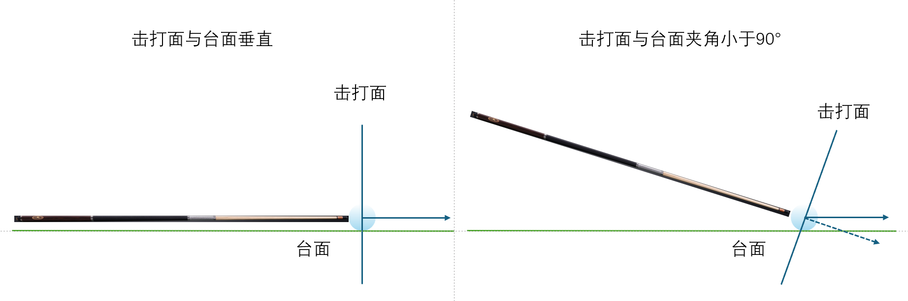
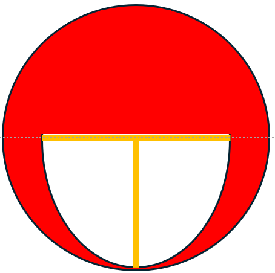
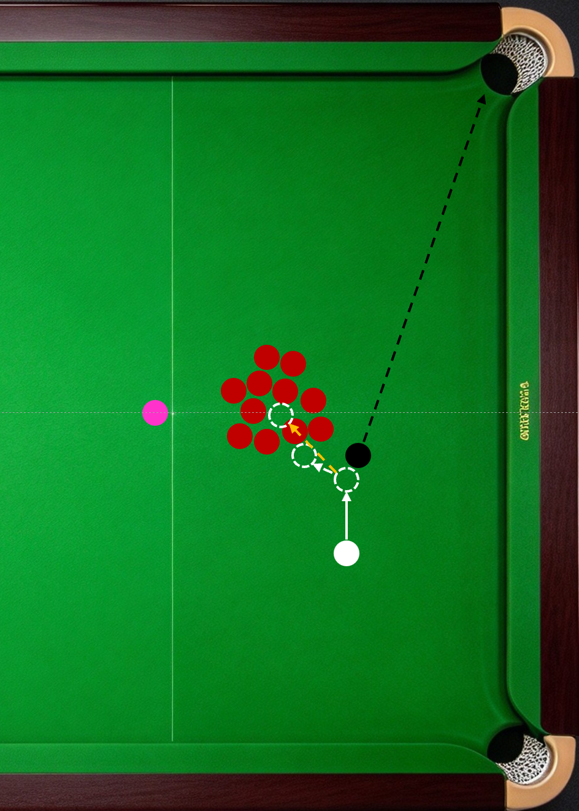

斯诺克规则中，母球与目标球之间有障碍球时，不能直接跳过去，只能绕着走。在比赛中经常能看到选手使用扎杆，还诞生了不少扎杆解进的名场面。下面介绍扎杆的打点范围、发力要求和动作要领，影响扎杆线路和旋转强弱的因素参见《斯诺克运杆物理原理》。

与常规打法不同的是，扎杆时球员主动抬高杆尾，若将所有打点投影到一个平面并称作击打面，则扎杆母球的击打面不再与台面垂直，二者的夹角小于90°。此时，球的运动可以分解为：

1.  延出杆水平方向（前进方向）的运动；

2.  垂直台面方向的运动，即球收到皮头和台面挤压，弹起腾空；

3.  垂直于台面和平行于台面的旋转；

4.  垂直于前进方向的旋转。

在《斯诺克运杆物理原理》一节中讨论了球在台尼上的运动，球的自身旋转在垂直行进方向上的分量（4），是扎杆效果的来源。因此，扎杆的打点在击打面垂直中心线的两侧。为了不让球跳起脱离台面，避免犯规，需控制传递给球的动能在垂直台面方向上的分量（2），合理选择力量和打点。因此扎杆的打点通常在击打面水平中心线以下。下图白色区域为扎杆打点范围（仅供参考）：

扎杆时杆尾抬起，击球后的送杆距离受限，发力通常短促有力，出杆加速快，停止也快。因此握杆手需前握。

扎杆击球时，通常使用高手架，特殊球形还会用到空中手架。扎杆击球时，随着杆尾抬升，重心偏向辅助腿，身体也随之外旋。球杆抬高到一定幅度，辅助腿转为支撑腿，握杆手、小臂、后肘的摆锤结构从标准手架击球姿势转为架杆姿势。

需要特别注意的是，不论如何调整打点、力量和速度，扎杆的画弧效果强还是弱，快还是慢，扎杆的弧线只出现在母球撞击前行进路线的前半段。若障碍球停在后半段，就不能使用扎杆绕过了。

跳杆虽不被允许，但仍可在特定球形中利用母球起跳实现走位和K球的目标，有时能发挥出常规杆法打不出的奇效。如下图所示：

打黑K球堆。目标：K散球堆，K出可衔接的红球。

------------------------------------------------------------------------

杆法一：强高杆。可能的效果：

1.  靠母球冲击力撞开外围第一圈红球，再凭借母球高速前旋进一步冲散球堆，最终冲出球堆。最理想的效果，实现难度大。

2.  靠母球冲击力撞开外围第一圈红球，再凭借母球高速前旋进一步冲击球堆第二圈，最终力竭停在球堆中。母球困死，K球失败。

3.  靠母球冲击力撞击外围第一圈红球，冲击力被球堆卸除，未撞开，再凭借母球旋转冲击，再次被球堆卸力，母球停止球堆外围。未撞出可衔接红球，K球失败。

杆法二：高杆下压。击打母球顶部高杆点位，出杆时皮头向斜下方延伸，利用皮头下压使母球微微弹起，撞击黑球后跳起落在球堆中间，冲击力配合高杆前旋效果冲散球堆。

可以看到，斯诺克中跳杆虽不能直接用于越过障碍击打目标球，或跳起落在目标球的另一侧，但灵活运用除此之外的用法，能创造出常规杆法打不出的效果。

------------------------------------------------------------------------

------------------------------------------------------------------------
