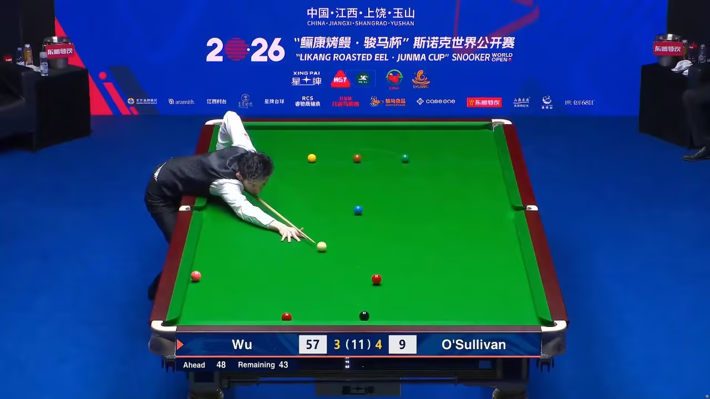
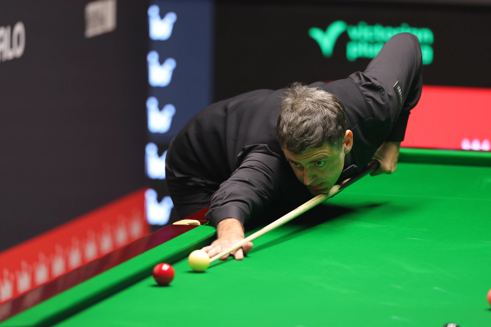

从使用场景看，需用弱侧手击打的球形均可使用架杆完成。弱侧手击球属于可选技能。

弱侧手击球也有其便利性和优势。人体大致左右对称，弱侧手的击球姿势、入位、握杆、手架、出杆和瞄准与惯用手基本相同。通过惯用手掌握的动作要领、积累的实践经验可以快速平移至弱侧手。而线路、打点、发力方式、杆法等等技能均是通用的。因此，练出稳定可靠的弱侧手，在击打短距离台上球时替代架杆，是完全没有问题。

------------------------------------------------------------------------

观察职业球员的动作，绝大多数球员弱侧手的击球姿势不如惯用手美观和标准，控制力、能力极限和稳定性也不如惯用手。但这并不影响他们在比赛的“秀杆法”环节使用弱侧手击球。

中国球员、2026年世锦赛冠军吴宜泽，在球局胜负尚未分晓的情况下，面对弱侧手和架杆二选一的球形，也常常十分自然地选择弱侧手击球，展现出强大的自信。

“火箭”罗尼 ·
奥沙利文的惯用手是右手，他的左手实力同样高超，能全程使用左手赢下比赛。对手输球后反而抱怨奥沙利文不尊重自己。

------------------------------------------------------------------------

------------------------------------------------------------------------
