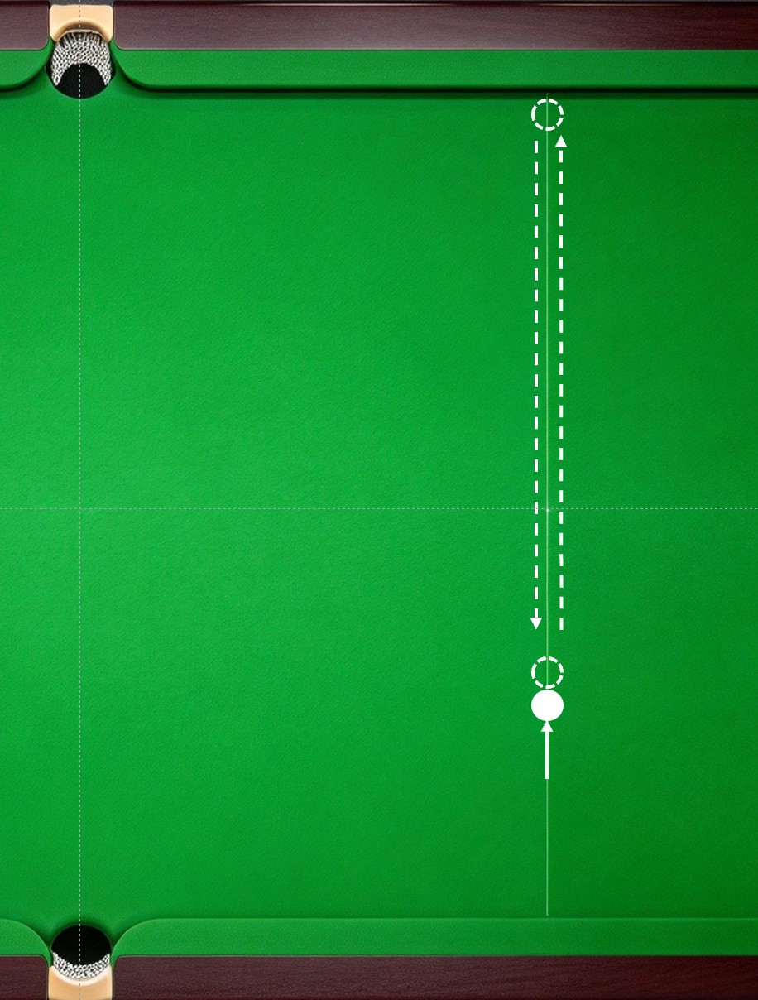
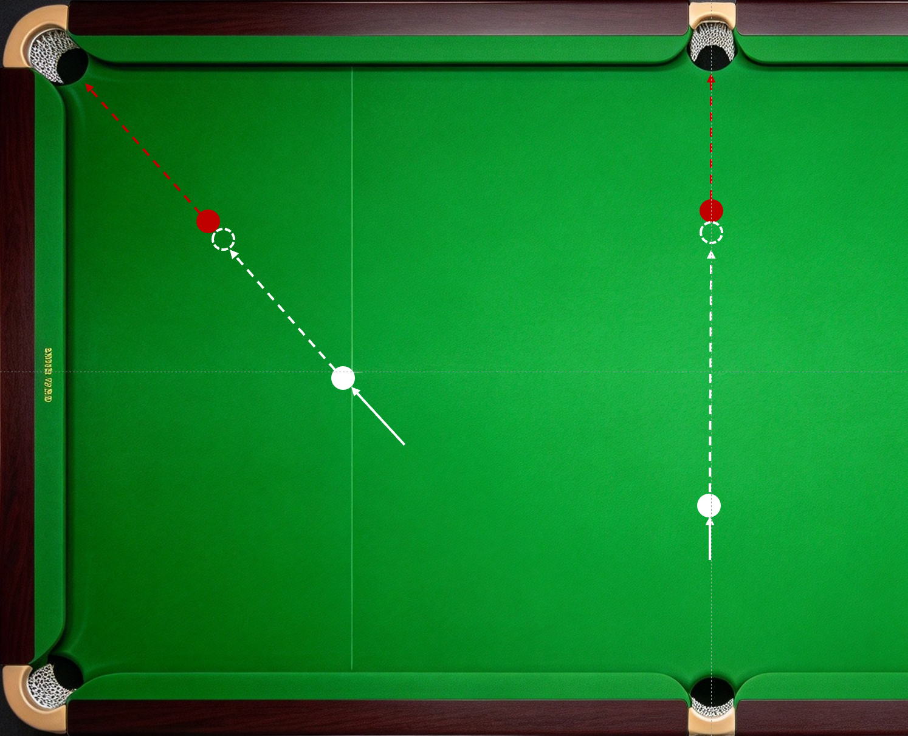
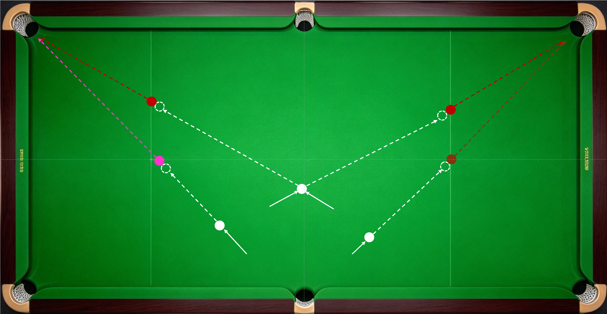
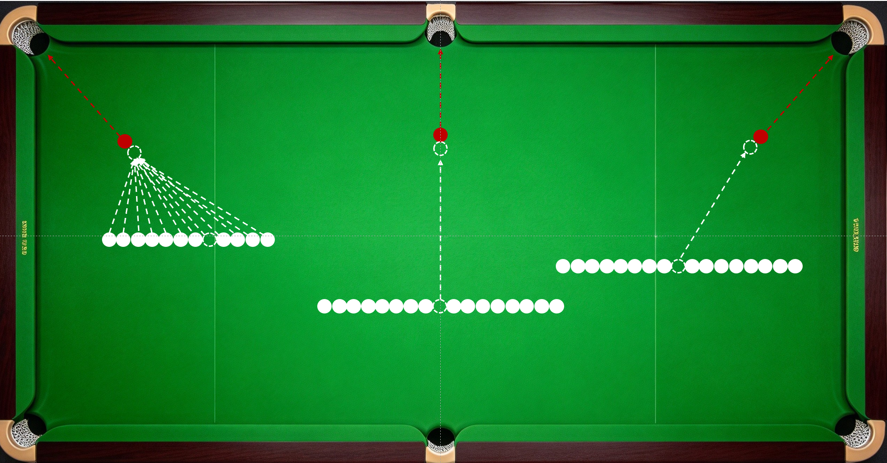
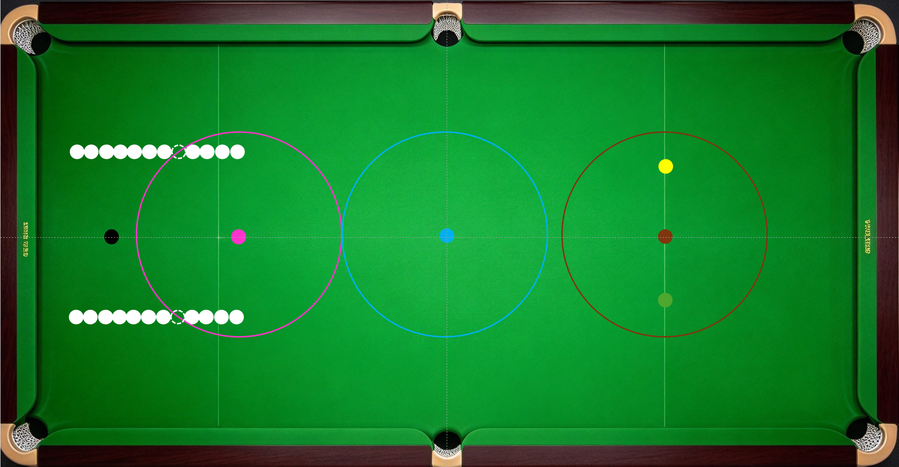
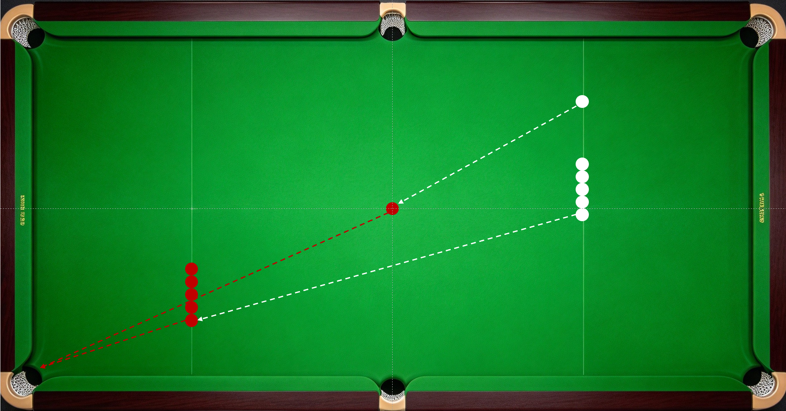
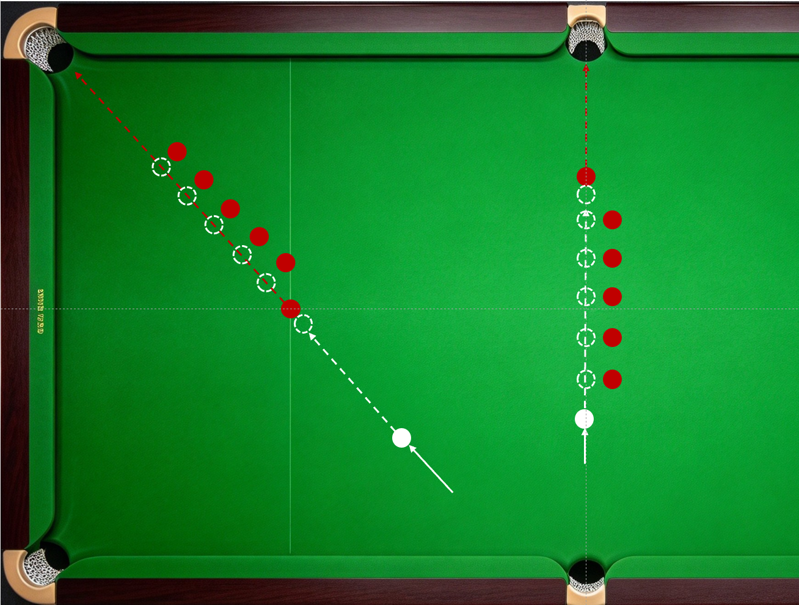

进球练习：不限杆法，进球即可，进球成功率达到50%可进阶下一难度。

1.  推白球；

2.  小台直线球，

3.  半台直线球；

4.  角度球；

5.  彩球点位球；粉、蓝、咖的练习点位在对应圆圈上。黄和绿对称，类似角度球练习。

6.  中长台直线球（5分点）；

    ------------------------------------------------------------------------

杆法练习：严格按要求的杆法，实现对应杆法效果，击球成功率达到50%以上。

1.  小台直线球，分别使用推、搓、点、登、打、戳等发力方式，使用中、高、低点位打出定杆、前进、后退效果。

2.  半台直线球，分别使用推、搓、点、登、打、戳等发力方式，使用中、高、低点位打出定杆、前进、后退效果。

    ------------------------------------------------------------------------

3.  中长台直线球，分别使用推、搓、点、登、打、戳等发力方式，使用中、高、低点位打出定杆、前进、后退效果。

    ------------------------------------------------------------------------

上面列举的球形涉及的基础技能包括瞄准、入位、击球姿势、握杆、手架、出杆，母球中轴线上的高、中、低打点，发力方式，以及杆法中的纯高杆、低杆和定杆。

适量练习球形（实战少用）：

1.  各种角度的黑球、蓝球贴库球及袋口球；

2.  架杆的进球练习；

3.  一颗障碍球的半台直线后障碍球；

    ------------------------------------------------------------------------

选练球形（实战可不用）：

1.多颗障碍球的半台直线、角度后障碍球；

2.弱侧手练习；

有偏离中轴线的打点，才需要让点，不能脱离打点说让点。选择偏离中轴线的打点，是为了走出特定线路。要走出特定线路，离不开相应的杆法，脱离线路谈杆法没有意义。我们讨论分离角、讨论入射角和反射角，讨论球在台上的各种运动规律，介绍打点、让点、线路、杆法，最终都是为了进球和走位。所谓走位，就是K停，属于K球的一种特殊结果。可以想象预期停球位置旁一颗球的位置有红球，母球停止后刚好轻贴这颗红球（K球）。因此，偏离中轴线打点的直线球和所有角度球球形练习，以及涉及的打点、让点、杆法、线路的练习，都放在应用技能相关章节介绍。

------------------------------------------------------------------------

------------------------------------------------------------------------
