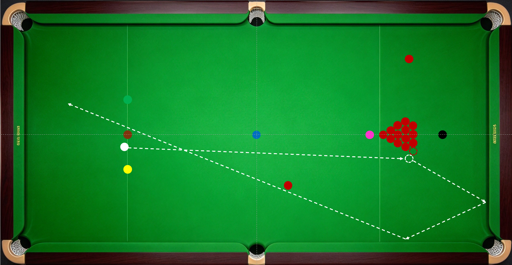
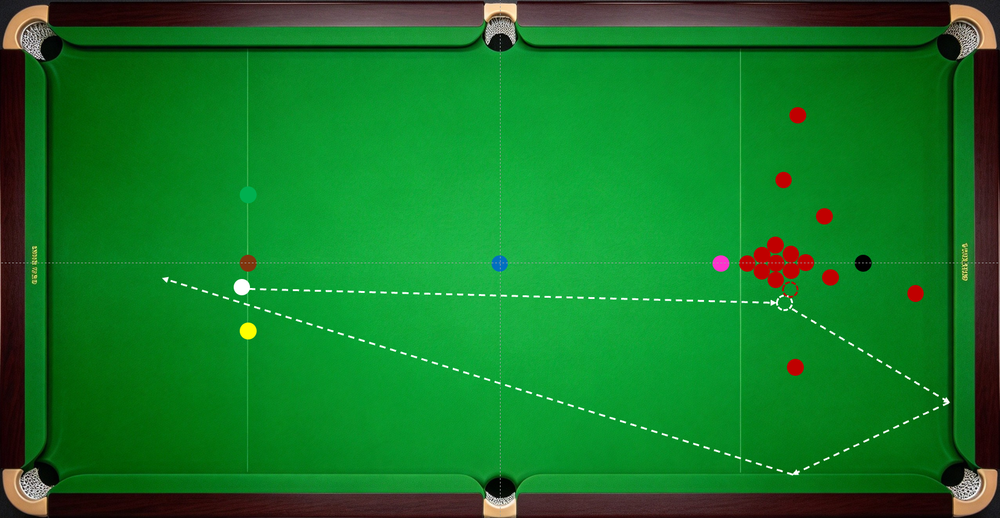

斯诺克球局，从“开球”开始。开球通常为防守。

------------------------------------------------------------------------

目标：常规目标是将母球打回开球区，轻微打散球堆，打出2颗可单下红球且不露出容易进攻的中袋或长台机会；进阶目标是将母球停在靠近顶库的位置，轻微打散球堆，打出2颗可单下红球且不露出容易进攻的中袋或长台机会；最高目标是将母球停止低分彩球后方形成斯诺克，球堆散开，可单下的红球多。

杆法和线路：以右侧开球为例，常用杆法和线路是中杆右塞或中低杆右塞3-4库、中杆或中高杆2-3库。左侧开球正好相反。

目标球选择：以右侧开球为例，目标球为球堆第1-3颗。目标球越靠近粉球，开球后球堆越散，黑、粉脱离点位锁死的可能性越高。

打法：常规打法，打第一颗，实现常规目标；

激进打法，打第2或第3颗，打出多颗可单下红球，保持黑、粉可下球（下图为示意图）；

控局打法，打第3颗，打乱球堆，将更多红球打到库边，并使黑、粉脱离点位锁死（下图为示意图）。

比赛中，通常根据双方长台成功率和竞技状态，比赛节奏和球局重要性，选择合适开球打法。对局伊始，通常选择常规打法试水。局中，我方长台成功率和竞技状态优势，可选择激进打法，快速建立局分优势。局末，我方局分大幅领先，可选择控局打法限制对手绝地反扑。局分焦灼的关键局，双方心理预期拉满，应避免使用激进打法，防止对手轻易建立局分和心理上的优势。决胜局，若对手手感正热，可采用控局打法拖住比赛节奏，诱使对手冒进；否则宜使用常规打法，不宜使用激进打法，避免被对手一杆打死。

上述策略均建立在双方防守能力相对的基础上。能在防守拉锯中胜出才是开球后赢球的关键。

------------------------------------------------------------------------
