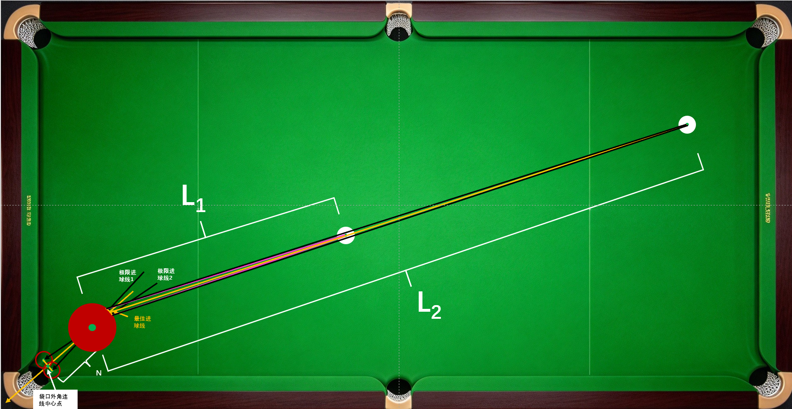
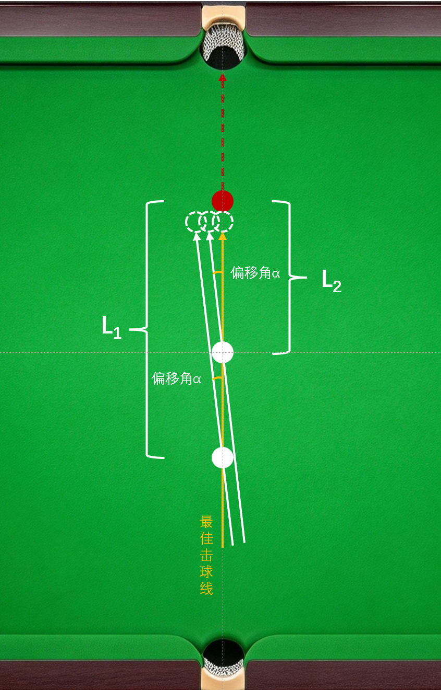
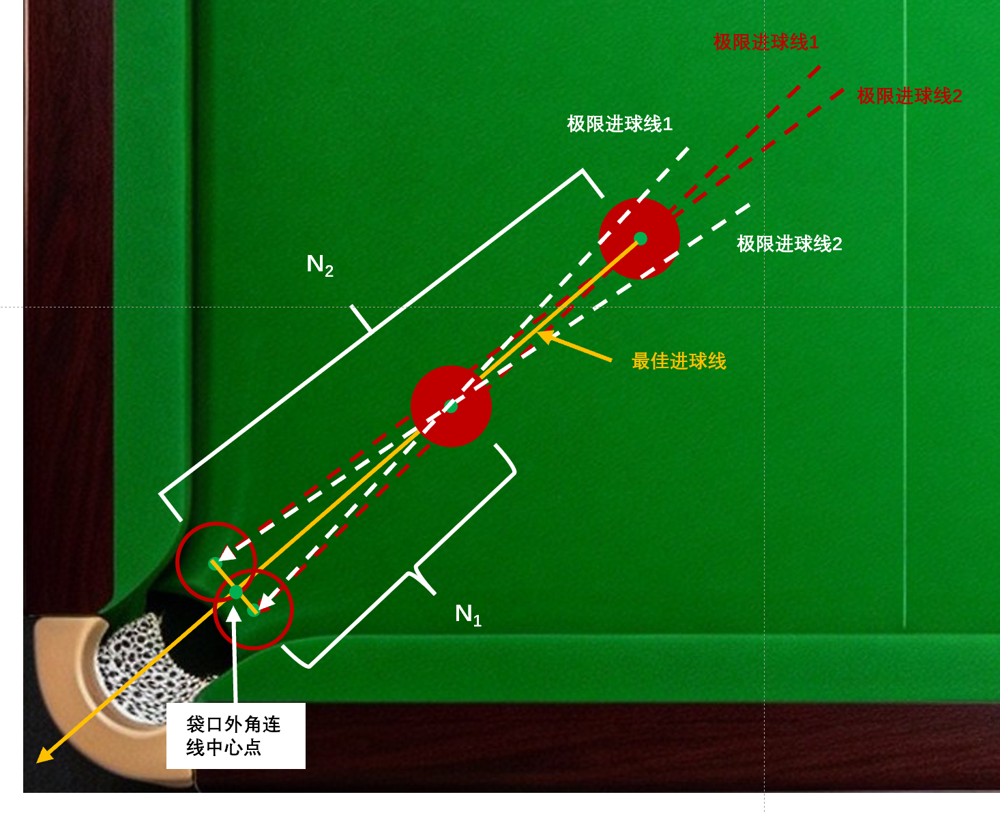
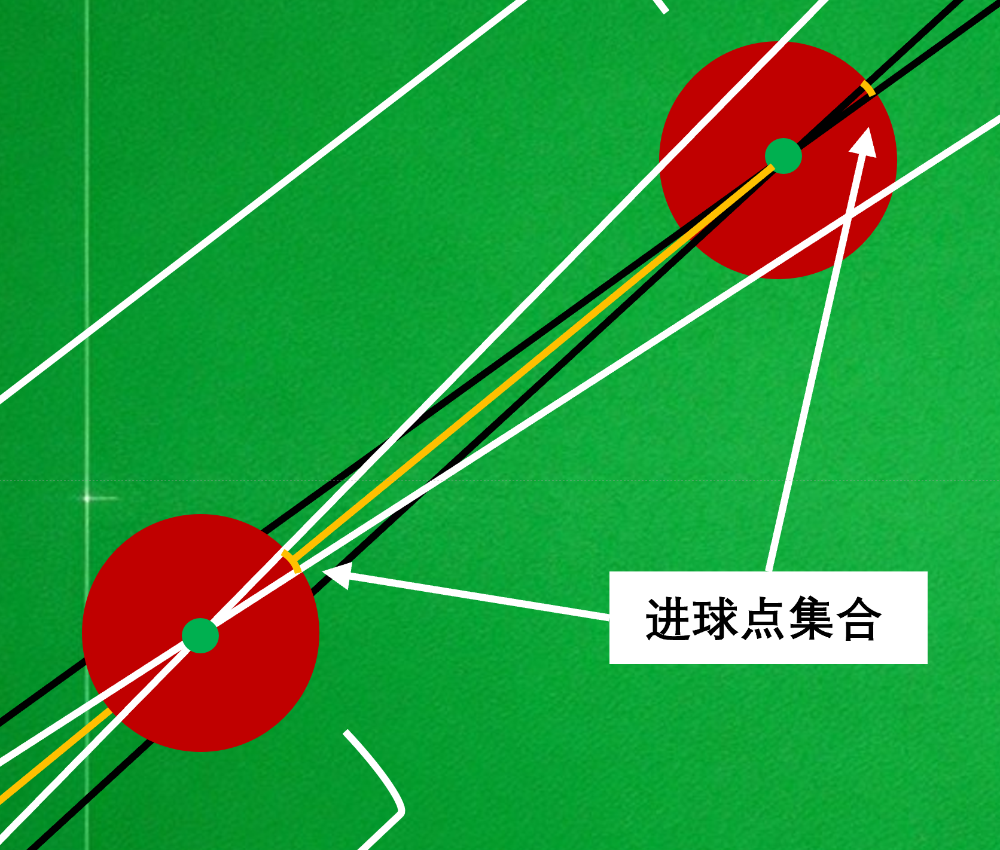
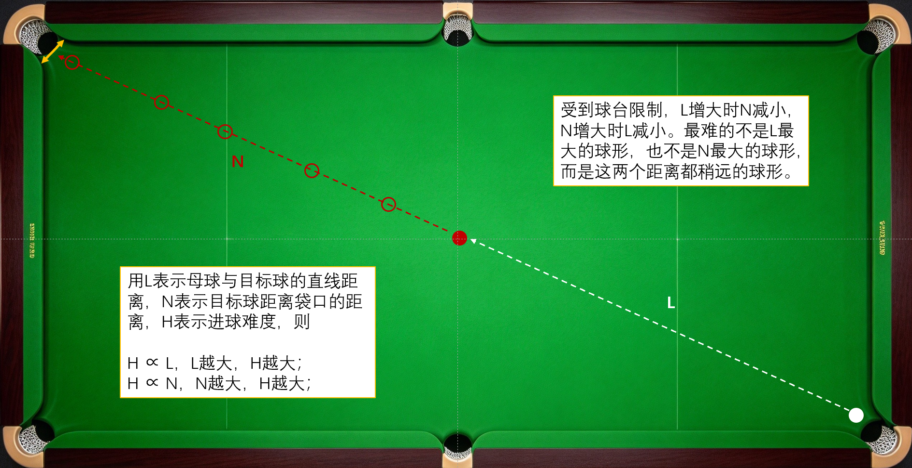
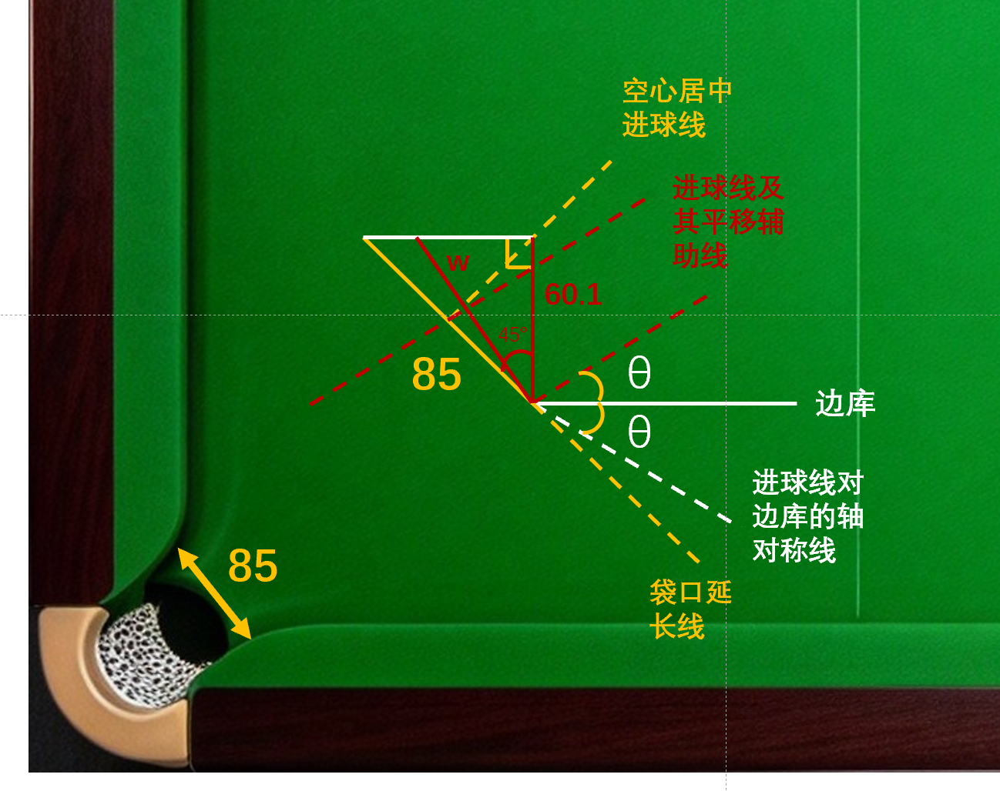
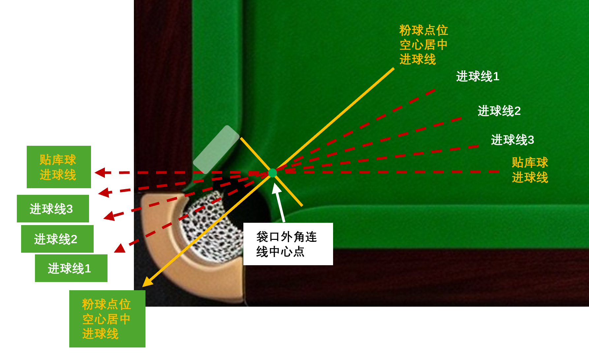
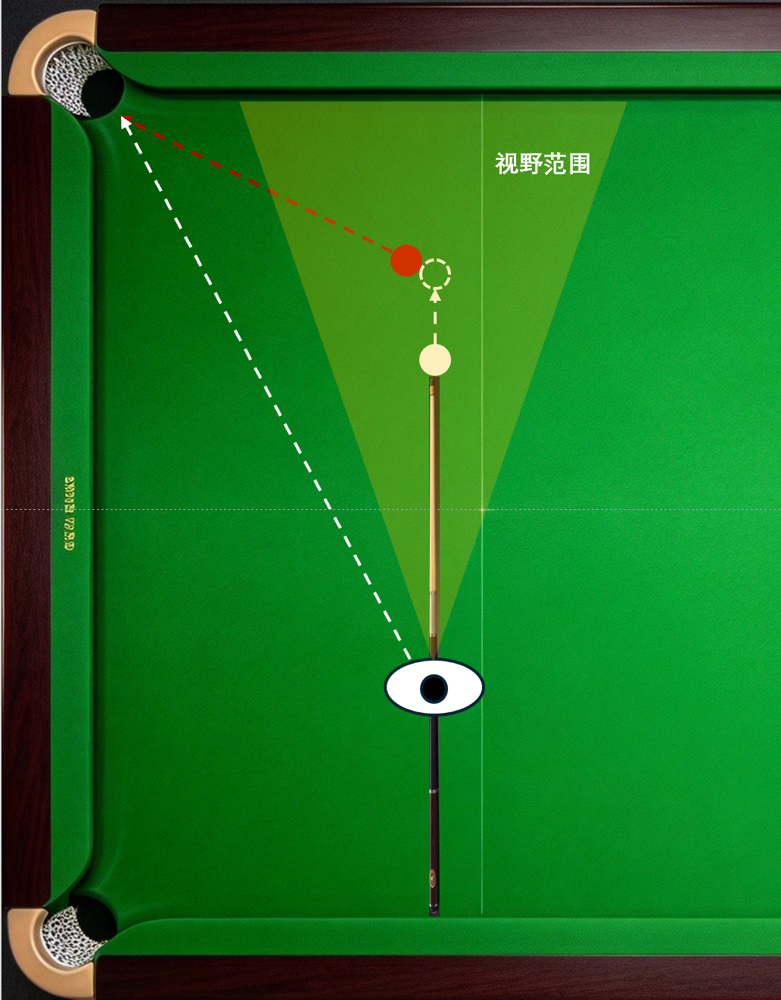
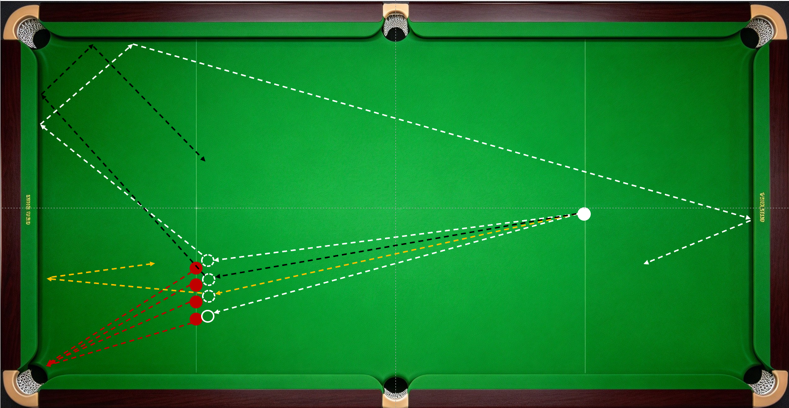
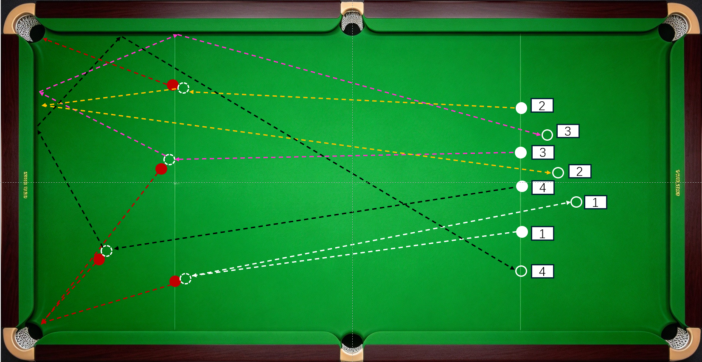

长台、贴库球和大角度球属于全部球形的一种，它的底层逻辑并未超出前文介绍过的内容范畴。之所以单独行文介绍，主要在于其特殊性和重要性。

1.  量变带来质变

    ------------------------------------------------------------------------

先说结论：

- 距离（长台）影响容错。击球点与目标球球心连线在袋口方向的延长线在碰撞处偏离最佳进球线的量随目标球与袋口距离增加而放大。击球线在击打处偏离最佳击球线的量随母球与目标球的距离增加而放大。

- 距离（长台）影响瞄准。进球点的视野范围随母球与目标球的距离增加而变小，难看清，进球线随目标球与袋口距离增加而难看清。

- 夹角（贴库球）影响有效袋口宽度。目标球的进球线与临近边库的夹角越小，有效袋口宽度越小。

- 角度（大角度球）影响袋口视野和进球点可视范围，袋口与主视眼的连线与击球线的夹角越大，袋口偏离视野中心越远，进球点的可视范围越小，瞄准越困难。

接下来逐一分析：

击球时，目标球球心与进袋前假想球球心间的连线为进球线，与袋口外角连线的中心点之间的连线为最佳进球线；目标球与母球碰撞瞬间的接触点为击球点，能使目标球进袋的击球点为进球点，延最佳进球线进袋的进球点为最佳进球点；母球球心与击球点的连线为击球线。最佳进球点与母球球心的连线，即为最佳击球线。

从母球的视角看。出杆瞬间，击打方向与最佳击球线重合，目标球空心居中进袋；若击打方向偏移，击球线也随之偏移。击球线相对最佳击球线的偏移量随母球与目标球间的距离增加而增大，即母球离目标球越远进球越难。

------------------------------------------------------------------------

同理，从目标球的视角看。击球点与目标球球心连线在袋口方向的延长线（后文简称延长线）与最佳进球线重合，目标球空心居中进袋；若击球点偏移，延长线也随之偏移。延长线相对最佳进球线的偏移量随目标球与袋口的距离增加而增大。即目标球离袋口越远进球越难。从放大图可以看到，目标球离袋口越近，进球点越多，组成的圆弧越长。

------------------------------------------------------------------------

用L表示母球与目标球的直线距离，N表示目标球距离袋口的距离，H表示进球难度，则

H ∝ L，L越大，H越大；

H ∝ N，N越大，H越大；

受到球台限制，L增大时N减小，N增大时L减小。对于某个击球人而言，在斯诺克球台上，最难的不一定是母球距离目标球最远的球形，也不一定是目标球距袋口最远的球形，而是这两个距离都稍远的球形：

------------------------------------------------------------------------

- 瞄得准，出杆质量低时，L越大越难，Hmax ∈ \[ L＞N,
  Lmax\]

- 出杆直，瞄准能力弱时，N越大越难，Hmax ∈ \[ N＞L,
  Nmax\]

贴库球（半贴库球）是相对进球线正对袋口开口方向的球来说的。斯诺克球桌的长宽比约等于2，因此目标球的进球线与临近边库的夹角（θ）的最大值为45°，最小值为零。斯诺克球径52.5mm，角袋宽85mm，球空心居中入袋时，左右两侧各有16.25mm的间隙，考虑到球吃袋角反弹滑进的情形，进球的容错空间更是超过16.25mm。

------------------------------------------------------------------------

用w表示有效袋口宽度，如图中红色线段w所示，随着 θ
变化，红色线段w在等腰直角三角形（由黄、白、红三段实线组成）中摆动，其长度范围为

w ∈ \[60.1 ,85\]

粉球点位空心居中进球，其进球线与临近边库的夹角 θ =
45°，此时袋口的有效袋口宽度（w）就是袋口设计宽度（W），即

------------------------------------------------------------------------

当 θ = 45°，wmax = W = 85 mm；

有效袋口宽度（w）与目标球的进球线与临近边库的夹角（θ）的关系是：θ
越小，w越小，进球难度越大，即

------------------------------------------------------------------------

H ∝ 1/w ∝ 1/θ

贴库球的进球线与临近边库的夹角最小（θmin =
0），有效袋口宽度最窄（wmin ≈
60.1mm，略大于球径52.5mm），只能吃袋角滑进。

如上图所示，无论从哪个方向、多大角度击打目标球，目标球的球心与袋口外角连线中心点重合时的进球线为最佳进球线，而随着进球线与临近边库的夹角（θ）变小，瞄准时视野中袋口外角连线中心点与外角的重叠度变高。这是很多人在实践中提出“贴库球（半贴库球）瞄外角”的原因。

大角度球（45°-
90°）是球形在袋口视野上的极限。直线球的进球线与击球线重合，二者夹角度数为零，进球点的视野范围最大。从直线球开始，随着袋口与主视眼的连线与击球线夹角持续增大，进球点在视野中被压缩，视野范围减小，瞄准视野中袋口偏离视线的中心点变远。

当袋口与主视眼的连线与击球线的夹角增大到一定程度（一般为35°，可根据自身视力情况确认自己的可视角度），附身击球时，袋口从视野中消失，进球线也随之消失，瞄准难度陡然跃升。这时常用的瞄准方法是先看最佳进球线，找到最佳进球点并盯住；再走到最佳击球线上，附身入位，转入击球姿势，再次之前视线焦点始终在最佳进球点上；随后按照《出杆和瞄准》一节中所述的顺序瞄准。有时为了避免丢失最佳进球点会简化瞄准步骤，或者重复上述瞄准过程强化确认。

量变带来质变。长台是球形在距离上的极限；贴库球是球形在有效袋口宽度上的极限；大角度球是球形在角度上的极限。长台和贴库球（半贴库球）是检验瞄准、入位、击球姿势、握杆、出杆、手架、打点、发力方式、让点、杆法等基础技能的黄金标尺。我们练习走位和K球是为了走出合适的角度，避免大角度球。极限大角度球难度高、使用频次低，通常不作为训练内容，实战中无把握也尽量不选择击打。

长台能力可通过提高出杆质量、强化练习来提高，投入产出比相对较高。贴库球（半贴库球）和大角度球的进球成功率通过努力练习会带来提升，但无法突破球台的物理限制以及人体的生理极限，投入产出比略低。这些限制对带有“上帝视角”的机器来说都不存在，这也是我在《斯诺克运动物理原理》一节中说的“机器比人强”的原因之一。

2.  战略价值

“在绝对的准度面前，开球都是错误”。长台准度的价值就在于此。长台是主动出击获得上手机会的常见方式，10进3的长台叫“莽”，10进5的长台叫“拼”，10进8的长台那就是“机会”。提升长台能力，把别人眼中的“莽”变成自身能力范围内的“机会”，让长台成为自己独有的战略武器，想想都觉得幸福。

3.  长台练习球形

长台直线球在《基础技能练习球形》中有示例图。下面介绍“台球皇帝”斯蒂芬·亨得利在“一小时训练计划”中推荐的长台练习球形。

图片方向从上到下四颗红球，第一颗红球对应白色线路，高杆或高杆顺塞走3库，练习“打带防”；第二颗为黑色线路，登杆两库叫黑；第三颗为黄色线路，推杆一库走黑；第四颗为白色线路，定杆走黑。

下面是四种长台“打带跑”球形。三条同侧线路：白色线低杆拉回；黄色线高杆一库；粉色线中杆两库；一条对侧线路：黑色线中低杆顺塞，母球转角回到开球区对侧。

------------------------------------------------------------------------
