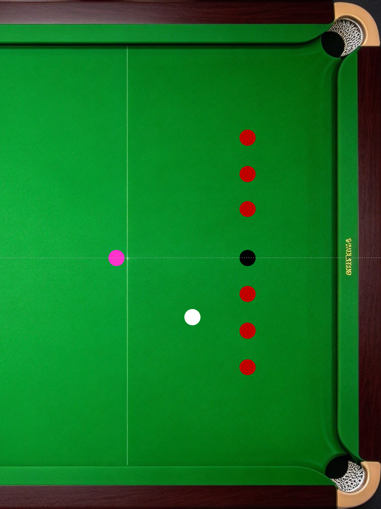
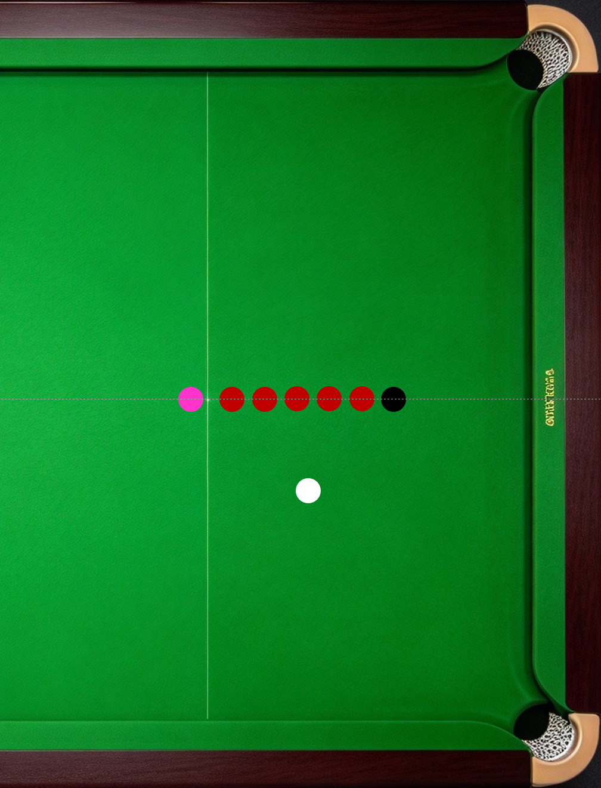
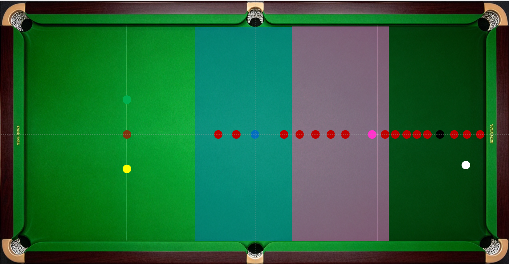
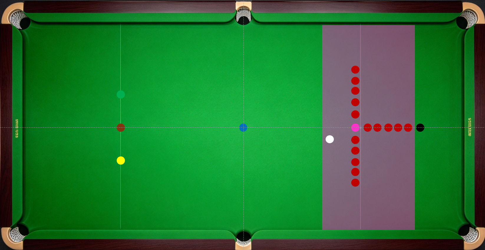
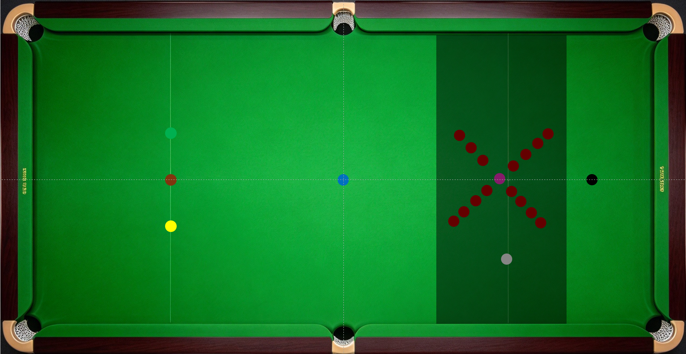
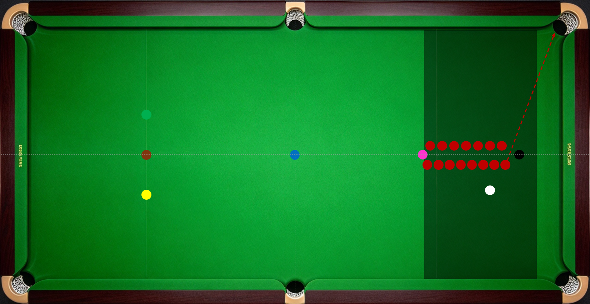
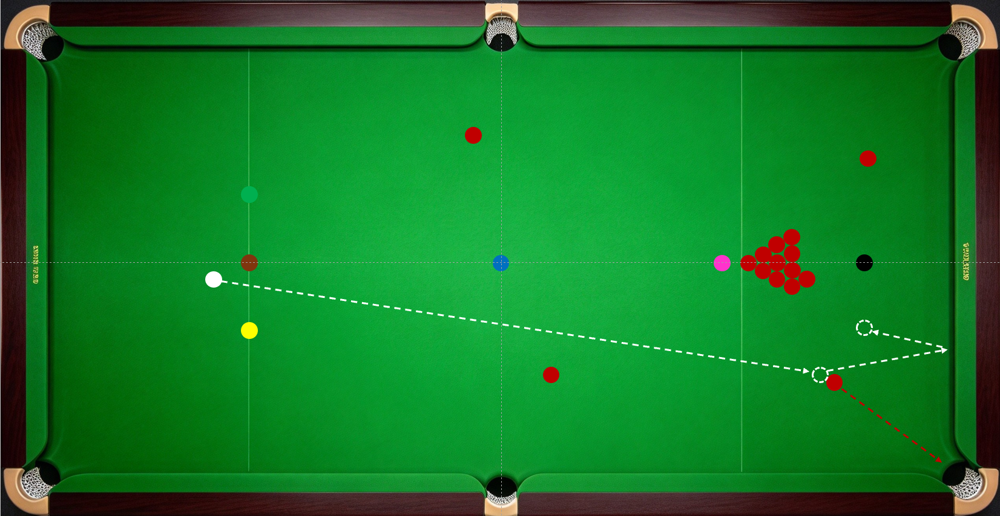

在《清台思路和进攻练习阶段》一节介绍了围球阶段的训练球形。这里所说的“围球”，就是围绕点位上的彩球清理点位附近的红球，从黑球或上手位置附近的彩球开始，依次过渡到粉球、蓝球，直至打完红球，进入清彩阶段。

------------------------------------------------------------------------

围球考验球局规划和“打一颗看三颗”的短期动态规划，属于动脑的范畴；还考验不同角度球和杆法切换，动手又动脑。围球练习属于综合练习，可以多花时间训练，赛前可用于热身。

“打一颗看三颗”。击打第一颗球时要确定第二颗球的预期停球位置，这个位置要便于叫位第三颗球。在围球初期，可供选择的红球较多，走位容错大，感觉不用提前规划都能顺利进行。到围球后期，球的选项减少，开始考验提前谋划和精准走位。初级便开始“打一颗看三颗”的好处是确保围球简单高效顺利，减少意外情况发生。“打一颗看三颗”是一个动态过程，切记每打一杆都要重新“打一颗看三颗”。

------------------------------------------------------------------------

常见的围球球形有：

1.  小蛇彩练习。

    ------------------------------------------------------------------------

纵向小蛇彩。清台要领是控力控角度，所有球留小角度或直线球，避免大角度球。

横向小蛇彩。清台要领是留红球正角度或直线球，避免反角度。

------------------------------------------------------------------------

2.  蛇彩练习。按标注区域颜色击打对应彩球。初期可从任一红球开始。清台要领是每颗红球走位对应彩球，走出小角度或直线球，避免大角度球。

3.  T字球形练习。从离粉球最近的一颗红球开始，尽量全部围粉。围粉要领是粉球留小反角，直线球可接受，大反角可纠错，避免形成正角度。

4.  X球形练习。红球在中袋和对角底袋的连线均匀排列，互不干扰进球路线，可从任一红球开始，尽量全部围黑。这个球形的走位容错较高，有中袋和顶袋接应，尽量练习全部红球进底袋。清台要领是避免黑球和红球的大角度球。

5.  “双龙”球形练习。红球在黑球和粉球连接线左右两侧交叉排列，两两互咬并将粉球锁死。从唯一可击打的红球开始，尽量围黑，可借蓝过渡，不能K散红球。此球形主要考验吃底库走位清台的精细度，用到的杆法和线路相对单一，以小横台、一库或两库走同侧和高杆顺塞一库走对侧为主。清台要领是留红球和黑球小反角。

6.  实盘模拟球形。这类球形的特点是长台起手，保留球堆，根据需要灵活调整可接应的袋口红球数量和高分值点位彩球数量。实战模拟球形的进阶之处在于加入了“长台上手”、“炸球”和“K球”。考虑球局规划和“打一颗看三颗”的能力，清台要领参考《清台思路和进攻练习阶段》一节。

上述球形都可根据训练需要调整红球数量、位置和击打规则。其他球形不再一一列举，按需选择即可。

围球训练计划。最好的计划是维持长期热情、榨干当日精力。练球要把握好度，避免长时间死磕一个球形，追求完美的成功率，或者一杆失误全盘重来，错失了体验其他球形的乐趣，过度消耗自身对斯诺克的热情；也要避免当日的全部训练时间都沉浸在舒适区里，看似练球时间很长，却因击球压力不足，练后精力满满，毫无长进。爱好者大可不必把练球当上学、当上班，享受斯诺克的魅力，开心最重要。

------------------------------------------------------------------------
