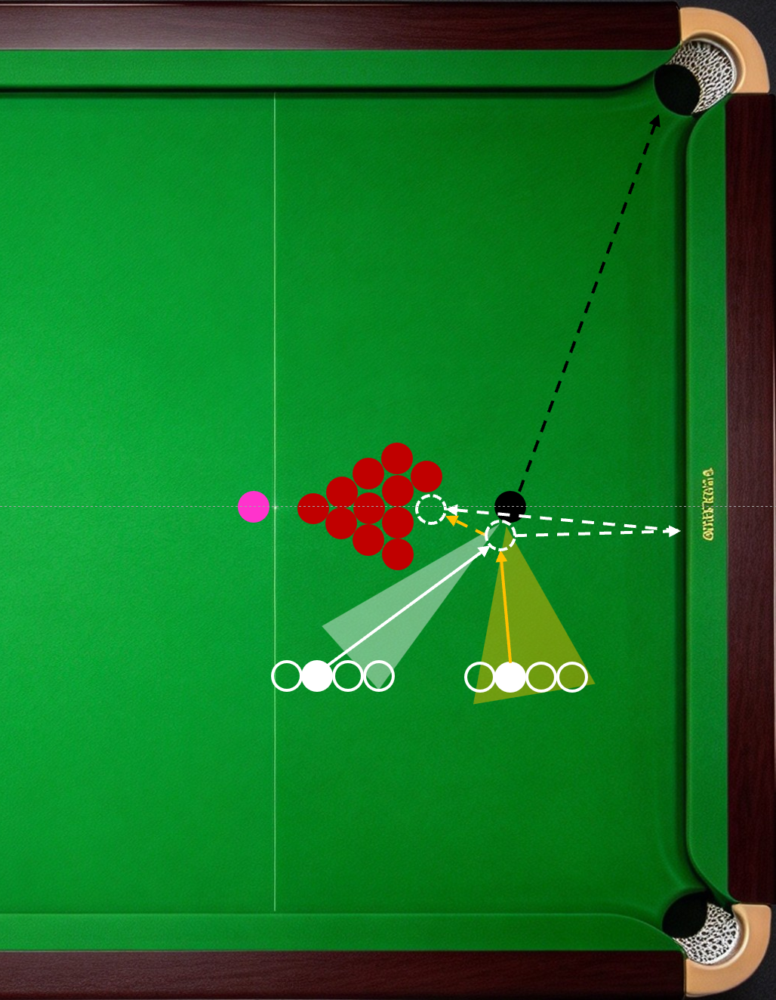
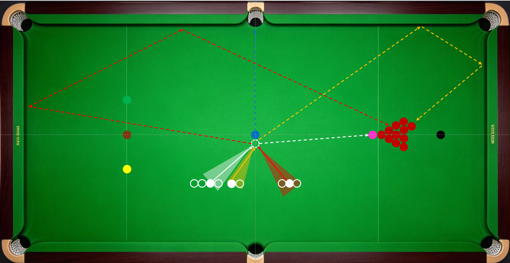

炸球通常指的是用点位彩球K开或K散摆球区球堆的击球行为，角度合适时，不在点位的彩球和球堆附近的红球也可用于炸球。炸球是K球的一种特殊形式，6颗彩球都可用于炸球，随着角度变化有固定的线路和杆法（参考庞卫国《台球进阶技巧图解》）。点位黑球和蓝球炸球是常见的优先炸球选项。

炸球的能量来源。炸开球堆需要较大的能量，其主要来源是母球撞击目标球时切向的能量分量，母球的旋转不足以冲散球堆，只能起辅助作用。因此用来炸球的目标球应为中大角度球，且母球撞击后的运动方向正对球堆方向。即炸球靠分量，旋转做辅助。

炸球的时机选择。下一杆有接应，目标球角度合适，果断炸球；下一杆无接应，不炸也得炸。

炸球的撞击点。中小力撞边缘，避免母球贴死；有空隙钻进去，加强旋转捣散球堆。

炸球的注意事项。炸球前观察球堆，避开犯规组合球；合理选择撞击方向，避免衔接球被挡；合理控制撞击力度，避免将过多红球K到边库或低分区。

------------------------------------------------------------------------

------------------------------------------------------------------------

1.  点位黑球炸球示例

上图中橙色球区域和线路最佳，中低杆，母球撞击分离方向正对球堆；白色区域和线路也可选，高杆或高杆左旋转，母球吃底库弹起再撞击球堆。

2.  点位蓝球炸球示例

上图中白色球区域和线路最佳，中杆或中高杆，母球撞击分离方向正对球堆；橙色区域和线路也可选，高杆或高杆右旋转，母球吃两库弹起再撞击球堆；红色区域和线路及其镜像线路（母球从咖啡球和黄球中间穿过），中高杆右旋转，母球吃两库后撞击球堆，路线远，能量损耗大。

------------------------------------------------------------------------
