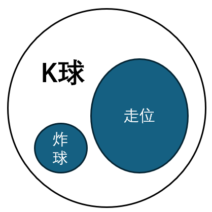
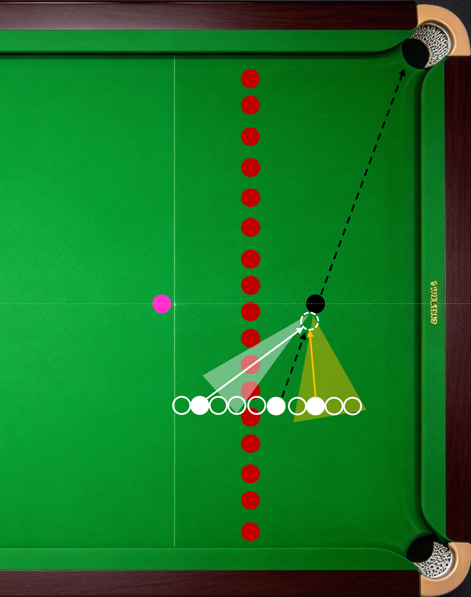
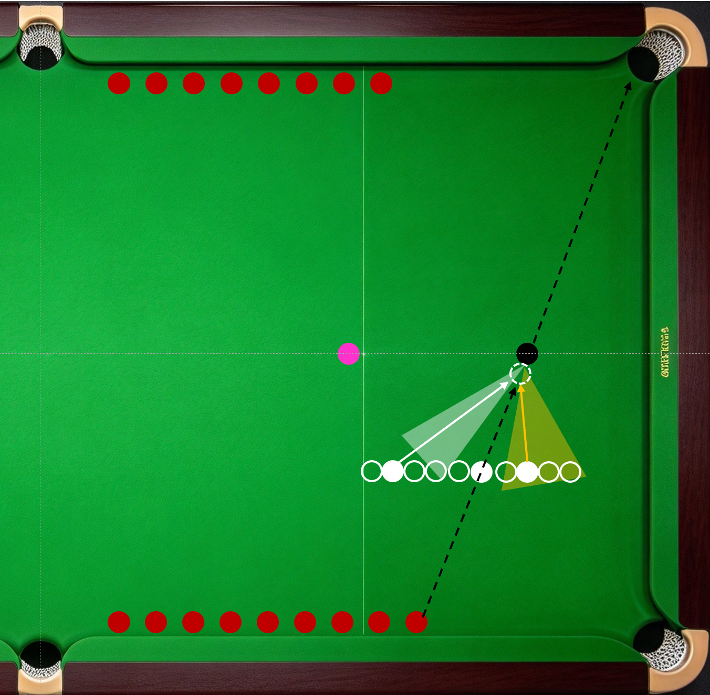

斯诺克的每一杆击球，都可以看成K球。炸球是大力K球堆，走位是K停。在《炸球》一节中说过，炸球是K球的一种特殊形式。走位，就是K停，属于K球的一种特殊结果。可以想象预期停球位置旁有一颗红球，母球停止后刚好轻贴这颗红球（K球）。

------------------------------------------------------------------------

在斯诺克涉及的所有基础技能和应用技能中，问哪个技能值得单项训练？K球必定首选。练K球就是练走位，还能同时练角度球、练杆法、练线路，性价比较高。斯诺克常用的点位黑球来K球，点位蓝球次之。下面介绍黑球K球的2种球形。

1.黑球K台中球。如下图所示，白色区域和线路是黑球正角度一库或两库K红球；黄色区域和线路是黑球反角度直接K或一库K红球。

2.黑球K库边球。如下图所示，白色区域和线路是黑球正角度一库K红球，左侧库边红球使用高杆或中高杆左旋转，右侧库边红球使用中杆右旋转、中低杆、中低杆右旋转等；黄色区域和线路是黑球反角度直接K红球，杆法主要区分打点高低、力量和速度。

------------------------------------------------------------------------

上述训练球形红球与黑球的距离可按需调整，图中模拟的是红球在摆球区附近；红球的数量也可按需调整，数量从少到多，控球从粗到细。不建议按顺序击打，可借助随机数生成器确定K球目标，确保每次出杆都重新思考。

------------------------------------------------------------------------
