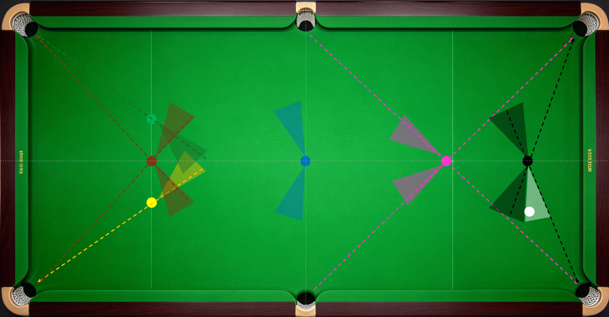
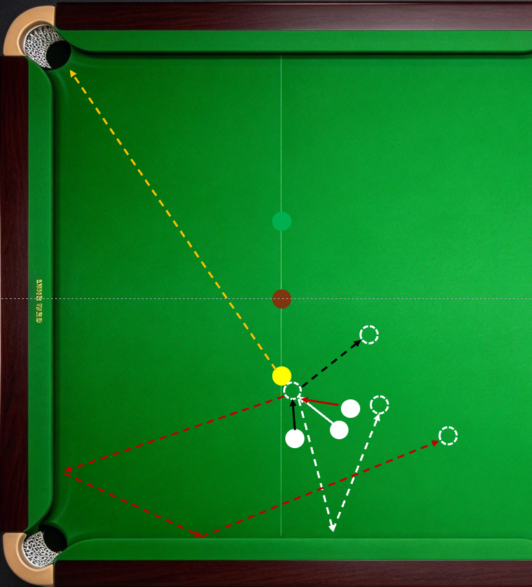

在彩球点位球练习中，已经练过了各种角度的点位彩球。清彩球就是在彩球点位球练习的基础上加上走位。

精彩球的常规练习顺序是黄叫绿，绿叫咖，咖角蓝。蓝叫粉，粉叫黑。进阶练习采用循环练习法，从黑叫黄开始，随后黄叫绿，绿叫咖，咖角蓝。蓝叫粉，粉叫黑，黑再叫黄，循环往复。比赛中不一定从黑叫黄开始，其他不变。清彩球的各种角度的线路和杆法在庞卫国老师的《台球进阶技巧图解》（北京：化学工业出版社，2010.1
ISBN
978-7-122-07269-6）中了详细介绍，推荐阅读。本节主要介绍清彩球的最佳走位区域。

------------------------------------------------------------------------

黑叫黄母球的最佳位置是黑球右侧反角，使用中杆、中杆左旋转等杆法一库走黄，母球吃库后线路正对黄球与袋口连线，走位容错高。平时训练时要主动留出这样的角度。其他角度和位置有对应的杆法和线路，难度各有不同，可适当练习。

黄叫绿的最佳位置是黄球与袋口连线的延长线，左侧5°-右侧20°（数值供参考，下同）之间的区域。

绿叫咖的最佳位置正好与黄叫绿对称。

咖啡球叫蓝球的最佳位置是左右两侧直线球和反角度35度以内。

蓝叫粉的最佳位置是反角度15~20度，轻推就能走到粉球与袋口的延长线。

粉叫黑最佳位置是粉球直线球到粉球正角度15度之间的区域。

黑球只要不是极限角度就行，相当于点位黑球练习，左右两侧直线球和正反20度以内都可以。

最佳走位区域，如图所示。训练的目标是每一杆叫位都走到最佳区域，每一次清彩训练的过程都一模一样。即杆杆走到，次次一样。

黄叫绿，母球走到黄球右侧时的补充线路：

图中白色线，角度为直线球或微偏右的正向小角度，低杆或低杆左旋转一库走位绿球；红色线，角度为正角度，比白色线球形稍大，高杆推两库；黑色线，角度为小反角，低杆或中低杆、登杆横台走位绿球。

------------------------------------------------------------------------
