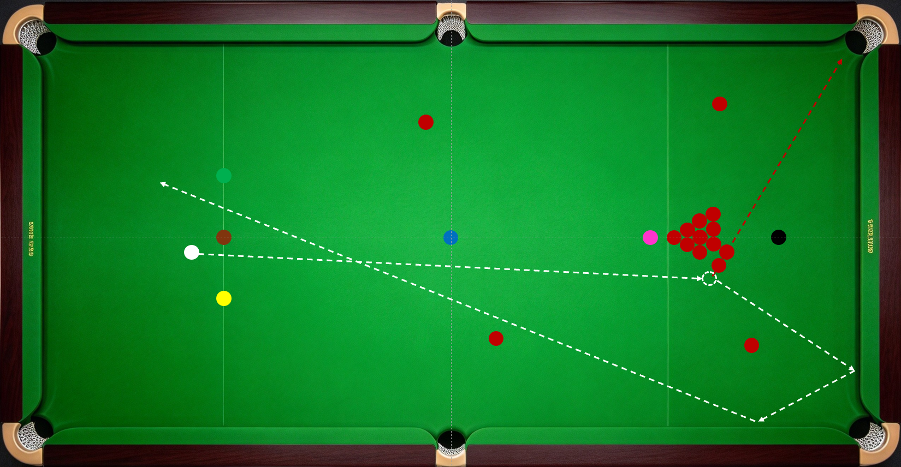
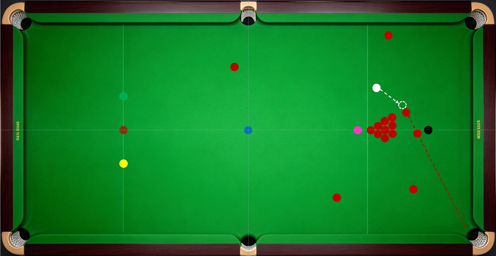
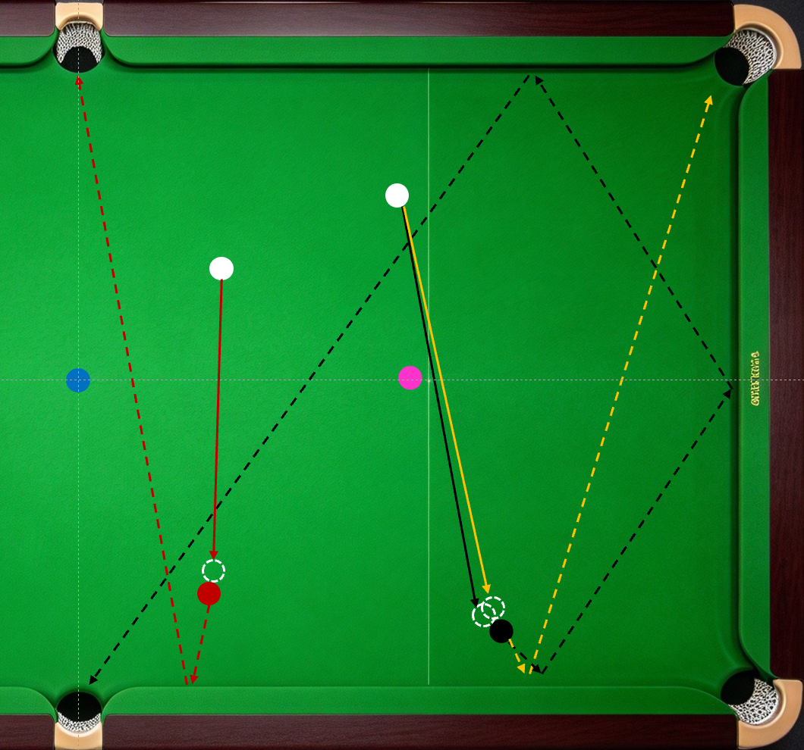
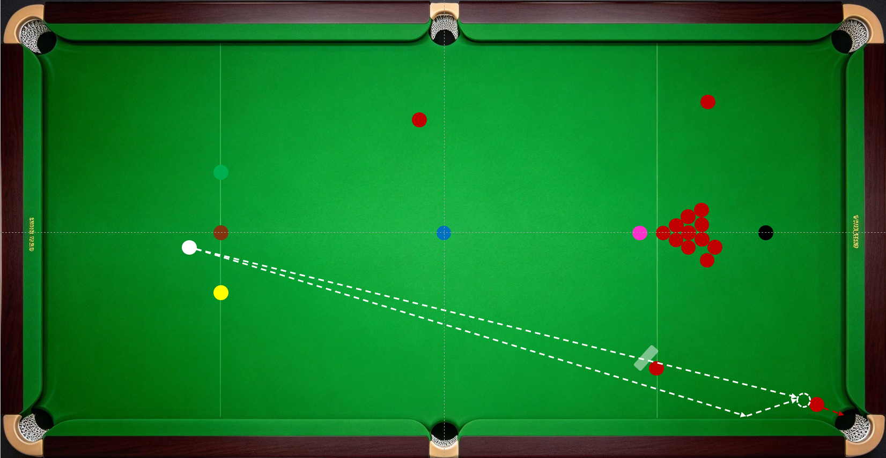
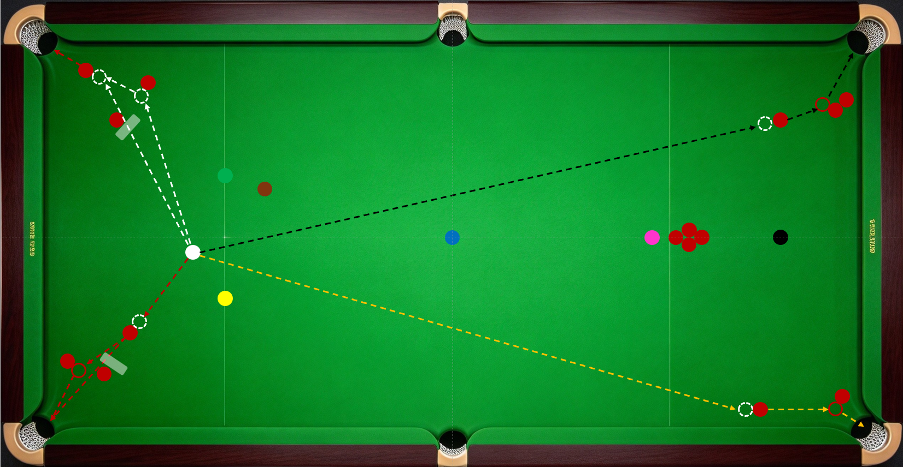
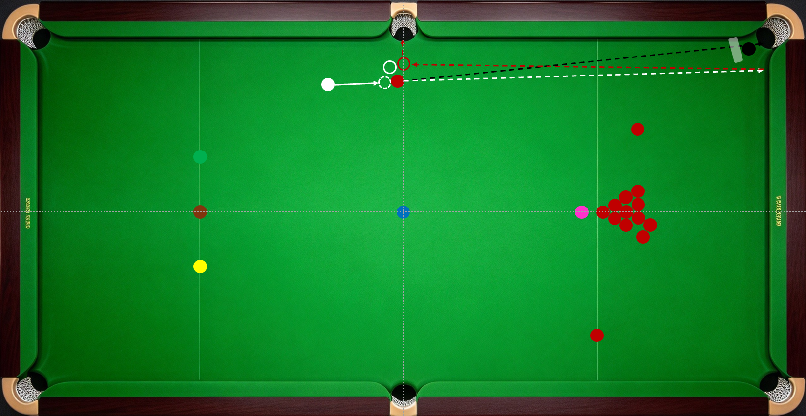
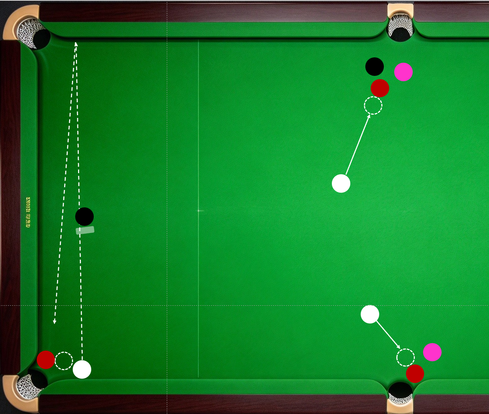

## 特殊进球方式

掌握特殊进球方式，能够拓宽“找机会、抓机会”的认知和能力，让自己技高一筹。在比赛中发现并把握对手看不到的机会，不仅能打出精彩进球，还能获得上手机会，延续进攻。下面介绍几种常见的特殊进球方式。

组合球。也叫传球，如二传、三传，指的是母球先撞击的红球直接或经过多次力量传导将另一颗红球撞进的进球方式。斯诺克中，红球堆常常会形成正对袋口的天然组合球（也叫自然角），在防守时及时发现并利用这种天然组合球可以“打带防”，获得上手机会；炸球时则要小心球堆组合球。“中国龙”丁俊晖曾在比赛中打出一杆底库“四传”组合球，非常精彩。下图分别为自然角组合球“打带防”和二传。

翻袋。即母球撞击目标球后，目标球先吃库，再进袋的进球方式。常见的翻袋球形是一库翻中袋。因为中袋袋口开口方向与翻袋时球的运动方向平行，袋口有效进球宽度大。不论顶库、底库翻角袋还是边库翻角袋，袋口的有效进球宽度往往都不及中袋翻袋。下图是常见的翻袋球形，红色线路为红球一库翻对侧中袋；争黑时对手黑白两边分，可以按黑色线路三库翻中袋，黄色线路一库翻对侧底袋属于比较激进的选择。斯诺克球台上翻长库和翻多库并非常规进攻手段，仅在表演环节出现，此处不再列举。

克拉克。Kick
shot的直译。指母球先碰库边反弹，再撞击目标球将其打进的进球方式。目标球停在袋口，容易进球，但母球直接击打的线路上有障碍，这时可用克拉克轻松化解。勾进属于克拉克的一种形式。如下图所示。

借下。指母球先撞击的红球撞击其他球后改变线路进袋的进球方式。借下有三种应用场景，一是目标球的进球线上有障碍，目标球不能直线入袋；二是直线入袋的有效进球宽度小于借下时的宽度；三是为了实现K球的目的。如下图所示。

红色线为目标球的进球线上有障碍的球形；黄色线为直线入袋的有效进球宽度小于借下宽度的球形；黑色线为K球借下，红球借库边互咬的两颗红球的上方一颗薄边借下，同时将两球K开。

开伦。类似于借下，指母球先撞击红球改变线路，再将目标红球打进的进球方式。常用于母球的击球线上有障碍，母球不能直接打到进球点的球形。如上图白色线所示球形。

二次撞击。指目标球与母球发生两次撞击后入袋的进球方式。二次撞击可能会用到翻袋和借下的进攻技巧。如下图所示。

红球直接击打左侧底袋的线路被黑球堵死。母球击打红球后，红球延白色线撞击底库，延红色线反弹，与停在左侧中袋附近的母球再次撞击，落入中袋。

下图底袋红球无直接切球角度，一库勾球线路被黑球挡住，观察母球、目标球与袋角关系，球形支持的情况下可以实现母球击打红球后，红球吃袋角弹起与母球二次撞击进袋。左侧中袋红球有切球角度，线路被粉球遮挡，球形支持的情况下也可使用二次撞击的方式进球。右侧中袋红球的进球线路被黑球和粉球挡住，可以母球高杆击打红球，红球撞开粉球和黑球后被高杆前进的母球二次撞击进袋。二次撞击的球形多种多样，您可自行探索。

看完各种特殊进球方式，我们不难发现，理论上桌面在绝大多数球形下均存在进球线路。只是有些线路太复杂，人一时想不到或算不清；有些线路难度太大，人来打成功率不足。对于能够快速计算和精细击打的机器来说，这些困难都不是困难。在它的眼里，桌上处处是机会。

本文版权协议为 CC-BY-NC-ND license
