防守的表现形式。最直观、最常见的“防守”，就是控制母球和目标球的相对位置，使对手无法轻易进攻的击球行为。进阶的防守形式，是能够形成斯诺克、建立防守先手的击球行为。应对对手做出的斯诺克时的击球行为，则为解球（解斯诺克）。做斯诺克和解斯诺克同为防守的表现形式，一体两面。

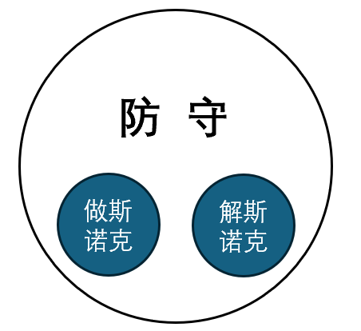

防守的常用线路。已知：

- 母球撞击目标球后先延切向运动（分离角），再根据旋转改变线路；

- 母球吃库时的入射角等于反射角，反射角的变化受旋转、力量等因素影响；

  ------------------------------------------------------------------------

- 母球向前滚动，自带前旋。

根据以上原理，面对任一球形时，均可现场计算防守线路，并运用对应杆法打出来。这是“万能钥匙”，我们应对着重提升实时规划线路的能力。斯诺克运动发展多年，球台参数固定，前人已总结出了很多简单、安全、可靠的线路，相当于“常备钥匙”。如《开球》一节中列举的常用开球线路。接下来介绍防守环节的常用线路：

1.  打红球堆薄边防守。包括母球不加顺塞两到三库回到同侧和加顺塞转角三到四库回到对侧两种线路，可参考开球线路。

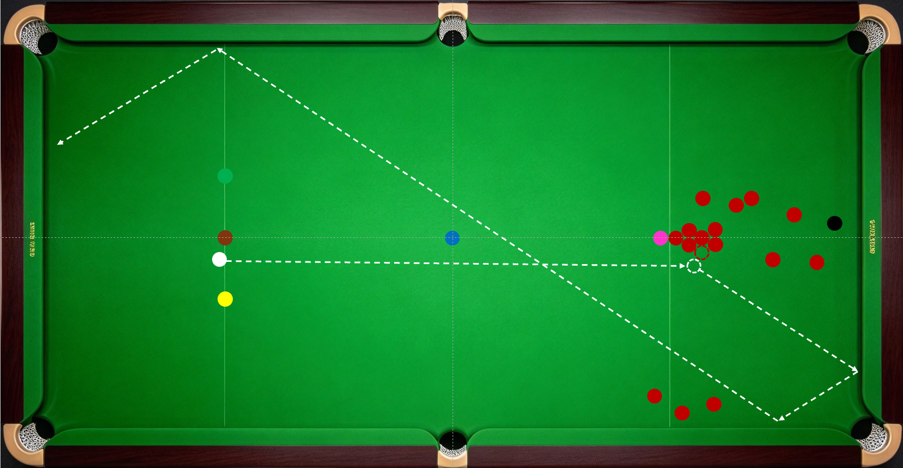

2.  贴球堆。对方开球后形成斯诺克，或没有回球线路，且红球集中不易漏球时采用。

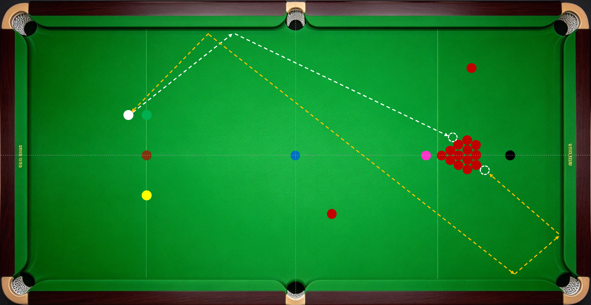

3.  十字回球。打单颗红球薄边回到开球区的防守方式，因白球和红球的运动线路互相交叉形似“十”字而得名。

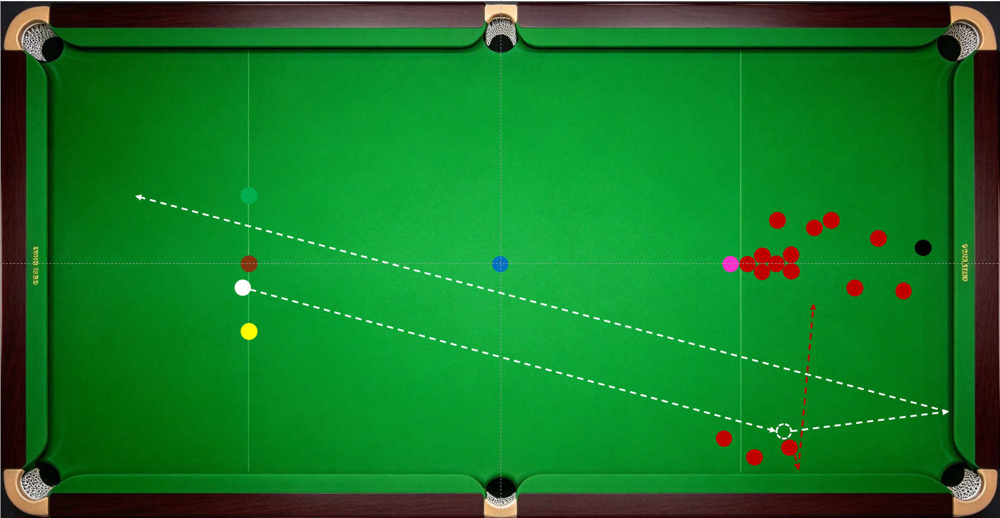

4.  白球沉底防守。母球没有返回开球区的线路，且沉底不漏机会，将母球从开球区打到底库附近的防守方式。

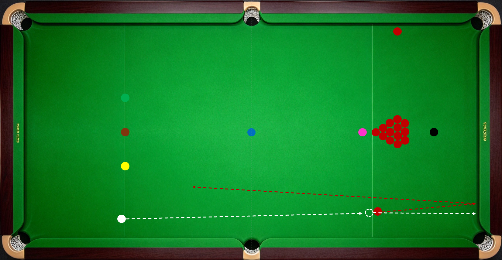

5.  贴单颗球。包括小力直接贴球和吃库勾贴，思路和线路类似贴红球堆。

6.  低杆卸力。球形分散，难以找到回球线路时，可以低杆将母球拉回开球区，同时目标球与袋角或其他球撞击卸力。这种方法母球可控，红球不可控，有一定风险。

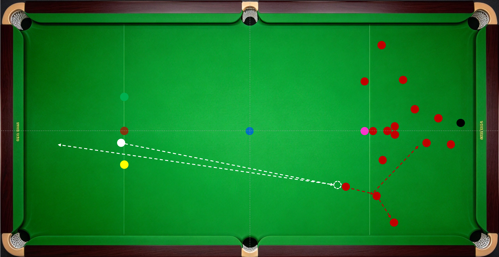

7.  两边分。非常实用的防守思路，常用于剩一颗红球和争黑环节的防守，将母球和目标球同时打到库边。

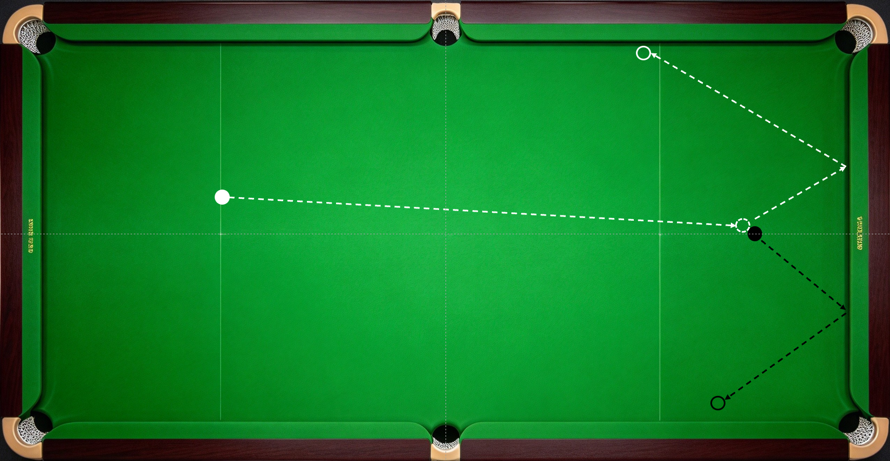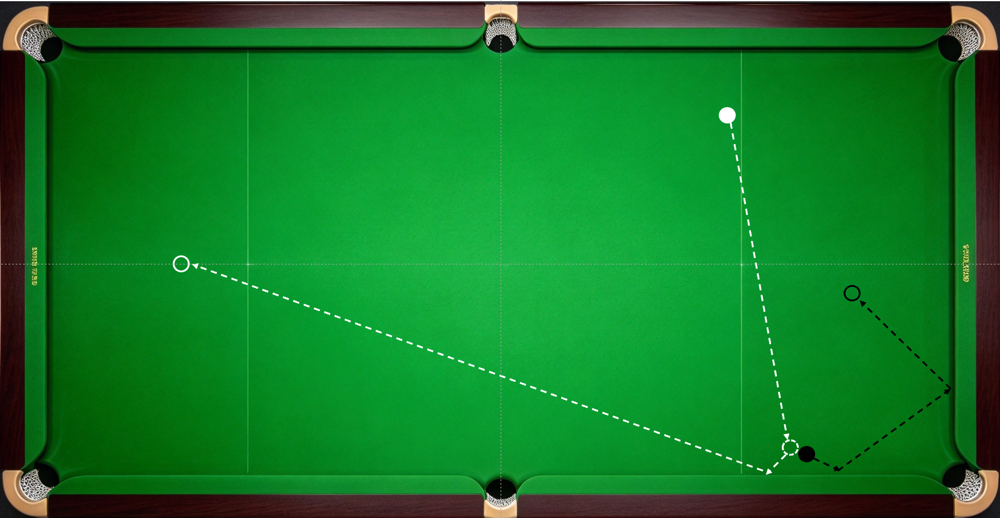

两边分的思路还能应用在做斯诺克上。斯诺克球台上低分彩球和高分彩球形成了两条天然障碍线，按照两边分的思路将母球和目标球停止这两条线上，是比赛中常见的做斯诺克的线路。

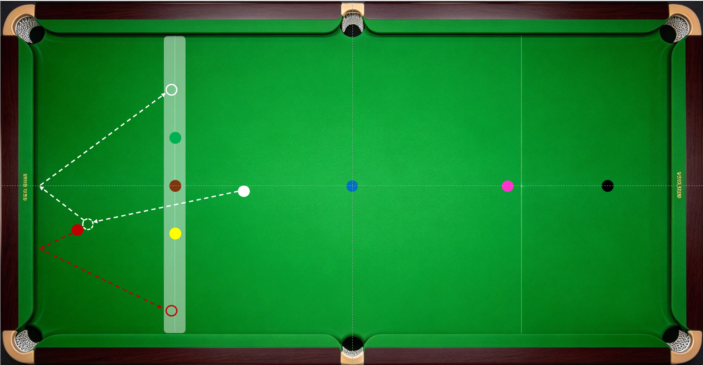

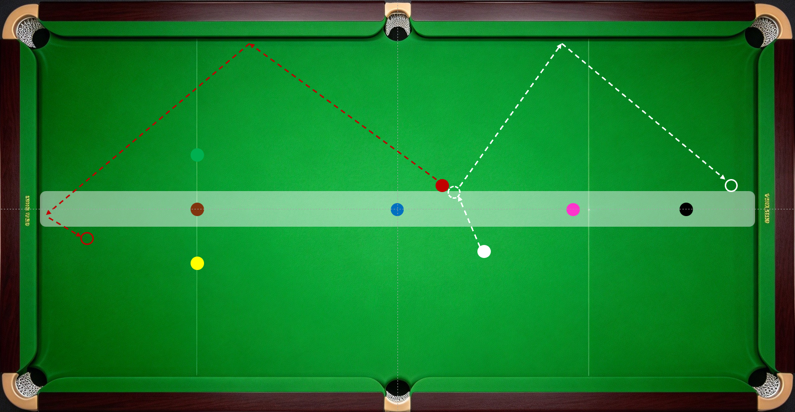

8.  一库勾踢。目标球靠近库边，母球加旋转吃一库后踢走目标球，同时占位目标球位置，形成反做。

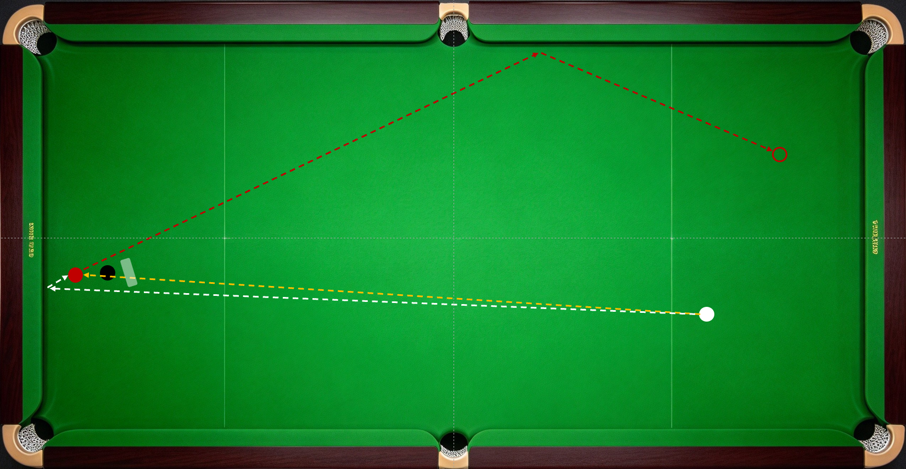

9.  两库勾薄边。

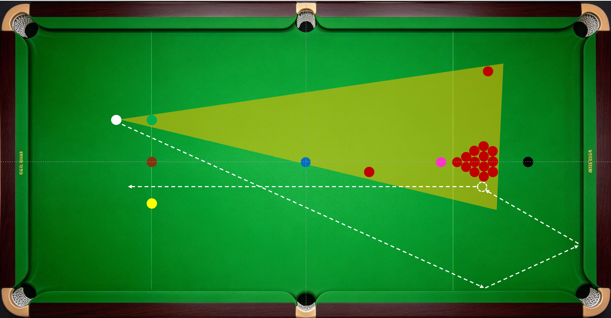

10. 扎杆绕过。利用扎杆变线的特性，绕过障碍球，实现防守目标。

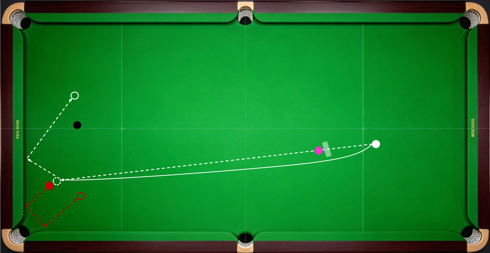

11. 巧用袋角。借助袋角反弹可以实现旋转和边库不支持的线路反转，巧用这一特点，可以打出精彩的走位或解球。

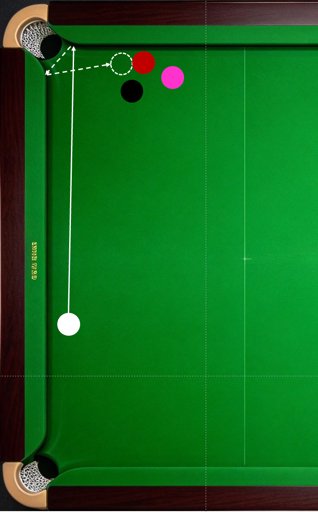

12. 大力出奇迹。在看不到明确进球线路或防守线路时，大力击打红球堆，可以增加进球的概率。

    ------------------------------------------------------------------------
