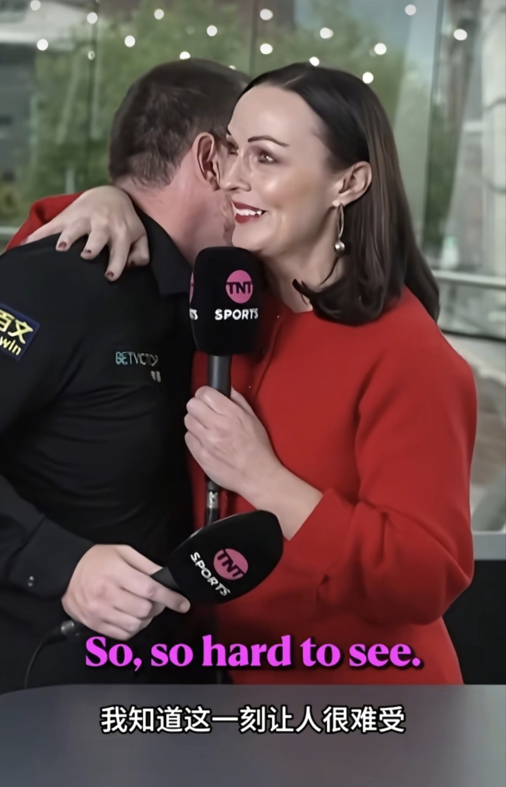

写这篇时，正好是“小钢炮”马克·艾伦自2026年5月份世锦赛错失关键黑球，在决胜局输给吴宜泽后，26/27赛季的首次参赛，也就是北爱尔兰公开赛，在他的老家。此前，他连续缺席6站排名赛，包括作为卫冕冠军的英格兰公开赛。他首轮对手是乔丹·布朗，世界排名第65位。比赛中，马克·艾伦在第二局和第六局两次出现简单黑球失误，与世锦赛的失误如出一辙，最终首轮出局。他在赛后接受了采访，并在社交媒体发布公开声明，首次亲自回应休赛长达167天的原因：

过去十周我一直在心理健康诊所接受治疗，刚刚办理出院，才得以出战贝尔法斯特的赛事。我状态并不好，但我接受当下的这份状态……
我会继续接受治疗，之后再看前路如何。

他在赛后采访中说，

I felt like if I was going to play one last time, play here at The
Waterfront, where it all started, 2005, against one of my best mates. I
thought that was a better way to sign out.

I've been flooded by support, but the problem is within. I don't, I just
don't see a future with snooker in it if I was honest. It's sad to say,
because it's all I've loved to do since I was 12. But... The last few
months have been really difficult and it's sort of put snooker into
perspective for me. At the moment, I'm just trying to survive.

我当时心想，如果这是我最后一次上场，那就选在水岸球场 ——
一切开始的地方，2005
年我就在这里起步，对手又是我最好的朋友之一。我觉得这会是一个更好的告别方式。

------------------------------------------------------------------------

铺天盖地的支持向我涌来，但问题根源在我自己内心。说实话，我已经看不到自己和斯诺克相伴的未来了。说起来很难过，毕竟从
12 岁起，斯诺克就是我唯一热爱的事。可是……
过去这几个月实在太难熬，也让我重新看清了斯诺克对我的意义。眼下，我只想撑下去。

说完这些，马克·艾伦和主持人都落泪了，主持人上前拥抱并鼓励艾伦，说大家永远支持你。

马克·艾伦1986年出生，“80”五虎之一，在2024年5月至8月临时世界排名登顶，成为北爱尔兰首位世界第一。目前获得12个排名赛冠军，其中包括1个大师赛和1个英锦赛冠军。2026年，马克·艾伦入选
WST 斯诺克名人堂。

马克·艾伦球风稳健，技术全面，竞技水平常年保持高水平。自2008年5月世界排名进入TOP16，至今约18年稳居其中。国内斯诺克比赛解说早有共识，马克·艾伦属于中国球员难战胜的外国球员，与肖恩·墨菲、、贾德·特鲁姆普、凯伦·威尔逊和尼尔·罗伯逊等顶级高手并列。

这就是竞技体育的特点，在外界看来强大坚韧的顶尖高手，也会受困于关键失误，陷入心理问题的泥潭之中。

我写这本书的目的，是记录自己练习和学习的心得，提供一种“放下器材包袱”、“正视名师光环”、“跳出科班范式”，享受斯诺克魅力和乐趣的进阶思路。希望这本书的读者不论是在职业赛场对战博弈，还是独自练球打磨技术，都能以一种朴素、求真的眼光看待斯诺克运动，认识并接纳自己的内心，通过斯诺克让自己的内心更加丰盈、沉静和坚韧。

心理博弈是斯诺克比赛的重要组成部分，临场发挥受心理因素的影响巨大。赢球一方面靠硬实力，另一方面也可以采用心理战术干扰对手的发挥。如

- 采用“控局开球打法”锁死高分彩球，干扰对手进攻节奏，给对手造成心理压力；

- 取得高比分优势或超分后，将红球或高分彩球打到边库，增加对手翻盘难度，给对手造成心理压力；

- 抓住对手的每一杆失误，让对手付出代价，增加对手出杆的心理压力；

- 凭借精湛的长台能力快速上手，用稳定的围球能力一杆致胜，给对手局分压力；

- 用高超的安全球水平，不断制造障碍，击溃对手心理防线；

- 用坚韧的球风与对手缠斗，让对手不敢稍有松懈；等等。

我不认同“故意拉长思考时间”、“刻意反复比划、瞄准、起身”、“揪住小节不放折磨对手和裁判”等恶意行为，这么做只会长对手志气。

在比赛中，始终保持平和的心态，客观看待运气和失误，胜不骄、败不馁，善于制造压力，更扛得住压力，保证技术动作稳定不变形，是提升比赛心理能力的核心要义。

------------------------------------------------------------------------
